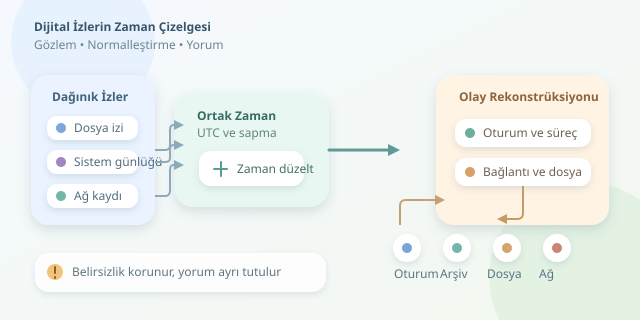

Bir bilgisayar olayını araştırmak, tanıkları farklı saatler kullanan bir dedektiflik hikâyesine benzer. Dosya tarihleri, oturum kayıtları ve ağ günlükleri konuşur; fakat hiçbiri bütün hikâyeyi tek başına anlatmaz. Zaman çizelgesi analizi, bu dağınık ifadeleri ortak bir zaman ekseninde buluşturarak “Önce ne oldu, sonra ne değişti?” sorularını yanıtlamaya çalışır.



``
## Zaman damgası, olayın kendisi değildir

Temel ayrım şudur: **Bir kaydın zamanı, her zaman eylemin gerçekleştiği zaman değildir.** Uygulama olayı geç yazabilir, günlük aktarımı gecikebilir veya cihazın saati yanlış olabilir. Dolayısıyla olay zamanı, kayıt zamanı ve toplama zamanı ayrı alanlar olarak korunmalıdır.

Yerel bir zaman damgasını karşılaştırılabilir hâle getirmek için şu modeli kullanabiliriz:

$$t_{UTC}=t_{yerel}-o-\Delta$$

Burada $o$ saat dilimi farkı, $\Delta$ ise cihaz saatinin referans saate göre sapmasıdır. Saat iki saniye ilerideyse $\Delta=2$ saniyedir. Ancak sapma ölçülmeden düzeltme yapılmaz; tahminle saati “tamir etmek”, delili hikâyeye uydurmak olur.

## Hangi iz, neyi anlatır?

İlk adım veri toplamaktır: disk imajları, Windows olay günlükleri, Linux sistem kayıtları, uygulama günlükleri ve ağ cihazları birlikte değerlendirilir. Kaynaklar mümkün olduğunca salt okunur yöntemlerle alınır; analiz kopyalar üzerinde yürütülür. Hash değerleri, toplama yöntemi ve delile erişen kişiler kaydedilerek bütünlük ve muhafaza zinciri belgelenir. Hash, kopyanın değişmediğini denetlemeye yardımcı olur; kayıttaki olayın doğru olduğunu kanıtlamaz.

| Kaynak | Sağladığı ipucu | Kritik sınırlama |
|---|---|---|
| Dosya meta verisi | Oluşturma, değiştirme, erişim izleri | Kopyalama veya müdahale tarihleri etkileyebilir |
| Windows olay günlükleri | Oturum ve süreç etkinlikleri | Denetim ayarları kapsamı belirler |
| Linux günlükleri | Kimlik doğrulama ve servis olayları | Döndürme nedeniyle eski kayıtlar kaybolabilir |
| Ağ günlükleri | Bağlantı, hedef ve trafik bilgisi | Bağlantı kurulması veri sızıntısını kanıtlamaz |

Önemli bir tuzak: Unix sistemlerinde **ctime**, genellikle oluşturulma değil, inode bilgilerinin değişim zamanıdır. **mtime** içerik değişimini gösterir; **atime** ise performans ayarları nedeniyle her erişimde güncellenmeyebilir.

## Normalleştirme: Saatleri aynı masaya oturtmak

Her olay için özgün zaman, UTC karşılığı, kaynak, açıklama ve mümkünse kullanıcı, cihaz, süreç kimliği tutulur. Saat dilimi bilinmeyen kayıtlar sessizce yerel saat kabul edilmez. Yaz saati geçişlerindeki belirsizlikler ayrıca işaretlenir. UTC kullanmak farklı bölgelerdeki sistemleri karşılaştırmayı kolaylaştırır; yanlış cihaz saatini kendiliğinden düzeltmez.

Aşağıdaki Python 3.11+ örneği, önceden ayrıştırılmış bir CSV dosyasını normalleştirir. Girdi sütunları `timestamp`, `source` ve `event` olmalıdır; örnek zaman biçimi `2026-04-12T10:03:12+03:00` şeklindedir.

```python
import csv
from datetime import datetime, timedelta, timezone

# Yalnızca bağımsız ölçümle doğrulanmış sapmalar.
clock_errors = {"windows": 2, "linux": -1}
events = []

with open("events.csv", encoding="utf-8", newline="") as f:
    for row in csv.DictReader(f):
        dt = datetime.fromisoformat(row["timestamp"])
        if dt.utcoffset() is None:
            raise ValueError("Saat dilimi eksik: " + row["timestamp"])
        utc = dt.astimezone(timezone.utc)
        error = clock_errors.get(row["source"], 0)
        utc -= timedelta(seconds=error)
        row["utc"] = utc.isoformat()
        events.append((utc, row))

events.sort(key=lambda item: item[0])
with open("timeline.csv", "w", encoding="utf-8", newline="") as f:
    writer = csv.DictWriter(f, fieldnames=["timestamp", "source", "event", "utc"])
    writer.writeheader()
    writer.writerows(row for _, row in events)
```

Kod özgün zaman damgasını korur, doğrulanmış sapmayı uygular ve olayları gerçek tarih nesneleriyle sıralar. Bilinmeyen kaynaklarda sıfır düzeltme kullanılması, saatin doğru olduğu anlamına gelmez. Gerçek incelemede sapmanın ölçüm yöntemi ve belirsizliği de raporlanmalıdır. Bu örnek ham EVTX veya disk imajı ayrıştırıcısı değildir.

## Kronolojiden olay örgüsüne

Örnek bir incelemede şu kayıtların bulunduğunu düşünelim:

| UTC zamanı | Gözlem | Destekleyici kaynak |
|---|---|---|
| 07:03:10 | Başarılı oturum açılması | Windows 4624 |
| 07:03:18 | Arşivleme süreci başlatılması | Etkinleştirilmiş süreç denetimi |
| 07:04:02 | Yeni arşiv dosyası oluşması | Dosya sistemi kayıtları |
| 07:05:11 | Harici adrese bağlantı | Ağ günlüğü |

Bunlar olası bir toplama ve aktarım zinciri önerir; kesin hüküm değildir. Kullanıcı, oturum ve süreç ilişkileri eşleştirilmelidir. Oturum açılması insanın klavyede olduğunu, harici bağlantı da arşivin gönderildiğini tek başına göstermez. Aktarım boyutu, hedef ve uygulama kayıtları ek destek sağlayabilir.

## Son kontrol: Belirsizlikleri görünür bırakın

Zaman damgaları yaklaşık değerlerse, sırayı kesinleştirmek için $t_A+\epsilon_A<t_B-\epsilon_B$ koşulu aranabilir. Burada $\epsilon$, zaman belirsizliğidir. Aralıklar çakışıyorsa kesin bir önce-sonra ilişkisi kurulamaz.

Silinmiş günlükler, saat değişiklikleri ve farklı çözünürlükteki damgalar raporda belirtilmelidir. Aynı olayın kopyalanmış kayıtları bağımsız doğrulamalar gibi sayılmamalıdır. İyi bir timeline, boşlukları saklamaz: gözlemi, yorumu ve alternatif açıklamaları ayırır. Amaç güzel bir hikâye değil, yeniden üretilebilir bir olay rekonstrüksiyonudur.
