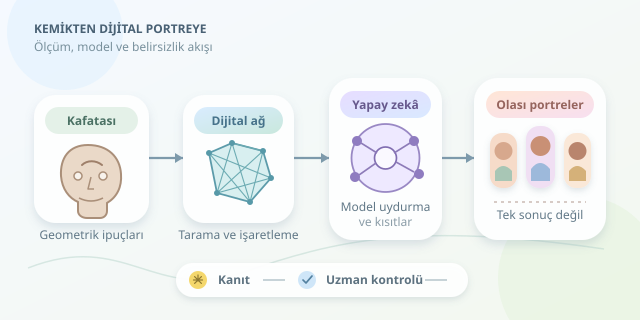

Binlerce yıllık bir kafatasına baktığınızda yalnızca kemik görürsünüz; araştırmacılar ise ölçülebilir ipuçlarıyla dolu bir geometri görür. Yapay zekâ, bu ipuçlarını üç boyutlu bir yüz önerisine dönüştürmeye yardımcı olabilir. Ancak ortaya çıkan görüntü geçmişten çekilmiş bir fotoğraf değildir: Anatomik veriler, istatistiksel modeller ve açıkça belirtilmesi gereken varsayımların birleşimidir. Gelin bu dijital dedektifliğin mutfağına girelim.

``

## Kafatası ne anlatır, neyi saklar?

Yüzün temel taşıyıcısı kafatasıdır. Göz çukurları, çene, elmacık kemikleri ve burun açıklığı; yüzün genel oranlarına ilişkin sınırlar koyar. Buna karşılık dudakların ayrıntılı biçimi, kulaklar, saçlar ve birçok yumuşak doku özelliği kemikten kesin olarak çıkarılamaz.

Rekonstrüksiyonda kullanılan önemli verilerden biri, belirli anatomik noktalardaki **yumuşak doku kalınlığıdır**. Bunlar tek bir evrensel cetvel oluşturmaz. Yaş, vücut yapısı, ölçüm yöntemi ve referans örneklemin özellikleri sonuçları etkiler. Dolayısıyla kafatasına ortalama kalınlıklar eklemek, bireyin gerçek yüzünü garanti etmez. Antik bireyle modern referans grubu arasındaki farklar da ayrıca değerlendirilmelidir.

## Dijital çalışma hattı

İşlem genellikle şu aşamalardan geçer:

1. **Tarama:** Bilgisayarlı tomografi veya fotogrametriyle kafatasının dijital geometrisi elde edilir. Fotogrametri, görünür yüzeylerle sınırlıdır.
2. **Temizleme:** Tarama hataları giderilir; kırık ve eksik bölgeler işaretlenir. Simetriyle tamamlama yapılırsa bunun varsayım olduğu kaydedilir.
3. **İşaretleme:** Anatomik referans noktaları belirlenir. Yapay zekânın önerileri uzman tarafından kontrol edilir.
4. **Model uydurma:** Referans yüz modeli, kemik geometrisi ve doku kalınlığı hedeflerine göre ayarlanır.
5. **Sunum:** Doku, ışık ve tarihsel aksesuarlar eklenir; kanıt ile sanatsal tercih ayrıştırılır.

| Yaklaşım | Güçlü tarafı | Temel sınırı |
|---|---|---|
| Elle anatomik modelleme | Uzman yorumuna açıktır | Zaman alır; yorum farklılaşabilir |
| İstatistiksel yüz modeli | Ölçülebilir ve tekrarlanabilirdir | Referans veriye bağımlıdır |
| Üretken görüntü modeli | Sunum çeşitliliği sağlar | Anatomiyi değiştirebilir, ayrıntı uydurabilir |

## Yapay zekâ aslında neyi öğreniyor?

Bir istatistiksel şekil modeli, hizalanmış yüzlerden ortak bir ortalama ve değişim yönleri öğrenebilir. Örneğin temel bileşen analiziyle yüz geometrisi şöyle yazılabilir:

$$F = F_0 + \sum_{i=1}^{k} a_i B_i$$

Burada $F_0$ ortalama yüz, $B_i$ öğrenilmiş geometrik değişimler, $a_i$ ise bireye uyarlanan katsayılardır. Algoritma, anatomik hedeflere yaklaşırken gerçekçi yüz dağılımından aşırı uzaklaşmamaya çalışır. Bu nedenle amaç fonksiyonu genellikle **veriye uyum** ve **düzenlileştirme** terimlerini birlikte içerir. Daha parlak bir render, daha doğru bir anatomi demek değildir!

## Python ile model uydurmanın çekirdeği

Aşağıdaki PyTorch örneği, önceden öğrenilmiş modeli hedef yüz noktalarına uydurur; tek başına kafatasından yüz üretmez. Girdiler aynı koordinat sistemindedir: `mean_face` ortalama ağ, `basis` standart sapmayla ölçeklenmiş bileşenler, `targets` ise kafatası ve doku tahminlerinden oluşturulan yüz hedefleridir. `sigma`, her hedefin milimetre cinsinden belirsizliğidir ve şekli `(L, 1)` olmalıdır.

```python
import torch

mu = torch.as_tensor(mean_face, dtype=torch.float32)
B = torch.as_tensor(basis, dtype=torch.float32)
ids = torch.as_tensor(landmark_ids, dtype=torch.long)
target = torch.as_tensor(targets, dtype=torch.float32)
s = torch.as_tensor(sigma, dtype=torch.float32).clamp_min(0.1)

coef = torch.nn.Parameter(torch.zeros(B.shape[0]))
optimizer = torch.optim.Adam([coef], lr=0.03)

for _ in range(400):
    optimizer.zero_grad()
    face = mu + torch.einsum('k,kvc->vc', coef, B)
    residual = (face[ids] - target) / s
    loss = residual.square().mean()
    loss = loss + 0.02 * coef.square().mean()
    loss.backward()
    optimizer.step()

result = (mu + torch.einsum('k,kvc->vc', coef, B)).detach()
```

Belirsizliği yüksek hedefler daha düşük ağırlık kazanır. Katsayı cezası ise modelin ölçümlere uymak uğruna aşırı biçimde deforme olmasını sınırlar. Gerçek uygulamada yüzey, çakışma ve anatomik kısıtlar da gerekir.

## Yüzden bütün figüre

Tam vücut rekonstrüksiyonunda uzun kemikler, boy tahmini ve beden oranları için bilgi sağlar. Eklem geometrisi, olası hareketleri sınırlar. Ancak kas hacmi, yağ dağılımı ve kişinin belirli bir andaki duruşu doğrudan korunmaz. Kıyafetler ve saç düzeni için arkeolojik bağlam gerekir; bunlar kemikten okunmuş özellikler gibi sunulmamalıdır.

## Sonuç: Tek portre yerine olasılıklar

En dürüst çıktı, tek bir “kesin yüz” değil, farklı doku kalınlıkları ve model varsayımlarıyla üretilmiş alternatiflerdir. Modern doğrulama örneklerinde rekonstrüksiyon, bilinen yüzle karşılaştırılabilir; antik bireyde bu kontrol çoğunlukla mümkün değildir. Cilt rengi ve benzeri özellikler yalnızca kafatasından güvenilir biçimde belirlenemez. Genetik veri varsa bile tahminlerin sınırları açıklanmalıdır. İnsan kalıntılarıyla çalışırken izinler ve ilgili toplulukların hassasiyetleri de gözetilmelidir.

Yapay zekânın değeri, geçmişi sihirli biçimde göstermesinde değil; varsayımları ölçülebilir, karşılaştırılabilir ve tartışılabilir hâle getirmesindedir.
