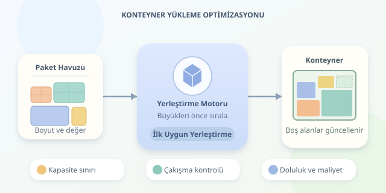

Bir konteyneri doldurmak, gerçek hayatın Tetris oyunudur: Kutular gelir, boşluklar oluşur ve yanlış yerleştirilen tek bir paket bütün planı bozabilir. Üstelik burada satırlar kaybolmaz; kötü kararların faturası ek araç, yakıt ve zaman olarak geri döner. Peki bilgisayarlar bu oyunu nasıl daha akıllıca oynar?

``

## Önce problemi doğru tanımlayalım

**Bin Packing Problem**, klasik biçimiyle, bütün nesneleri kapasitesi sınırlı kutulara yerleştirirken kullanılan kutu sayısını azaltmayı amaçlar. Her nesnenin bir büyüklüğü vardır; hiçbir kutunun toplam yükü kapasitesini aşamaz.

Ancak “tek konteynere mümkün olduğunca çok paket koymak” biraz farklıdır. Burada bazı paketleri dışarıda bırakabilirsiniz. Dolayısıyla amaç fonksiyonunu seçmeden algoritmaya geçmek, adresi bilmeden navigasyonu açmaya benzer.

| Senaryo | Amaç | Yakın problem ailesi |
|---|---|---|
| Bütün paketler taşınacak | Konteyner sayısını azaltmak | Bin packing |
| Tek konteyner, seçilebilir paketler | Paket sayısını artırmak | Kardinalite kısıtlı knapsack |
| Farklı ticari değerler | Toplam değeri artırmak | Knapsack |
| Gerçek kutular ve koordinatlar | Geometrik olarak uygulanabilir yerleşim | Üç boyutlu packing |

Klasik bin packing NP-zordur. Bu, her örneğin çözülemez olduğu anlamına gelmez; büyük örneklerde kesin optimumu bulmanın hesaplama maliyeti hızla büyüyebilir. Bu nedenle pratikte sezgisel yöntemlerden sıkça yararlanılır.

## Kapasite hesabının teorik temeli

Tek boyutlu modelde paket büyüklüklerini $s_i$, konteyner kapasitesini $C$ ile gösterelim. Büyüklük; ağırlık, uzunluk veya soyut bir kaynak tüketimi olabilir. Kullanılacak konteyner sayısı için basit bir alt sınır şudur:

$$B_{alt} = \left\lceil \frac{\sum_{i=1}^{n} s_i}{C} \right\rceil$$

Toplam yük 20, kapasite 10 ise en az iki konteyner gerekir. Ancak bu sınır, iki konteynerin mutlaka yeterli olduğunu söylemez: Paketlerin bölünememesi boşluk yaratabilir.

Doluluk oranı da yararlı bir ölçüttür:

$$U = \frac{\sum_{i=1}^{n} s_i}{BC} \times 100$$

Burada $B$, gerçekten kullanılan konteyner sayısıdır. Yalnızca doluluğu değil, bütün paketlerin yerleşip yerleşmediğini de kontrol etmek gerekir.

## First Fit Decreasing: Büyükleri önce yerleştir

**First Fit Decreasing**, önce paketleri büyükten küçüğe sıralar. Ardından her paketi, yeterli boşluğu bulunan ilk konteynere koyar. Uygun konteyner yoksa yenisini açar. Büyük paketleri erkenden yerleştirmek, sonradan ortaya çıkabilecek “bu artık hiçbir yere sığmıyor” sürprizlerini azaltır.

Aşağıdaki Python kodu, her konteynerin kalan kapasitesini ve içindeki paketleri birlikte tutar:

```python
def first_fit_decreasing(sizes, capacity):
    sizes = list(sizes)
    if capacity <= 0:
        raise ValueError("Kapasite pozitif olmalı.")
    if any(size <= 0 or size > capacity for size in sizes):
        raise ValueError("Paket büyüklükleri kapasiteye uygun olmalı.")

    bins = []
    for size in sorted(sizes, reverse=True):
        for container in bins:
            if container["remaining"] >= size:
                container["items"].append(size)
                container["remaining"] -= size
                break
        else:
            bins.append({
                "remaining": capacity - size,
                "items": [size]
            })
    return bins

result = first_fit_decreasing([6, 5, 3, 2, 2, 2], 10)
print([container["items"] for container in result])
```

Python’daki `for...else`, döngü `break` olmadan bittiğinde çalışır; yani paket mevcut konteynerlerden hiçbirine sığmadığında yeni konteyner oluşturur. Bu basit uygulamanın en kötü durumdaki zaman karmaşıklığı $O(n^2)$ seviyesindedir.

Örneğin sonuç `[6, 3]`, `[5, 2, 2]`, `[2]` olur: Üç konteyner kullanılır. Oysa `[6, 2, 2]` ve `[5, 3, 2]` düzeni iki konteynere sığar. Doluluk yaklaşık yüzde 66,7 yerine yüzde 100 olabilir. **Sezgisel yöntem hızlıdır, ama optimum garantisi vermez.**

## Gerçek konteynerlerde üçüncü boyut sahneye çıkar

Hacimleri toplamak yeterli değildir. Toplam hacmi uygun iki kutu, şekilleri nedeniyle yan yana sığmayabilir. Üç boyutlu modelde her paketin konumu, boyutları ve izin verilen yönelimleri belirlenmelidir.

Yerleşimin geçerli olması için kutular konteyner sınırlarında kalmalı ve birbirleriyle çakışmamalıdır. Ayrıca ağırlık sınırı, ağırlık merkezi, kırılganlık, destek yüzeyi ve boşaltma sırası önemlidir. Havada duran bir kutu, matematiksel çizimde hoş görünse de depodaki arkadaşları pek güldürmez.

Pratik bir yaklaşım, boş alanları listelemek ve her paket için izin verilen yönelimleri denemektir. Yerleştirme sonrasında kalan alanlar güncellenir; ancak bu da tek başına optimum garantilemez.

## Algoritmayı nasıl değerlendirmeli?

Küçük örneklerde kesin çözücüyle karşılaştırma yapın. Büyük örneklerde farklı paket dağılımlarını deneyerek çalışma süresini, kullanılan konteyner sayısını ve doluluğu ölçün. Üç boyutlu senaryolarda fiziksel geçerliliği ayrıca doğrulayın.

Özetle, iyi yükleme optimizasyonu sadece boşlukları doldurmaz: Doğru hedefi seçer, kısıtları korur ve hız ile çözüm kalitesi arasında bilinçli bir denge kurar.
