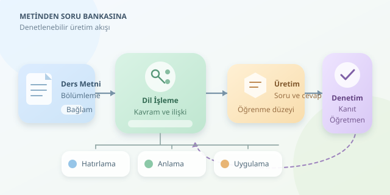

Bir ders metnini yüklediğinizi ve birkaç saniye sonra karşınıza cevaplarıyla birlikte sorular çıktığını düşünün. Kulağa öğretmenin dijital yardımcısı gibi geliyor, değil mi? Doğal dil işleme ile otomatik soru üretimi tam olarak bunu hedefler. Ancak iyi bir soru, cümlenin sonuna soru işareti koymaktan çok daha fazlasıdır.

``

## Soru üretiminin teorik temeli

Doğal dil işleme, bilgisayarların insan dilindeki yapıları ve anlam ilişkilerini işlemesini sağlar. Soru üretiminde sistem önce metindeki kavramları, olayları ve ilişkileri belirler; ardından bunları öğrencinin bilgisini ölçebilecek ifadelere dönüştürür.

Örneğin, “Fotosentez kloroplastlarda gerçekleşir” cümlesinden bir yer bilgisi çıkarılabilir. Bu bilgi, “Fotosentez hangi organelde gerçekleşir?” sorusuna dönüşür. Fakat “Fotosentez ekosistem için neden önemlidir?” sorusu, metinde açıklanmıyorsa yalnızca bu cümleden güvenilir biçimde üretilemez.

Üretici modellerin hedefi kabaca şöyle gösterilebilir:

$$P(Q, A \mid T, L)$$

Burada $Q$ soru, $A$ cevap, $T$ kaynak metin, $L$ ise hedef öğrenme düzeyidir. Model, bu koşullara uygun bir soru-cevap çifti üretmeye çalışır. Yüksek olasılık, pedagojik doğruluğun garantisi değildir; ayrıca denetim gerekir.

| Yaklaşım | Çalışma mantığı | Temel sınırlama |
|---|---|---|
| Kural tabanlı | Dil kalıplarını soru şablonlarına dönüştürür | Esneklik düşüktür |
| Üretici model | Bağlamdan yeni ifadeler oluşturur | Desteksiz bilgi ekleyebilir |
| Hibrit sistem | Üretimi kurallar ve kontrollerle birleştirir | Daha fazla tasarım gerektirir |




## Metinden ders materyaline giden yol

İyi bir işlem hattı, doğrudan “Bana soru yaz” komutuyla başlamaz. Önce başlıklar, paragraflar ve kavram bütünlüğü korunarak metin bölümlere ayrılır. Çok uzun parçalar modelin odağını dağıtabilir; çok kısa parçalar ise gerekli bağlamı kaybettirebilir.

Ardından öğrenme hedefi tanımlanır: Öğrenci bir kavramı hatırlayacak mı, açıklayacak mı, yoksa yeni bir duruma uygulayacak mı? Sonrasında soru, cevap ve cevabı destekleyen kaynak alıntısı birlikte üretilir. Böylece sistem yalnızca konuşkan değil, denetlenebilir bir yardımcı olur.

## Python ile küçük bir prototip

Aşağıdaki örnek, Türkçe yönergelerle çalışabilen bir dil modelinden iki soru ister. Çalıştırmak için `transformers`, `torch` ve `accelerate` paketleri gerekir; modelin indirilmesi ve çalışması donanım kaynağı tüketir.

```python
import json
from transformers import pipeline

uretici = pipeline(
    "text-generation",
    model="Qwen/Qwen2.5-1.5B-Instruct",
    device_map="auto"
)

metin = (
    "Fotosentez kloroplastlarda gerçekleşir. "
    "Işık enerjisi kimyasal enerjiye dönüştürülür."
)

istek = f"""
Metne dayanarak iki kısa, açık uçlu soru üret.
Hedef: temel kavramları hatırlama ve anlama.
Yalnızca JSON dizisi döndür; Markdown kullanma.
Her öğede soru, cevap ve kanit alanları bulunsun.
Kanit, metinden aynen alınmış boş olmayan bir alıntı olsun.
Metin: {metin}
"""

ham = uretici(
    [{"role": "user", "content": istek}],
    max_new_tokens=350,
    do_sample=False,
    return_full_text=False
)[0]["generated_text"]

sorular = json.loads(ham)
for soru in sorular:
    if not soru["kanit"] or soru["kanit"] not in metin:
        raise ValueError("Kaynak kanıtı doğrulanamadı.")

print(sorular)
```

Kod, sohbet biçimindeki yönergeyi modele gönderir, çıktıyı JSON olarak okur ve kanıtın kaynakta bulunmasını kontrol eder. Ancak alıntının gerçekten cevabı desteklediğini kanıtlamaz. Üretimde JSON ayrıştırma hataları, eksik alanlar ve tekrar eden sorular da ele alınmalı; mümkünse şema kısıtlı çıktı kullanılmalıdır.

## Zorluk seviyesi nasıl ayarlanır?

Bloom taksonomisi burada yararlı bir pusuladır. Hatırlama düzeyinde doğrudan bilgiler sorulurken, anlama düzeyinde açıklama istenir. Uygulama düzeyinde ise öğrenilen kavram yeni bir senaryoya taşınır.

| Düzey | Soru beklentisi | Değerlendirme |
|---|---|---|
| Hatırlama | Kavramı veya bilgiyi belirtme | Kısa cevap anahtarı |
| Anlama | İlişkiyi kendi sözleriyle açıklama | Temel anlam ölçütleri |
| Uygulama | Bilgiyi yeni durumda kullanma | Gerekçeli değerlendirme rubriği |

Uzun bir soru otomatik olarak zor değildir. Zorluk; gerekli ön bilgiye, düşünme adımlarına ve öğrencinin düzeyine bağlıdır. Modelden yalnızca “zor soru” istemek yerine bu koşulları açıkça belirtmek daha yararlıdır.

## Kaliteyi ölçmek ve öğretmeni döngüde tutmak

Üretilen sorular; cevaplanabilirlik, kaynakla tutarlılık, dil açıklığı ve kazanıma uygunluk açısından incelenmelidir. Çoktan seçmeli sorularda tek bir doğru cevap bulunmalı; çeldiriciler makul olmalı, fakat doğru cevabı yanlışlıkla paylaşmamalıdır.

Bir pilot uygulamada öğretmenlerin kabul ettiği soru oranı, düzeltme süresi ve öğrencilerin yanlış anladığı ifadeler izlenebilir. Başka bir modelden değerlendirme almak yardımcıdır, ancak bağımsız doğruluk garantisi sağlamaz. Öğrenci verileri kullanılıyorsa kişisel bilgiler temizlenmeli ve veri paylaşım koşulları kontrol edilmelidir.

Sonuç olarak otomatik soru üretimi, öğretmenin yerini alan sihirli bir sınav fabrikası değildir. Doğru tasarlandığında hazırlık yükünü azaltan, farklı öğrenme düzeylerine uyarlanabilen ve insan denetimiyle güvenilirleşen bir eğitim yardımcısıdır.
