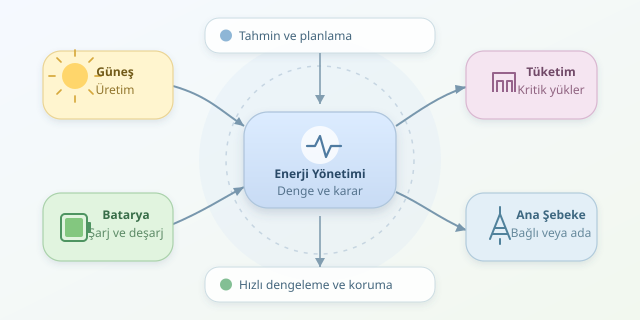

Bir yerleşim biriminin ana elektrik şebekesiyle bağlantısı kesildiğinde hayatın durması gerekmez. Güneş panelleri, bataryalar ve akıllı kontrolörler birlikte çalışıyorsa mahalle, küçük bir enerji adasına dönüşebilir. Mikro şebeke, yalnızca elektrik üretmek değil; üretim, tüketim ve depolamayı sürekli dengelemek demektir. Prizlerin arkasında oldukça disiplinli bir orkestra vardır.
``

## Temel mesele: Üretim ve tüketim dengesi

Mikro şebeke; belirli bir elektriksel sınır içindeki üreticileri, depolama sistemlerini ve tüketicileri koordineli yöneten yapıdır. Çatı panelleri, ortak batarya, elektrikli araç şarj noktaları ve gerektiğinde jeneratör bu yapının parçaları olabilir. Ana şebekeden ayrılarak çalışmasına **ada modu** denir.

Ada modunda anlık aktif güç dengesi yaklaşık olarak şöyledir:

$$P_{gunes}+P_{ruzgar}+P_{desarj}=P_{yuk}+P_{sarj}+P_{kayip}$$

Buradaki güçler kilovat cinsindedir. Şebekeye bağlı çalışmada denkleme ithalat veya ihracat terimi eklenir. Üretim yetersizse batarya devreye girer; yetmiyorsa esnek yükler azaltılır. Fazlalık varsa depolama yapılır veya üretim kısılır.

| Özellik | Şebekeye bağlı | Ada modu |
|---|---|---|
| Enerji açığı | Şebekeden karşılanabilir | Yerel kaynaklarla giderilir |
| Gerilim ve frekans referansı | Genellikle ana şebeke | Yerel şebeke oluşturucu kaynak |
| Fazla üretim | Bağlantı koşullarıyla satılabilir | Depolanır veya kısılır |




## Kontrol neden katmanlıdır?

Bulut geçişi saniyeler içinde üretimi değiştirebilir; bataryanın geceye hazırlanması ise saatlik planlama ister. Bu nedenle bütün kararları tek bir yazılım döngüsüne yüklemek iyi fikir değildir. Kontrol görevleri farklı zaman ölçeklerine ayrılır.

| Katman | Tipik zaman ölçeği | Temel görev |
|---|---|---|
| Birincil kontrol | Milisaniye–saniye | Hızlı dengeleme ve güç paylaşımı |
| İkincil kontrol | Saniye–dakika | Frekans ve gerilim sapmalarını düzeltme |
| Enerji yönetimi | Dakika–saat | Tahmin, rezerv ve ekonomik planlama |

Birincil kontrolde kullanılan yöntemlerden biri **droop kontrolüdür**: $f=f_0-k_P(P-P_0)$. Uygun sistemlerde aktif güç arttıkça frekans referansı kontrollü biçimde azalır; paralel kaynaklar yük paylaşabilir. Gerilim ve reaktif güç için de benzer ilişkiler kullanılır. Katsayılar rastgele seçilmez; kararlılık analizi gerekir.

## Batarya: Depo var, ama sınırsız değil

Bataryanın doluluk oranı, yani $SOC$, gelecekteki kararları sınırlar. Kontrolör yalnızca mevcut enerjiyi değil; şarj gücünü, sıcaklığı, verimi ve yıpranmayı da değerlendirmelidir. Basitleştirilmiş enerji modeli şöyledir:

$$SOC_{t+1}=SOC_t+\frac{(\eta_c P_c-P_d/\eta_d)\Delta t}{E_{nom}}$$

Burada $E_{nom}$ kilovatsaat, $\Delta t$ saat, güçler kilovattır. Böylece sonuç boyutsuz kalır. Doluluğu örneğin yüzde 20–90 arasında tutmak bir işletme tercihi olabilir; gerçek sınırları batarya üreticisi ve rezerv gereksinimleri belirler.

## Python ile basit bir enerji yöneticisi

Aşağıdaki örnek, 80 kWh batarya ve 30 kW güç sınırı için on beş dakikalık karar üretir. Önce güneş enerjisini kullanır, sonra bataryayı değerlendirir; karşılanamayan tüketimi ve kısılması gereken üretimi raporlar.

```python
def dispatch(pv_kw, load_kw, soc, dt_h=0.25):
    capacity, eta, limit = 80.0, 0.95, 30.0
    surplus = pv_kw - load_kw
    charge = discharge = 0.0

    if surplus >= 0:
        room = max(0.0, (0.90 - soc) * capacity / (eta * dt_h))
        charge = min(surplus, limit, room)
    else:
        available = max(0.0, (soc - 0.20) * capacity * eta / dt_h)
        discharge = min(-surplus, limit, available)

    next_soc = soc + (eta * charge - discharge / eta) * dt_h / capacity
    return {
        "soc": round(next_soc, 3),
        "charge_kw": charge,
        "discharge_kw": discharge,
        "unserved_kw": max(0.0, -surplus - discharge),
        "curtailed_kw": max(0.0, surplus - charge),
    }

print(dispatch(pv_kw=55, load_kw=70, soc=0.55))
```

Bu senaryoda batarya 15 kW sağlar; doluluk yaklaşık 0,501 olur. `min` ifadeleri güç ve enerji sınırlarını birlikte uygular. Kod hangi cihazın kapatılacağını belirlemez: `unserved_kw`, ayrı bir yük önceliklendirme mekanizmasına gönderilecek ihtiyaçtır. Kayıplar, tahminler ve batarya yaşlanması burada basitleştirilmiştir.

## Gerçek sistemde son söz güvenliğin

Enerji yönetimi yazılımı inverterin hızlı kontrolünün yerine geçmez. Ada modunda gerilim ve frekans referansı oluşturabilen kaynak gerekir. Koruma koordinasyonu, topraklama, haberleşme kaybındaki davranış ve kesinti sonrası yeniden başlatma ayrıca tasarlanmalıdır. Ana şebekeye dönüş de sıradan bir açma-kapama işlemi değildir; senkronizasyon ve uygun koruma koşulları sağlanmalıdır.

Pratik öncelik sırası; kritik sağlık ve su altyapısını beslemek, yeterli rezerv bırakmak, ardından araç şarjı gibi ertelenebilir tüketimleri planlamaktır. Bu nedenle iyi bir kontrolörün hedefi yalnızca en ucuz elektrik değildir: **güvenilirlik, maliyet ve batarya ömrü arasında denge kurmaktır**. Mikro şebekenin başarısı, güneşli öğleden sonra değil, zor geçen gecede anlaşılır.
