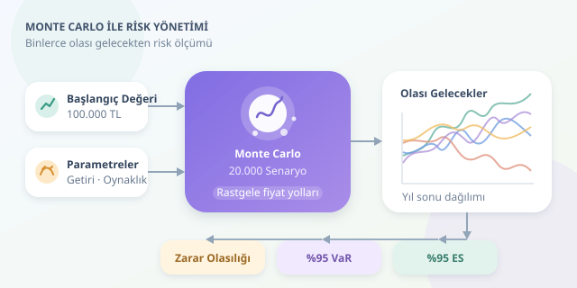

Bir yatırımın gelecek yıl ne kadar kazandıracağını tek sayıyla söylemek, hava durumunu yalnızca “güzel olacak” diye özetlemeye benzer. Oysa yatırımcı için fırtına ihtimali de önemlidir. Monte Carlo simülasyonu, binlerce olası gelecek üreterek getirinin yanında kayıp olasılığını ve kötü senaryoların büyüklüğünü incelememizi sağlar. Kristal küre değil, olasılık laboratuvarıdır!




``

## Rastgelelik nasıl bir modele dönüşür?

Monte Carlo yaklaşımında önce yatırımın davranışını açıklayan bir matematiksel model seçilir. Ardından modelin belirsiz girdileri için rastgele örnekler üretilir. Her örnek farklı bir fiyat yolculuğu oluşturur. Bu yolların sonunda elde edilen değerler, yatırımın olası sonuçlarının ampirik dağılımını verir. Burada belirleyici nokta şudur: Rastgele sayılar, seçtiğimiz varsayımlara göre üretilir; keyfî fiyat tahminleri değildir.

Hisse benzeri bir varlık için yaygın başlangıç modeli **geometrik Brown hareketidir**. Modelin ayrık zaman adımlarındaki geçişi şöyledir:

$$V_{t+\Delta t}=V_t\exp\left[(\mu-\tfrac{1}{2}\sigma^2)\Delta t+\sigma\sqrt{\Delta t}Z\right]$$

Burada $V_t$ yatırım değeri, $\mu$ yıllık anlık beklenen getiri parametresi, $\sigma$ yıllık volatilite ve $Z\sim N(0,1)$ standart normal değişkendir. Her adımda yeni, bağımsız bir $Z$ çekilir. Üstel yapı fiyatları pozitif tutar; modelde logaritmik getiriler normal, dönem sonu değerleri ise lognormal dağılır.

| Yaklaşım | Ürettiği sonuç | Görünmeyen taraf |
|---|---|---|
| Tek noktalı tahmin | Bir gelecek değer | Sonuçların dağılımı |
| İyimser-kötümser senaryolar | Birkaç alternatif | Senaryoların olasılıkları |
| Monte Carlo | Binlerce örnek sonuç | Model dışında kalan riskler |

Önemli ayrıntı: $\mu=0{,}08$, yıllık basit getirinin tam olarak yüzde sekiz olduğu anlamına gelmez. Bu modelde beklenen dönem sonu değer $E[V_T]=V_0e^{\mu T}$ olur.

## Python ile 20.000 alternatif gelecek

Aşağıdaki kod, 100.000 TL başlangıç değerini bir yıl boyunca 252 işlem adımında simüle eder. NumPy, her adımda bütün senaryoları birlikte güncelleyerek hesaplamayı hızlandırır.

```python
import numpy as np

rng = np.random.default_rng(42)
initial = 100_000
mu, sigma = 0.08, 0.20
scenarios, steps = 20_000, 252
dt = 1 / steps

paths = np.empty((scenarios, steps + 1))
paths[:, 0] = initial

for t in range(1, steps + 1):
    z = rng.standard_normal(scenarios)
    growth = np.exp(
        (mu - 0.5 * sigma**2) * dt
        + sigma * np.sqrt(dt) * z
    )
    paths[:, t] = paths[:, t - 1] * growth

terminal = paths[:, -1]
losses = initial - terminal
var95 = np.quantile(losses, 0.95)
es95 = losses[losses >= var95].mean()

print(f"Ortalama son değer: {terminal.mean():,.0f} TL")
print(f"Zarar olasılığı: {np.mean(losses > 0):.1%}")
print(f"%95 VaR: {var95:,.0f} TL")
print(f"%95 ES: {es95:,.0f} TL")
```

`paths` matrisinin her satırı farklı bir yatırım hikâyesidir. Son sütun yıl sonu değerlerini içerir. Sabit rastgelelik tohumu, aynı kod ve ortamda sonuçların yeniden üretilebilmesini sağlar. Ancak tohumu sabitlemek belirsizliği ortadan kaldırmaz; yalnızca aynı deneyin tekrarını mümkün kılar. Ayrıca günlük oynaklık $\sqrt{\Delta t}$ ile ölçeklenir; doğrudan $\Delta t$ kullanmak riski yanlış hesaplatır.

## VaR ve ES: Kötü günlerin ölçüsü

Kaybı $L=V_0-V_T$ olarak tanımlarız. Pozitif değer zarar, negatif değer kazançtır. **Riske Maruz Değer**, yani VaR, belirli güven düzeyindeki kayıp eşiğidir:

$$\operatorname{VaR}_{0.95}=Q_{0.95}(L)$$

**Beklenen Kayıp**, yani ES, bu eşiğin ötesindeki kötü sonuçların ortalamasını ölçer. Kod, sürekli dağılımın bu kuyruk ortalamasını örneklerle yaklaşık hesaplar.

| Ölçüt | Yanıtladığı soru |
|---|---|
| Zarar olasılığı | Başlangıç değerinin altında kalma ihtimali nedir? |
| %95 VaR | Modelde kayıpların yüzde 95'i hangi eşikten küçüktür? |
| %95 ES | En kötü yüzde 5'lik dilimde ortalama kayıp nedir? |

Bu parametrelerle teorik %95 VaR yaklaşık 23.600 TL’dir; simülasyon sonucu bunun çevresinde değişir. VaR **maksimum kayıp değildir**. Daha büyük zararların mümkün olduğunu özellikle hatırlamak gerekir.

## Modelin sınırlarını unutmayın

Gerçek piyasalar sabit volatilite ve bağımsız normal logaritmik getiriler varsayımına her zaman uymaz. Krizler, sıçramalar, likidite sorunları ve kalın kuyruklar kayıpları büyütebilir. Çok varlıklı portföylerde korelasyonları yok saymak da çeşitlendirme faydasını abartabilir. Bu nedenle tarihsel verilerle kalibrasyon, alternatif parametrelerle duyarlılık analizi ve stres testleri birlikte kullanılmalıdır.

Simülasyon sayısını artırmak örnekleme hatasını azaltır; yanlış modeli düzeltmez. Tipik Monte Carlo hatası yaklaşık $1/\sqrt{N}$ hızında küçülür: Hatayı yarıya indirmek için yaklaşık dört kat senaryo gerekir. Üstelik yıl sonu ölçümleri, yıl içindeki sert düşüşleri gizleyebilir. Sağlam risk yönetimi, yalnızca varış noktasını değil yolculuğu da inceler.
