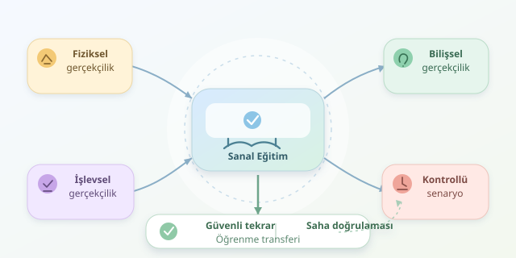

Bir eğitim sırasında yapılan hatayı geri almak mümkün olsaydı ne değişirdi? Simülasyon tabanlı askeri eğitim sistemleri, tam olarak bu fırsatı sunar: Personel, gerçek ekipmanı ve insanları tehlikeye atmadan kararlarının sonuçlarını görebilir. Sanal gerçeklik gözlüklerinden masaüstü senaryolarına kadar uzanan bu sistemler; bakım, lojistik, iletişim ve acil durum eğitimlerinde kontrollü bir öğrenme alanı oluşturur. Ancak iyi bir simülasyon, yalnızca etkileyici grafiklerden ibaret değildir.

``

## Gerçekçilik Neden Sadece Görüntü Kalitesi Değildir?

Simülasyonun teorik temeli, gerçek sistemin eğitim açısından önemli özelliklerini bir model üzerinde temsil etmektir. Burada üç gerçekçilik boyutu öne çıkar: fiziksel gerçekçilik, işlevsel gerçekçilik ve bilişsel gerçekçilik. Bir aracın görünüşü fiziksel; göstergelerinin doğru tepki vermesi işlevsel; personelin zaman baskısı altında öncelik belirlemesi ise bilişsel boyuta örnektir.

Asıl hedef, öğrenilen becerinin gerçek ortama aktarılmasıdır. Buna **öğrenme transferi** denir. Parlak kaplamalar etkileyici olabilir; fakat yanlış davranışları ödüllendiren bir model, yüksek çözünürlüklü bir yanlış öğretmendir. Bu nedenle senaryolar uzmanlarla doğrulanmalı, öğrenme hedefleri açıkça tanımlanmalıdır.

## Maliyet: Ucuz Oturum, Pahalı Başlangıç

Sanal eğitim; yakıt, ulaşım, ekipman yıpranması ve tekrar hazırlığı gibi giderleri azaltabilir. Ayrıca farklı bölgelerdeki personelin ortak bir ortamda çalışmasını sağlar. Buna karşılık yazılım geliştirme, donanım, lisanslama, teknik destek ve içerik güncellemeleri başlangıç bütçesini büyütür.

Basitleştirilmiş karşılaştırmada simülasyon maliyeti $C_s=F+n v_s$, saha eğitimi maliyeti ise $C_f=n v_f$ olsun. Burada $F$ başlangıç yatırımı, $n$ oturum sayısı, $v_s$ ve $v_f$ oturum başına değişken giderlerdir. Eğer $v_f>v_s$ ise başabaş noktası $n^*=F/(v_f-v_s)$ olur.

| Boyut | Saha eğitimi | Simülasyon |
|---|---|---|
| Başlangıç yatırımı | Mevcut altyapıya bağlı | Yazılım ve donanım ağırlıklı |
| Tekrar maliyeti | Sarf ve hazırlık giderleri yüksek olabilir | Genellikle daha düşük |
| Hava koşulları | Programı etkileyebilir | Kontrollü biçimde modellenebilir |
| Fiziksel deneyim | Doğrudan yaşanır | Kısmen temsil edilir |




Bu model, karşılaştırmayı öğretmek içindir; finansal karar verirken bakım, amortisman, kapasite kullanımı ve saha altyapısının sabit giderleri de hesaba katılmalıdır.

## Risk Azalır, Ama Sıfırlanmaz

Risk için basit bir yaklaşım $R=pL$ ifadesidir: olay olasılığı ile olası kaybın çarpımı. Simülasyon, eğitim sırasında fiziksel kazaya maruz kalmayı azaltabilir. Örneğin personel, bir bakım hatasının sonuçlarını gerçek ekipmana zarar vermeden inceleyebilir.

Bununla birlikte sanal ortamın kendi riskleri vardır: hareket rahatsızlığı, göz yorgunluğu, kişisel performans verilerinin açığa çıkması ve modele aşırı güven. Ayrıca gerçek ortamın ağırlık, yorgunluk ve beklenmedik çevresel etkileri eksik temsil edilebilir. Dolayısıyla simülasyon, saha eğitimini otomatik olarak ortadan kaldıran sihirli bir düğme değildir.

## Küçük Bir Maliyet Hesaplayıcısı

Aşağıdaki Python örneği, varsayımsal maliyetlerle başabaş oturum sayısını ve toplam giderleri hesaplar. `dataclass`, model parametrelerini düzenli tutar; doğrulama ise ekonomik avantaj bulunmadığında yanıltıcı sonuç üretilmesini engeller.

```python
from dataclasses import dataclass
from math import ceil

@dataclass(frozen=True)
class EgitimMaliyeti:
    yatirim: float
    saha_oturumu: float
    sanal_oturum: float

    def basabas(self) -> int:
        fark = self.saha_oturumu - self.sanal_oturum
        if self.yatirim < 0 or self.sanal_oturum < 0:
            raise ValueError("Maliyetler negatif olamaz.")
        if fark <= 0:
            raise ValueError("Oturum başına tasarruf yok.")
        return ceil(self.yatirim / fark)

    def toplamlar(self, oturum: int) -> tuple[float, float]:
        if oturum < 0:
            raise ValueError("Oturum sayısı negatif olamaz.")
        return (
            self.yatirim + oturum * self.sanal_oturum,
            oturum * self.saha_oturumu,
        )

model = EgitimMaliyeti(3_000_000, 12_000, 1_200)
print(model.basabas())        # 278 oturum
print(model.toplamlar(300))  # (3360000, 3600000)
```

Bu senaryoda 300 oturum sonunda simülasyon toplamda 240.000 birim daha ucuzdur. Ancak düşük kullanım oranı veya sık donanım yenilemesi, avantajı tersine çevirebilir.

## Başarıyı Nasıl Ölçeriz?

Eğitim tasarımı, kolaydan zora ilerleyen senaryoları ve oturum sonu değerlendirmeyi birlikte kullanmalıdır. Eğitmen, yalnızca sonucu değil, hataya götüren düşünce sürecini de incelemelidir.

| Gösterge | Ne anlatır? |
|---|---|
| Hata oranı | İşlemlerin doğruluğunu |
| Tamamlama süresi | Doğrulukla birlikte yorumlanan verimliliği |
| Saha doğrulaması | Becerinin gerçek ortama aktarımını |

En güçlü yaklaşım karma eğitimdir: sanal ortamda güvenli tekrar, ardından denetimli gerçek uygulama. Böylece maliyet avantajı, gerçek performansla sınanır. Ekrandaki “yeniden başlat” düğmesi öğrenmeyi kolaylaştırır; gerçek hayatta ise amaç, o düğmeye hiç ihtiyaç bırakmamaktır.
