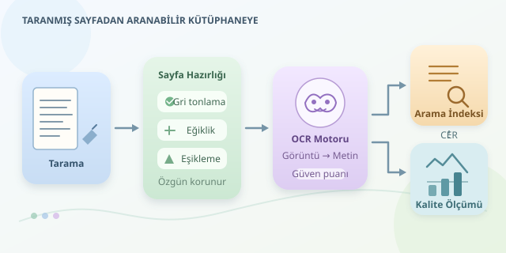

Yüz yıllık bir kitabın içinde belirli bir sözcüğü aradığınızı düşünün. Sayfaları tek tek çevirmek romantik olabilir; fakat binlerce kitaplık bir arşivde romantizm biraz yorucudur. Optik karakter tanıma, yani OCR, taranmış sayfalardaki harf görüntülerini bilgisayarın işleyebileceği metne dönüştürür. Böylece dijital kütüphane yalnızca resim saklayan bir depo olmaktan çıkar, sorgulanabilir bir bilgi kaynağına dönüşür.

``

## OCR aslında neyi çözüyor?

Tarayıcı bir sayfayı kelimeler olarak değil, piksel değerlerinden oluşan bir görüntü olarak kaydeder. Bilgisayar için “kitap” sözcüğü başlangıçta yalnızca koyu ve açık bölgelerin belirli bir düzenidir. OCR sistemi bu düzeni yorumlayarak karakter dizisi üretir.

Klasik sistemlerde sayfa önce metin bölgelerine, satırlara ve karakterlere ayrılır. Modern yaklaşımlar ise sinir ağlarıyla satır görüntülerinden doğrudan karakter dizileri çıkarabilir. Dil bilgisi ve sözcük olasılıkları, görsel açıdan benzer adaylar arasında seçim yapmayı kolaylaştırır. Ancak eski yazım biçimleri, modern dil modellerinin beklentilerine uymayabilir.

Problemi kabaca $P(T \mid G)$ ile ifade edebiliriz: Görüntü $G$ verildiğinde metin $T$ ne kadar olasıdır? Buradaki amaç, görüntüyle en iyi uyuşan metni bulmaktır; metni günümüz Türkçesine çevirmek değildir.

## Önce sayfayı hazırlayalım

OCR motoruna bulanık, eğri ve lekeli bir sayfa vermek, gözlüğünü unutmuş birine küçük puntolu sözleşme okutmaya benzer. Başarı çoğu zaman tanıma başlamadan belirlenir.

Yaklaşık 300 DPI, basılı metin için yaygın bir başlangıç noktasıdır; küçük puntolar daha yüksek çözünürlük gerektirebilir. Eğiklik düzeltme, kenar gölgelerini azaltma ve sayfa bölgelerini ayırma önemli adımlardır. Uyarlamalı eşikleme, farklı aydınlanan bölgeleri ayrı değerlendirerek metni arka plandan ayırabilir. Ancak aşırı temizlik, noktaları ve ince harf çizgilerini de silebilir. Özgün tarama mutlaka korunmalıdır.

| İşlem | Sağladığı avantaj | Dikkat edilmesi gereken |
|---|---|---|
| Gri tonlama | Renk karmaşasını azaltır | Renkli notlar bilgi taşıyabilir |
| Eğiklik düzeltme | Satırların bulunmasını kolaylaştırır | Sayfa kıvrımı ayrıca düzeltilmelidir |
| Uyarlamalı eşikleme | Yerel gölgelerde yardımcı olur | İnce çizgiler kaybolabilir |
| Düzen analizi | Sütunları ve dipnotları ayırır | Yanlış sıra anlamı bozabilir |

## Python ile küçük bir OCR hattı

Aşağıdaki örnek, sayfayı hazırlayıp Tesseract ile okur. Hem düz metin hem de sözcüklerin koordinatlarını içeren JSON üretir. Bunun için `opencv-python`, `pytesseract`, ayrıca sistemde Tesseract ve Türkçe dil verisi bulunmalıdır.

```python
import json
from pathlib import Path
import cv2
import pytesseract
from pytesseract import Output

image = cv2.imread('sayfa.png')
if image is None:
    raise ValueError('Sayfa görüntüsü okunamadı.')

gray = cv2.cvtColor(image, cv2.COLOR_BGR2GRAY)
binary = cv2.adaptiveThreshold(
    gray, 255, cv2.ADAPTIVE_THRESH_GAUSSIAN_C,
    cv2.THRESH_BINARY, 31, 15
)
data = pytesseract.image_to_data(
    binary, lang='tur+eng',
    config='--oem 1 --psm 3', output_type=Output.DICT
)
lines, words = {}, []
for i, raw in enumerate(data['text']):
    text = raw.strip()
    if not text:
        continue
    key = tuple(data[k][i] for k in (
        'page_num', 'block_num', 'par_num', 'line_num'
    ))
    lines.setdefault(key, []).append(text)
    words.append({
        'text': text,
        'confidence': float(data['conf'][i]),
        'box': [data[k][i] for k in ('left', 'top', 'width', 'height')]
    })

Path('sayfa.txt').write_text(
    '\n'.join(' '.join(line) for line in lines.values()), encoding='utf-8'
)
Path('sayfa.json').write_text(
    json.dumps(words, ensure_ascii=False, indent=2), encoding='utf-8'
)
```

`--psm 3`, otomatik sayfa düzeni analizini kullanır. Koordinatlar, arama sonuçlarında ilgili sözcüğü görüntü üzerinde işaretlemeye yarar. Güven puanı ise inceleme önceliği belirleyebilir; doğruluğun garantisi değildir. Eşikleme parametreleri her koleksiyon için örnek sayfalarda denenmelidir. Osmanlıca veya farklı tarihsel alfabeler için yalnızca Türkçe model yeterli olmayabilir.

## Metinden aranabilir kütüphaneye

Düz metin üretmek ilk adımdır. Aranabilir PDF, özgün sayfa görüntüsünü korurken üzerine görünmez bir metin katmanı yerleştirir. OCRmyPDF bu süreci otomatikleştirebilir:

```bash
ocrmypdf -l tur+eng --deskew kaynak.pdf aranabilir.pdf
```

Kütüphane ölçeğinde metinler; kitap kimliği, sayfa numarası ve bibliyografik bilgilerle birlikte indekslenir. Ters indeks, her sözcüğün geçtiği belgeleri listeler. Böylece sorgu sırasında bütün kitaplar yeniden okunmaz. Satır sonu tirelerini birleştirmek aramayı iyileştirebilir; fakat yapılan değişiklikler özgün OCR çıktısından ayrı tutulmalıdır.

## Kaliteyi nasıl ölçeriz?

Elle doğrulanmış örnek sayfalar üzerinden karakter hata oranı hesaplanabilir:

$$CER = \frac{S + D + I}{N}$$

Burada $S$ değiştirme, $D$ silme, $I$ ekleme sayısı; $N$ ise referans metindeki karakter sayısıdır. Yüz karakterde toplam sekiz hata varsa CER yüzde sekizdir. Farklı baskılar, yazı tipleri ve hasar düzeyleri ayrı değerlendirilmelidir. Başarılı bir dijital kütüphane, yalnızca çok sayfa işleyen değil, hatalarını ölçen ve düzeltmeleri izlenebilir biçimde saklayan kütüphanedir.



