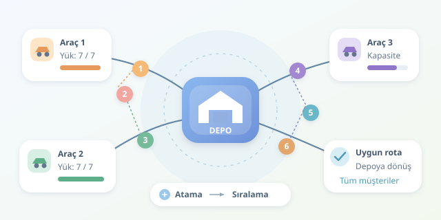

Bir depodan çıkan üç kamyonunuz, teslimat bekleyen onlarca müşteriniz ve sınırsız olmayan bagajlarınız var. Hangi müşteri hangi araca atanmalı, ziyaretler hangi sırayla yapılmalı? Araç Rotalama Problemi, yani VRP, tam olarak bu organizasyon bulmacasını çözer. Amaç yalnızca kısa yollar bulmak değil, bütün teslimatları kısıtlara uyarak ekonomik biçimde tamamlamaktır.

``

## Problemin kalbi: Atama ve sıralama

Kapasiteli Araç Rotalama Problemi, kısaca CVRP, klasik modelde tek bir depo, müşterilerin bilinen talepleri ve sınırlı taşıma kapasiteleriyle çalışır. Her müşteri yalnızca bir araç tarafından ziyaret edilir; teslimatı bölünmez. Araçlar depodan çıkar, kendilerine atanan müşterilere uğrar ve depoya döner. Her aracın taşıdığı toplam yük, kapasitesini aşamaz.

Burada birbirine bağlı iki karar bulunur: müşterileri araçlara paylaştırmak ve her aracın ziyaret sırasını belirlemek. En yakın müşterileri aynı araca vermek mantıklı görünebilir; ancak talepleri büyükse kapasite hemen dolar. Yalnızca yükleri dengelemek ise araçları şehrin bir ucundan diğerine sürükleyebilir. Kısacası, harita ile bagaj birlikte düşünülmelidir.

## Matematik direksiyona geçsin

Müşteri $i$ için talep $q_i$, araç $k$ için kapasite $Q_k$ olsun. Müşteri o araca atanmışsa $y_{ik}=1$, aksi durumda sıfırdır. Temel kapasite koşulu şöyledir:

$$\sum_{i=1}^{n} q_i y_{ik} \le Q_k$$

Ayrıca her müşteri tam bir araca atanmalıdır: $\sum_k y_{ik}=1$. Araç $k$, $i$ noktasından $j$ noktasına gidiyorsa $x_{ijk}=1$ diyelim. Yol maliyeti $c_{ij}$ olduğunda hedef:

$$\min \sum_k \sum_{i\ne j} c_{ij}x_{ijk}$$

Bu ifadeler modelin çekirdeğidir, tamamı değildir. Atamalarla yol değişkenlerini bağlayan, giriş ve çıkışları dengeleyen, depoya dönüşü sağlayan ve depodan kopuk müşteri döngülerini engelleyen kısıtlar da gerekir. Aksi hâlde matematik, kamyonu depodan hiç çıkarmadan mahallede döndürmek gibi yaratıcı ama kullanışsız çözümler üretebilir!

| Model | Temel karar | Ek kısıt |
|---|---|---|
| TSP | Tek aracın ziyaret sırası | Her noktayı ziyaret etmek |
| CVRP | Araç ataması ve ziyaret sırası | Taşıma kapasitesi |
| VRPTW | Atama, sıra ve zamanlama | Müşterinin zaman penceresi |




## Neden basit bir sıralama yetmez?

CVRP, NP-zor bir problemdir. Müşteri sayısı büyüdükçe olası atamalar ve ziyaret sıraları hızla çoğalır. Küçük örneklerde karma tamsayılı programlama veya dal-sınır yöntemleriyle optimal çözüm aranabilir. Büyük örneklerde ise sezgisel yöntemler, kabul edilebilir sürede iyi rotalar üretmek için tercih edilir. Buradaki önemli ayrım şudur: iyi çözüm, kanıtlanmış en iyi çözüm demek değildir.

Örneğin Clarke–Wright tasarruf yöntemi, müşterilere ayrı ayrı gitmek yerine uygun rotaları birleştirmenin kazancını hesaplar. Yerel arama ise mevcut rotadaki ziyaretleri değiştirir veya müşterileri araçlar arasında taşır. Bu hamlelerde kapasiteyi korumak, mesafeyi azaltmak kadar önemlidir. Algoritmanın hızını ve çözüm kalitesini birlikte değerlendirmek gerekir.

## Python ile ilk rotalar

Aşağıdaki açgözlü kurucu, her araç için kapasiteye sığan en yakın müşteriyi seçer. Koordinatlardan Öklid mesafesi hesaplar; `0` depoyu temsil eder.

```python
from math import dist

def rota_uret(noktalar, talepler, kapasiteler):
    kalan = set(talepler)
    rotalar = []
    for kapasite in kapasiteler:
        rota, yuk = [0], 0
        while kalan:
            adaylar = [i for i in kalan
                       if yuk + talepler[i] <= kapasite]
            if not adaylar:
                break
            sonraki = min(adaylar, key=lambda i: (
                dist(noktalar[rota[-1]], noktalar[i]), i))
            rota.append(sonraki)
            yuk += talepler[sonraki]
            kalan.remove(sonraki)
        rotalar.append(rota + [0])
    if kalan:
        raise ValueError("Açgözlü yerleştirme tamamlanamadı.")
    return rotalar

noktalar = {0: (0, 0), 1: (2, 1), 2: (3, 2),
            3: (-2, 1), 4: (-3, 2)}
talepler = {1: 3, 2: 4, 3: 2, 4: 5}
print(rota_uret(noktalar, talepler, [7, 7]))
```

Sonuç `[[0, 1, 2, 0], [0, 3, 4, 0]]` olur. İlk araç $3+4=7$, ikinci araç $2+5=7$ birim taşır. Böylece kapasite sınırları korunur ve bütün müşteriler ziyaret edilir. Eşit mesafelerde müşteri numarası kullanılması, aynı girdinin aynı çıktıyı üretmesini sağlar. Örnek, pozitif talepler ve kapasiteler varsayar.

Ancak bu yaklaşım optimal değildir; hatta kötü yerleştirmeler yüzünden, uygulanabilir bir çözüm varken müşteri bırakabilir. Dolayısıyla hata mesajı, problemin çözümsüz olduğunun kanıtı sayılmaz. Üretimde koordinat mesafesi yerine yol ağına dayalı süre veya maliyet matrisi kullanın; toplam mesafenin yanında araç sayısını, kapasite kullanımını ve gecikmeleri de ölçün. İyi rotalama, yalnızca kısa yol değil, çalışabilir bir plandır.
