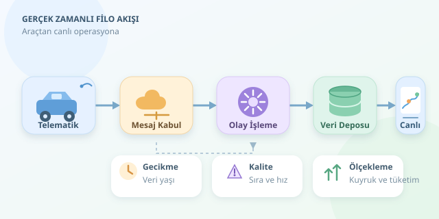

Bir haritada yüzlerce hareketli araç görmek, dijital bir karınca kolonisini izlemeye benzer. Ancak başarılı bir filo yönetim sistemi, renkli işaretçilerden çok daha fazlasıdır: Konum, yakıt tüketimi, motor durumu ve bağlantı kalitesini anlamlı kararlara dönüştürür. Peki bu hareketli dünyanın arkasında nasıl bir yazılım mimarisi çalışır?

``

## Araçtan ekrana uzanan veri yolculuğu

Her araçta bulunan telematik cihaz, GNSS alıcısından konum; uygun CAN veya OBD bağlantısından hız, motor devri ve arıza bilgileri toplar. Cihazın ve aracın desteklediği ölçümler değişebilir. Veriler mobil bağlantı üzerinden merkeze gönderilir; bağlantı kesilirse cihaz bunları yerel olarak tamponlar.

Merkezdeki akış genellikle şöyledir: **cihaz → mesaj kabul katmanı → olay işleme → depolama → canlı ekran**. Buradaki bileşenler aynı işi yapmaz:

| Teknoloji | Temel görev | Önemli özellik |
|---|---|---|
| MQTT | Cihaz mesajlarını taşımak | Hafif yayınlama ve abonelik |
| Kafka | Sunucu tarafında olay akışı oluşturmak | Kalıcı kayıt ve yeniden işleme |
| WebSocket | Tarayıcıya güncelleme göndermek | Açık bağlantı üzerinden çift yönlü iletişim |

Hepsini kullanmak zorunlu değildir. Küçük bir filoda daha sade bir mimari yeterliyken, büyüyen sistemlerde sorumlulukları ayırmak bakım ve ölçekleme işini kolaylaştırır.

## “Gerçek zamanlı” demek, “anında” demek değildir

Önce bir gecikme hedefi belirlenmelidir: Operasyon ekranı için birkaç saniye kabul edilebilirken, kritik bir alarm farklı gereksinimler taşıyabilir. Ölçülen değer, yalnızca sunucunun işlem süresi değil, olayın araçta oluşmasından ekranda görünmesine kadar geçen toplam süredir.

Her mesajda araç kimliği, olay zamanı, mesaj kimliği ve mümkünse sıra numarası bulunmalıdır. Böylece tekrar gönderilen veya geç ulaşan mesajlar ayırt edilir. Eski bir kayıt geçmişe eklenebilir; fakat haritadaki güncel konumu geriye taşımamalıdır. Cihaz saatinin yanlış olabileceği de unutulmamalıdır.

## Kapasiteyi önce hesaplayalım

$N$ araç, her $T$ saniyede bir mesaj gönderiyorsa ortalama mesaj hızı:

$$R = N / T$$

Örneğin 500 araç ve beş saniyelik gönderim aralığı, saniyede 100 mesaj üretir. Mesaj başına yaklaşık 1 KB kabul edildiğinde günlük ham veri yaklaşık 8,64 GB olur; indeksler, kopyalar ve protokol yükü buna dahil değildir.

Asıl sürpriz ortalamada değil, bağlantısı geri gelen araçların birikmiş mesajları aynı anda göndermesindedir. Bu nedenle kuyruklar ve kontrollü tüketim önemlidir.

## Konum verisini küçük bir kalite kontrolünden geçirelim

İki konum arasındaki mesafeden ortalama hız hesaplanabilir: $v = d / (t_2 - t_1)$. Aşağıdaki Python fonksiyonu Haversine yaklaşımını kullanır; zaman farkını ve yapılandırılabilir hız sınırını kontrol eder:

```python
from math import radians, sin, cos, asin, sqrt


def gps_hizi(onceki: dict, yeni: dict,
             ust_sinir: float = 180) -> float | None:
    dt = yeni["ts"] - onceki["ts"]
    if dt <= 0 or dt > 30:
        return None

    lat1, lon1, lat2, lon2 = map(radians, (
        onceki["lat"], onceki["lon"],
        yeni["lat"], yeni["lon"]
    ))
    a = (sin((lat2 - lat1) / 2) ** 2
         + cos(lat1) * cos(lat2)
         * sin((lon2 - lon1) / 2) ** 2)
    mesafe = 6_371_000 * 2 * asin(sqrt(max(0, min(1, a))))
    hiz = mesafe / dt * 3.6
    return hiz if hiz <= ust_sinir else None
```

Burada `ts`, saniye cinsinden olay zamanıdır; sonuç km/sa cinsindedir. Koordinat aralıkları ayrıca doğrulanmalıdır. Hesaplanan değer anlık değil, iki ölçüm arasındaki ortalama hızdır. GPS sapmaları yanlış sıçramalar oluşturabileceğinden şüpheli ölçümleri silmek yerine kalite etiketiyle saklamak daha sağlıklıdır.

## Harita güzel; operasyonel anlam daha güzel

Son konumlar hızlı erişilen bir depoda, geçmiş ölçümler zaman serisi veritabanında tutulabilir. Coğrafi sorgular için konumsal indeksler kullanılabilir. Tarayıcı yalnızca yetkili olduğu araçların güncellemelerine abone olmalıdır.

| Gösterge | Operasyonel anlamı | Dikkat edilmesi gereken |
|---|---|---|
| Veri yaşı | Takibin güncelliği | Eski konumu canlı göstermemek |
| Rölanti süresi | Olası gereksiz tüketim | Kontak ve motor durumunu birlikte değerlendirmek |
| Yakıt tüketimi | Kullanım verimliliği | Yük, rota ve araç sınıfını karşılaştırmak |

Haritada son güncelleme zamanı görünmelidir. Dakikalardır haber alınamayan araç, hâlâ hareket ediyormuş gibi sunulmamalıdır.

## Ölçek, güvenlik ve sürdürülebilirlik

Akışları araç kimliğine göre bölümlendirmek, aynı aracın olaylarını sırayla işlemeyi kolaylaştırır. Yoğunluk arttığında tüketiciler ölçeklenebilir; tekrarları ayıklayan işlemler ise mükerrer kayıtları önler. Ekrana her mesajı ayrı ayrı göndermek yerine kısa aralıklarla birleştirilmiş güncellemeler sunmak tarayıcı yükünü azaltır.

Son olarak cihaz kimlik doğrulaması, şifreli iletişim, rol tabanlı erişim ve saklama süreleri tasarımın parçası olmalıdır. Konum verisi kişilerle ilişkilendirilebildiğinde KVKK yükümlülükleri de değerlendirilmelidir. İyi filo yazılımı, yalnızca araçların nerede olduğunu değil, gösterdiği bilginin ne kadar güvenilir olduğunu da anlatır.
