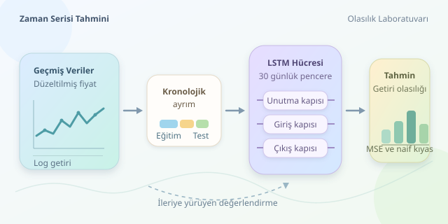

Hisse senedi grafiğine bakıp “Yarın yükselir mi?” diye sormak kolay; güvenilir bir tahmin sistemi kurmak ise bambaşka bir macera. LSTM gibi makine öğrenmesi modelleri geçmiş hareketlerdeki ilişkileri öğrenmeye çalışır. Ancak piyasalar, dün ezberlediğiniz kuralları bugün değiştirebilen oldukça yaramaz sistemlerdir.

``

## Önce problemi doğru tanımlayalım

Zaman serisi, gözlemlerin sıralı olduğu veridir. Bugünün kapanışı dünün ardından gelir; satırları rastgele karıştırmak bu bağlamı bozar. Tahmin görevinde model, geçmişteki bir pencereyi kullanarak henüz gözlenmemiş bir değeri üretir.

Doğrudan fiyat tahmini yerine logaritmik getiri tahmini sıklıkla tercih edilir:

$$r_t = \log(P_t/P_{t-1})$$

Burada $P_t$, ilgili günün kapanış fiyatıdır. Fiyat seviyeleri uzun vadede sürüklenebilir; getiriler ise bazı dönemlerde daha kararlı istatistiksel özellikler gösterebilir. Bu, getirilerin kesinlikle durağan veya kolay tahmin edilebilir olduğu anlamına gelmez.

Tahmin edilen getiri tekrar fiyata çevrilebilir:

$$\widehat{P}_{t+1}=P_t e^{\widehat{r}_{t+1}}$$

Önemli ayrıntı: Gelecekteki fiyat, geçmiş fiyatların mekanik bir devamı değildir. Haberler, likidite ve beklenmedik olaylar modeli hazırlıksız yakalayabilir.

## LSTM neden kullanılır?

LSTM, tekrarlayan sinir ağlarının uzun bağımlılıkları öğrenmek için geliştirilmiş bir türüdür. Hücre durumu bilgiyi taşırken unutma, giriş ve çıkış kapıları hangi bilginin korunacağını belirler. Kapılar sürekli değerler üretir; dolayısıyla davranışları basit bir açma-kapama düğmesinden daha esnektir.

Bunu finansal not defteri gibi düşünebilirsiniz: Model bazı eski notları siler, bazılarını günceller, gerektiğinde ilgili sayfayı açar. Fakat deftere yazılan her desen gerçek bir piyasa kuralı değildir.

| Model | Temel yaklaşım | Başlıca sınırlama |
|---|---|---|
| Naif tahmin | Son fiyat değişmez | Karmaşık ilişkileri kullanmaz |
| ARIMA | Doğrusal zaman bağımlılıkları | Doğrusal olmayan yapıları kaçırabilir |
| XGBoost | Gecikmeli özelliklerden öğrenir | Özellik tasarımı gerektirir |
| LSTM | Sıralı pencereleri işler | Fazla öğrenmeye açıktır |

## Veri sızıntısını kapıdan çevirelim

Veriyi kronolojik olarak eğitim, doğrulama ve test bölümlerine ayırın. Ölçekleyiciyi yalnızca eğitim verisine uygulayarak öğrenin; doğrulama ve test verilerini aynı parametrelerle dönüştürün. Aksi hâlde geleceğin istatistikleri geçmişe sızar ve sonuçlar gereğinden parlak görünür.

Bölünme ve temettü etkileri için uygun biçimde düzeltilmiş fiyatlar kullanın. Hacim veya haber özellikleri ekliyorsanız, tahmin anında gerçekten erişilebilir olduklarından emin olun. Sonradan yayımlanan bilgi, modele zamanda yolculuk yaptırır!

## Python ile küçük bir deney

Aşağıdaki örnek, `date` ve `adjusted_close` sütunları bulunan, yeterli uzunlukta bir CSV dosyasından sonraki günün getirisini tahmin eder. Her örnek önceki 30 getiriyi içerir.

```python
import numpy as np
import pandas as pd
from sklearn.preprocessing import StandardScaler
from sklearn.metrics import mean_squared_error
from tensorflow import keras

np.random.seed(42)
keras.utils.set_random_seed(42)
df = pd.read_csv("prices.csv", parse_dates=["date"])
p = df.sort_values("date")["adjusted_close"].dropna()
r = np.log(p).diff().dropna().to_numpy().reshape(-1, 1)
a, b = int(len(r) * 0.7), int(len(r) * 0.85)

scaler = StandardScaler().fit(r[:a])
z = scaler.transform(r).astype("float32")
lookback = 30
idx = np.arange(lookback, len(z))
X = np.array([z[i-lookback:i] for i in idx])
y = z[idx]
train = idx < a
valid = (idx >= a) & (idx < b)
test = idx >= b

model = keras.Sequential([
    keras.Input(shape=(lookback, 1)),
    keras.layers.LSTM(32),
    keras.layers.Dense(1)
])
model.compile(optimizer="adam", loss="mse")
stop = keras.callbacks.EarlyStopping(
    patience=5, restore_best_weights=True
)
model.fit(
    X[train], y[train], validation_data=(X[valid], y[valid]),
    epochs=50, batch_size=32, shuffle=False,
    callbacks=[stop], verbose=0
)
pred = scaler.inverse_transform(model.predict(X[test], verbose=0))
actual = scaler.inverse_transform(y[test])
print("LSTM MSE:", mean_squared_error(actual, pred))
print("Naif MSE:", mean_squared_error(actual, np.zeros_like(actual)))
```

Pencereler yalnızca hedef günden önceki gözlemleri içerir. Test penceresinde önceki doğrulama günlerinin bulunması sızıntı değildir: Bu gözlemler tahmin anında zaten bilinmektedir. Erken durdurma doğrulama kaybını izler; test kümesi model seçimine katılmaz.

## Başarıyı nasıl ölçeriz?

Ortalama karesel hata, $MSE=\frac{1}{N}\sum_{i=1}^{N}(r_i-\widehat r_i)^2$, büyük hataları daha ağır cezalandırır. Kodun naif modeli sıfır getiri öngörür; yani fiyatın değişmeyeceğini varsayar. LSTM bunu geçemiyorsa karmaşıklığı henüz haklı çıkmamıştır.

Yön doğruluğunu da inceleyin, fakat doğru yön tahmini otomatik olarak kâr değildir. Komisyon, alış-satış farkı ve kayma sonuçları değiştirebilir. Strateji değerlendirmesinde sinyalin üretildiği an ile işlemin gerçekleştirilebildiği an ayrılmalıdır.

Son olarak ileriye yürüyen değerlendirme kullanın: Geçmişte eğitin, sonraki dönemde ölçün, pencereyi ilerletin. Tek bir başarılı test dönemi yerine farklı piyasa koşullarında tutarlılık arayın. LSTM'nin marifeti geleceği bilmek değil; sınanabilir tahminler üretmektir.



