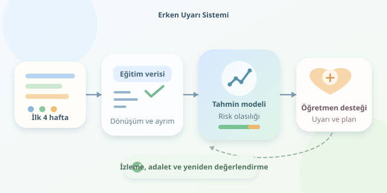

Bir öğrencinin desteğe ihtiyaç duyduğunu dönem bitmeden anlayabilseydik nasıl olurdu? Makine öğrenmesi, geçmiş performanstaki örüntülerden yararlanarak bu soruya olasılıksal bir yanıt verebilir. Ancak amaç bir dijital kâhin üretmek değil, öğretmene zaman kazandıran bir erken uyarı sistemi kurmaktır.

``

## Önce “risk” kavramını tanımlayalım

Örneğin dönem sonu notu 50’nin altında kalan öğrencileri riskli sınıf olarak tanımlayalım: Bu öğrenciler için $y=1$, diğerleri için $y=0$ olsun. Modelin görevi, ilk dört haftada erişilebilen bilgilerden bu sonucu tahmin etmektir. Böylece problem, denetimli bir ikili sınıflandırmaya dönüşür.

Bu tanım evrensel değildir. Devamsızlık nedeniyle başarısızlık veya okulu bırakma riski, farklı hedefler ve ayrı modeller gerektirir.

## Veriyi zaman makinesine çevirmeyin

Girdi değişkenleri, tahmin anında gerçekten bilinen bilgiler olmalıdır. Önceki dönem ortalaması, ilk haftalardaki devamsızlık ve ödev teslim oranı kullanılabilir. Dönem sonu notunu girdilere eklemek ise cevap anahtarını sınava götürmektir: Sonuçlar şahane görünür, sistem gerçek hayatta tökezler.

| Değişken | Kullanım | Gerekçe |
|---|---|---|
| Önceki dönem ortalaması | Uygun | Geçmiş performansı özetler |
| İlk dört haftalık devamsızlık | Uygun | Erken katılım sinyalidir |
| Dönem sonu notu | Yalnızca hedef | Tahmin sırasında bilinmez |

Eksik değerler de dikkat ister. Eksik kayıt her zaman düşük başarı anlamına gelmez; veri toplama sorunu olabilir. Doldurma ve ölçekleme işlemleri yalnızca eğitim verisinde öğrenilmelidir. Aksi hâlde test kümesinden bilgi sızar.

## Modeller neyi öğrenir?

Lojistik regresyon, özelliklerin ağırlıklı birleşimini 0 ile 1 arasında bir olasılığa dönüştürür:

$$p(y=1\vert x)=\frac{1}{1+e^{-(w^Tx+b)}}$$

Burada $x$ öğrenci özelliklerini, $w$ öğrenilen ağırlıkları, $b$ sabit terimi gösterir. Karar ağaçları ise “devamsızlık yüksek mi?” gibi dallanmalar kurar. Gradyan artırma, birçok küçük ağacın hatalarını sırayla düzelterek daha karmaşık ilişkileri yakalar.

| Model | Güçlü yanı | Dikkat noktası |
|---|---|---|
| Lojistik regresyon | Açıklanabilir başlangıç | Doğrusal ilişki varsayımı |
| Karar ağacı | Anlaşılır kurallar | Aşırı öğrenme riski |
| Gradyan artırma | Karmaşık örüntüler | Ayar ve açıklama ihtiyacı |

En karmaşık model otomatik olarak kazanmaz. Modelleri aynı veri bölmeleri ve ölçütlerle karşılaştırmak gerekir.

## Python ile başlangıç modeli

Aşağıdaki örnekte her satır, bir öğrencinin ilk dört haftalık özetidir. CSV dosyasının belirtilen sütunları içerdiği varsayılır. Eski dönemlerle eğitim yapıp 2025 dönemini test için ayırıyoruz.

```python
import pandas as pd
from sklearn.compose import ColumnTransformer
from sklearn.pipeline import make_pipeline
from sklearn.impute import SimpleImputer
from sklearn.preprocessing import StandardScaler, OneHotEncoder
from sklearn.linear_model import LogisticRegression
from sklearn.metrics import average_precision_score, recall_score

df = pd.read_csv('ogrenci_ozetleri.csv')
num = ['gecmis_ortalama', 'devamsizlik_4h', 'odev_orani_4h']
features = num + ['ders']
y = (df['donem_notu'] < 50).astype(int)
train = df['yil'] < 2025
test = df['yil'] == 2025

prep = ColumnTransformer([
    ('sayisal', make_pipeline(
        SimpleImputer(strategy='median'), StandardScaler()), num),
    ('kategori', make_pipeline(
        SimpleImputer(strategy='most_frequent'),
        OneHotEncoder(handle_unknown='ignore')), ['ders'])
])
model = make_pipeline(prep, LogisticRegression(max_iter=1000))
model.fit(df.loc[train, features], y[train])
p = model.predict_proba(df.loc[test, features])[:, 1]
pred = (p >= 0.35).astype(int)
print('AP:', average_precision_score(y[test], p))
print('Duyarlılık:', recall_score(y[test], pred))
```

Pipeline, dönüşümleri eğitim verisinde öğrenip test verisine uygular. Tekrarlanan öğrenci kayıtları varsa, aynı öğrencinin iki kümeye düşmesi engellenmelidir. Buradaki 0.35 örnek eşiği, gerçek uygulamada geçmiş dönemlerden ayrılan doğrulama verisiyle seçilmelidir; test kümesine bakılarak ayarlanmamalıdır.

## Doğruluk tek başına yetmez

Öğrencilerin yalnızca yüzde 10’u riskliyse, herkese “risksiz” diyen model yüzde 90 doğruluk alır. Fakat yardım bekleyen kimseyi bulamaz! Bu nedenle farklı ölçütleri birlikte değerlendirin.

| Ölçüt | Yanıtladığı soru |
|---|---|
| Duyarlılık | Riskli öğrencilerin kaçını yakaladık? |
| Kesinlik | Uyarıların kaçı gerçekten riskli? |
| Ortalama kesinlik, AP | Risk sıralaması ne kadar başarılı? |
| Kalibrasyon | Olasılıklar gerçekleşme oranlarıyla uyumlu mu? |

Eşik düşürüldüğünde genellikle daha fazla riskli öğrenci yakalanır, ancak yanlış alarm artar. Seçim, danışmanların destek kapasitesine ve kaçırılan öğrencinin yaratacağı maliyete bağlıdır.

## Tahmini desteğe dönüştürün

Risk puanı öğrencinin kimliği veya kaderi değildir. Uyarıları öğretmen değerlendirmesi, gönüllü danışmanlık ve çalışma planlarıyla birleştirin. Verileri asgari düzeyde toplayın, erişimi sınırlandırın ve farklı öğrenci gruplarındaki hata oranlarını inceleyin. Modeli dönemler değiştikçe yeniden değerlendirin. Son başarı ölçütü yalnızca iyi tahmin değil, verilen desteğin öğrencinin öğrenmesine gerçekten katkı sağlamasıdır.
