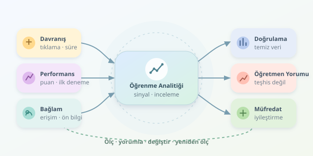

Bir dersin videosu bin kez izlenmiş olabilir; ama bu, bin kez anlaşıldığı anlamına gelmez. Öğrenme analitiği, öğrencilerin dijital izlerini öğrenme hedefleriyle birlikte yorumlayarak müfredatı iyileştirmeye çalışır. Amaç öğrenciyi bir gösterge paneline sıkıştırmak değil, içeriğin nerede tökezlediğini bulmaktır. Kısacası veri, öğretmenin büyüteci olmalıdır; sihirli değneği değil.

``

## Önce Ölçtüğümüz Şeyi Anlayalım

Öğrenme analitiğinin temelinde üç katman bulunur: davranış, performans ve bağlam. Tıklamalar davranışı; sınav sonuçları performansı; ön bilgi ve erişim koşulları bağlamı temsil eder. Bunları birlikte değerlendirmek gerekir. Uzun çalışma süresi zorlanmaya işaret edebilir; fakat meraklı bir öğrencinin derinlemesine araştırmasını da gösterebilir. Bu nedenle etkileşim, öğrenmenin kendisi değil, öğrenme hakkında dolaylı bir sinyaldir. Korelasyon da tek başına neden-sonuç ilişkisi kurmaz.

Basit bir modül güçlük göstergesi şöyle tanımlanabilir:

$$D = 1 - S/100$$

Burada $S$, ilk sınav denemelerinin 0–100 aralığındaki ortalamasıdır. $D$ yükseldikçe inceleme ihtiyacı artar. Ancak zor sınav, belirsiz soru veya eksik ön bilgi aynı sonucu üretebilir. Gösterge teşhis değil, araştırma davetidir.

## Veriyi Toplamak Yetmez

Öğrenme yönetim sisteminden olay kimliği, takma adlı öğrenci kimliği, modül, zaman damgası, olay türü, aktif süre ve sınav puanı alınabilir. Aktif süre, açık bırakılmış tarayıcı sekmesinin toplam süresinden ayrılmalıdır. Yinelenen kayıtları temizleyin; puan aralıklarını, eksik değerleri ve zaman sırasını doğrulayın. Süre kayıtlarının örtüşmemesine dikkat edin. Ayrıca her modülü ilgili kazanımla eşleştirin; aksi halde güzel grafikler üretir, neyi iyileştireceğinizi bilemezsiniz.

| Sinyal | Aceleci yorum | Kontrol edilmesi gereken |
|---|---|---|
| Uzun aktif süre | İçerik zor | Ön bilgi, görev kapsamı |
| Düşük sınav puanı | Öğrenci öğrenmedi | Soru kalitesi, kazanım uyumu |
| Az etkileşim | İlgi yok | Erişim sorunu, çevrimdışı çalışma |




## Python ile İnceleme Listesi

Aşağıdaki örnek, temizlenmiş olay kayıtlarından modül bazında öğrenci sayısını, ilk sınav puanını ve medyan aktif süreyi hesaplar. Sonuç, otomatik müfredat kararı değil, öğretmenin inceleme listesidir.

```python
import pandas as pd

e = pd.read_csv("events.csv", parse_dates=["timestamp"])
e = e.drop_duplicates("event_id").sort_values("timestamp")
quiz = e[e["event"] == "quiz"].drop_duplicates(
    ["student_id", "module"]
)
minutes = (
    e.groupby(["module", "student_id"])["active_seconds"]
    .sum().div(60)
)
report = pd.DataFrame({
    "students": e.groupby("module")["student_id"].nunique(),
    "mean_score": quiz.groupby("module")["score"].mean(),
    "median_minutes": minutes.groupby("module").median()
})
report["difficulty"] = 1 - report["mean_score"] / 100
report["review"] = (
    (report["difficulty"] > 0.4) & (report["students"] >= 20)
)
print(report.sort_values("difficulty", ascending=False))
```

İlk denemeyi seçmek, tekrar sınavların başlangıçtaki güçlüğü gizlemesini azaltır. Medyan, aşırı uzun sürelerden ortalamaya göre daha az etkilenir. Buradaki eşikler yalnızca örnektir; yirmi öğrenci istatistiksel güvence sağlamaz. Sınava girmeyenler puan ortalamasına katılmaz; bu yüzden sınava katılım oranını ayrıca raporlayın. Öğrenci sayısı da tüm kayıtlı sınıfı değil, gözlenen kullanıcıları gösterir.

## Bulguyu İçerik Değişikliğine Çevirmek

Diyelim döngüler modülünde süre yüksek, puan düşük. Hemen videoyu kısaltmak yerine soru bazında yanlışları inceleyin. Öğrenciler özellikle döngü sınırlarında hata yapıyorsa, adım adım yürütme animasyonu ve kısa alıştırmalar ekleyin. Sorun değişken kavramından kaynaklanıyorsa önceki modüle köprü kurun. Böylece müfredatın yalnızca anlatımı değil, sıralaması da iyileşir. Forum soruları ve kısa öğrenci görüşmeleri, sayıların açıklayamadığı noktaları tamamlar. Verinin söylediği “buraya bak”; öğretmenin kararı ise “şunu değiştir” olmalıdır.

## Değişiklik Gerçekten İşe Yaradı mı?

Yeni içeriği mümkünse rastgele oluşturulmuş gruplarla karşılaştırın. Ön test ve son test kullanarak başlangıç farklılıklarını dikkate alın. Aynı kazanımları ölçen değerlendirmeler uygulayın; yalnızca tıklama artışını başarı saymayın. Öğrenme kazanımı, gecikmeli hatırlama ve çalışma yükünü birlikte izleyin. Rastgele atama yapılamıyorsa dönem karşılaştırmalarında öğretmen, sınav ve öğrenci profili farklılıklarını açıkça belirtin. Bulguları belirsizlik aralıklarıyla paylaşın; tek bir yüzdeye zafer bayrağı dikmeyin.

## Gizlilik Tasarımın Parçasıdır

Yalnızca gerekli verileri toplayın, amacı açıkça anlatın ve uygun hukuki dayanağı belirleyin. KVKK kapsamında erişim yetkilerini ve saklama süresini planlayın. Takma kimlik kullanmak tam anonimlik sağlamaz; küçük gruplarda yeniden tanımlanma mümkündür. Raporları mümkün olduğunca toplulaştırın. Verileri cezalandırıcı öğrenci etiketlerine dönüştürmeyin; erişim engellerini başarısızlıkla karıştırmayın. Öğrencilerin yorum ve itirazlarını da değerlendirme sürecine katın.

İyi öğrenme analitiği döngüsü basittir: ölç, yorumla, değiştir, yeniden ölç. Ama asıl başarı, daha kalabalık bir panel değil; öğrencinin daha az tökezlediği, öğretmenin ise nedenini daha iyi bildiği bir derstir.
