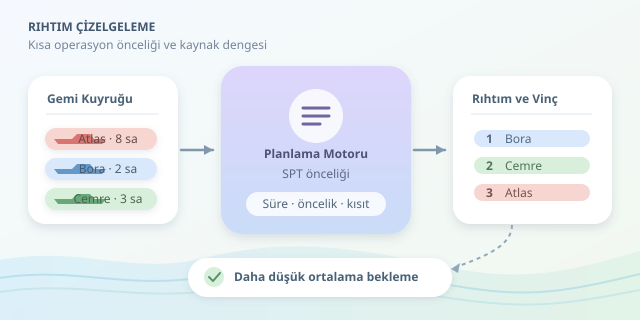

Bir konteyner terminalini devasa bir işlemci gibi düşünün: Gemiler işler, rıhtımlar çalışma alanları, vinçler ise hesaplama kaynaklarıdır. Yanlış gemiyi önce işleme almak, arkadaki kuyruğu saatlerce uzatabilir. Peki boşaltma sırasını nasıl belirlemeliyiz? Cevap, yalnızca geliş saatlerine bakmak değil; operasyon sürelerini, fiziksel kısıtları ve hizmet hedeflerini birlikte değerlendirmektir.



``

## Önce problemi doğru tanımlayalım

Bir geminin limana varış zamanı $a_i$, boşaltmaya başlama zamanı $s_i$ ve operasyon süresi $p_i$ olsun. Bekleme süresi $W_i = s_i - a_i$, tamamlanma zamanı ise $C_i = s_i + p_i$ olarak tanımlanır. Limanda toplam kalış süresi, bekleme ile operasyon süresinin toplamıdır; bu iki metriği karıştırmamak gerekir.

Boşaltma süresini yaklaşık olarak şöyle hesaplayabiliriz:

$$p_i = M_i/(q_i r_i \eta_i)$$

Burada $M_i$ konteyner hareketi sayısı, $q_i$ atanmış vinç sayısı, $r_i$ vinç başına saatlik nominal hareket kapasitesi, $\eta_i$ ise etkinlik katsayısıdır. Gerçek hayatta vinçler birbirini engelleyebilir; saha araçları yetişemeyebilir. Dolayısıyla vinç sayısını ikiye katlamak, süreyi mutlaka yarıya indirmez.

Temel hedefimiz $\min \sum_i w_i W_i$ olabilir. $w_i$, geminin hizmet önceliğini temsil eder. Bütün ağırlıklar eşitse toplam beklemeyi azaltmak, ortalama beklemeyi azaltmakla eşdeğerdir.

## Hangi sıralama daha mantıklı?

İlk gelenin önce hizmet alması kolay anlaşılır, ancak kuyruk performansı açısından her zaman iyi değildir. Kısa operasyonları öne almak, daha fazla geminin kuyruğu erken terk etmesini sağlar.

| Yaklaşım | Karar ölçütü | Avantajı | Sınırı |
|---|---|---|---|
| FIFO | Önce gelen gemi | Basit ve şeffaf | Uzun işler kuyruğu tıkayabilir |
| SPT | En kısa operasyon | Ortalama beklemeyi düşürebilir | Büyük gemileri geciktirebilir |
| Ağırlıklı planlama | Bekleme ve hizmet önceliği | Sözleşmeleri dikkate alır | Doğru ağırlık seçimi gerekir |

SPT, bütün gemiler başlangıçta hazırsa, tek rıhtım varsa ve operasyonlar kesintisiz yürütülüyorsa toplam bekleme için optimaldir. Mantığı basittir: Uzun bir işin arkasındaki kısa işi öne aldığınızda, kısa işin kazancı uzun işin kaybından büyüktür. Farklı varış zamanlarında bu garanti kalkar; bazen yaklaşan kısa bir gemi için rıhtımı bilinçli olarak boş bırakmak daha iyi olabilir.

## Küçük bir örnek, büyük bir fark

Atlas, Bora ve Cemre aynı anda gelsin; operasyonları sırasıyla 8, 2 ve 3 saat sürsün. Başlangıç sırası Atlas, Bora, Cemre kabul edilirse sonuç şöyledir:

| Plan | İşlem sırası | Beklemeler | Ortalama bekleme |
|---|---|---|---|
| FIFO | Atlas → Bora → Cemre | 0, 8, 10 saat | 6 saat |
| SPT | Bora → Cemre → Atlas | 0, 2, 5 saat | 2,33 saat |

Toplam iş yine 13 saatte tamamlanır. İyileşen şey vinçlerin hızı değil, gemilerin kuyrukta geçirdiği süredir. Ancak Atlas daha uzun bekler: Ortalama performans ile bireysel adalet aynı hedef değildir.

## Python ile olay tabanlı bir planlayıcı

Aşağıdaki kod, tek rıhtım ve sabit toplam hareket hızı varsayar. Her operasyon bitiminde, gelmiş gemiler arasından en kısa işi seçer. Henüz kimse gelmediyse zamanı sonraki varışa taşır; başlamış operasyonu kesmez.

```python
from dataclasses import dataclass

@dataclass(frozen=True)
class Gemi:
    ad: str
    varis: float
    hareket: int

def planla(gemiler: list[Gemi], hiz: float = 40):
    if hiz <= 0 or any(
        g.hareket <= 0 or g.varis < 0 for g in gemiler
    ):
        raise ValueError("Hız, hareket ve varış değerlerini kontrol edin.")

    kalan = list(gemiler)
    zaman = 0.0
    sonuc = []

    while kalan:
        hazir = [g for g in kalan if g.varis <= zaman]
        if not hazir:
            zaman = min(g.varis for g in kalan)
            continue

        gemi = min(hazir, key=lambda g: (g.hareket / hiz, g.varis))
        sure = gemi.hareket / hiz
        sonuc.append((gemi.ad, zaman, zaman + sure,
                      zaman - gemi.varis))
        zaman += sure
        kalan.remove(gemi)

    return sonuc

print(planla([
    Gemi("Atlas", 0, 320),
    Gemi("Bora", 0, 80),
    Gemi("Cemre", 0, 120),
]))
```

Çıktıdaki alanlar gemi adı, başlangıç, bitiş ve beklemedir. Saatlik 40 hareket, örneğin iki vincin 25 hareketlik nominal hızına yüzde 80 etkinlik uygulanmasıyla elde edilebilir.

## Gerçek terminalde modeli genişletmek

Birden fazla rıhtımda gemi boyu, su çekimi, vinç erişimi ve gelgit pencereleri eklenir. Saha doluluğu ve kamyon kapasitesi de boşaltmanın hızını sınırlar. Bu durumda sıra seçimi, rıhtım ataması ve vinç dağıtımı birlikte çözülmelidir.

Karma tamsayılı programlama veya kısıt programlama uygun araçlardır. Belirsiz varışlar için planı kayan ufukla yeniden hesaplayın; başlamış işleri sabitleyin. Ortalama beklemenin yanında yüksek yüzdelikli beklemeyi, gecikmeleri ve kaynak kullanımını da izleyin. İyi plan, yalnızca hızlı değil, uygulanabilir ve dayanıklı plandır.
