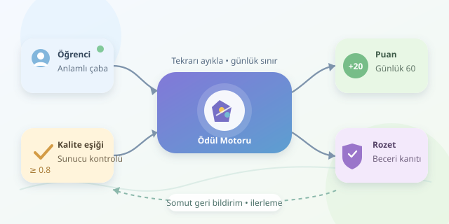

Bir öğrencinin algoritma alıştırmasını bitirdikten sonra kazandığı rozet, yalnızca renkli bir simge değildir: doğru tasarlandığında ilerlemenin görünür kanıtıdır. Ancak her tıklamaya puan dağıtmak, öğrenme platformunu bilgi fabrikasından puan çiftliğine dönüştürebilir. Asıl mesele öğrenciyi ekranda tutmak değil, anlamlı öğrenme davranışlarını sürdürülebilir hâle getirmektir. Gelin bu motivasyon motorunun kaputunu açalım.

``

## Motivasyonun teorik altyapısı

Öz belirleme kuramı, motivasyonu destekleyen üç temel psikolojik ihtiyaca dikkat çeker: **özerklik, yeterlik ve ilişki kurma**. Öğrencinin görev seçebilmesi özerkliği; gelişimini görebilmesi yeterliği; arkadaşlarıyla yardımlaşabilmesi ise ilişki kurmayı destekler. Puanlar ve rozetler, bu ihtiyaçları beslediğinde anlam kazanır.

Burada kritik ayrım, içsel ve dışsal motivasyondur. İçsel motivasyonda öğrenci problemi merak ettiği için çözer; dışsal motivasyonda ödül için çalışır. Ödüller mutlaka zararlı değildir, fakat kontrol edici bir dille sunulmaları öğrenmenin değerini gölgeleyebilir. Bu yüzden “Bunu yap, puanı kap!” yerine “Bu beceride ilerlediğini gösterdin” yaklaşımı daha sağlıklı bir tasarım hedefidir. Etki, öğrencinin yaşına ve bağlama göre değişebilir.

## Puan mı, rozet mi?

İkisini aynı işi yapan aksesuarlar gibi düşünmeyin. Puanlar küçük adımları, rozetler anlamlı eşikleri görünür kılar.

| Mekanik | Temel işlev | İyi kullanım | Tasarım riski |
|---|---|---|---|
| Puan | Sürekli geri bildirim | Nitelikli çözümü ödüllendirmek | Tekrarlı işlemle puan kasmak |
| Rozet | Beceriyi belgelemek | Belirli kazanımları doğrulamak | Her şeye rozet vererek değeri düşürmek |
| Liderlik tablosu | Sosyal karşılaştırma | Benzer düzeylerde gönüllü yarışma | Geride kalanları uzaklaştırmak |
| İlerleme çubuğu | Hedefi görünür kılmak | Kişisel gelişimi göstermek | Hızı öğrenmeyle karıştırmak |




Rozetin açıklaması, hangi becerinin hangi kanıtla kazanıldığını söylemelidir. “Python Ninjası” eğlencelidir; “Üç farklı döngü problemini başarıyla çözdü” ise öğretici ve anlaşılırdır.

## Ödülü davranışa bağlayan matematik

Örnek bir sistemde günlük puanı şöyle hesaplayabiliriz:

$$
P_{u,d}=\min\left(60,\sum_{e\in E_{u,d}}\lfloor20q_e\rfloor\right)
$$

Burada $E_{u,d}$, öğrencinin o gün ilk kez tamamladığı ve başarı ölçütünü karşıladığı farklı öğrenme hedefleridir. $q_e$, önceden açıklanmış bir değerlendirme rubriğine göre belirlenen, sıfır ile bir arasındaki kalite değeridir. Yalnızca $q_e\geq0.8$ olan çalışmalar puan kazanır. Günlük tavan 60 puandır; aynı hedefi tekrar tamamlamak yeni puan üretmez.

Bu sınır, sınırsız puan biriktirmeyi azaltan bir tasarım tercihidir; evrensel bir doğru değildir. Başarısız denemeler cezalandırılmaz, çünkü hata yapmak öğrenmenin doğal parçasıdır. Öğrenciye düzeltilebilir, somut geri bildirim verilir.

## Python ile küçük bir ödül motoru

Aşağıdaki kod, öğrenciye özel bir durum üzerinde çalışır. Tekrarlanan olayları ayıklar, günlük sınırı uygular ve üç farklı hedef tamamlandığında rozet verir. Kalite ve hedef bilgileri, istemciden gelen beyana değil, sunucuda doğrulanmış değerlendirmeye dayanmalıdır.

```python
state = {
    'events': set(), 'mastered': set(),
    'daily': {}, 'badges': set()
}

def reward(state, event_id, unit, quality, day):
    if event_id in state['events']:
        return 0
    if not 0.8 <= quality <= 1:
        return 0

    state['events'].add(event_id)
    if unit in state['mastered']:
        return 0

    current = state['daily'].get(day, 0)
    earned = min(int(20 * quality), max(0, 60 - current))
    state['daily'][day] = current + earned
    state['mastered'].add(unit)

    if len(state['mastered']) >= 3:
        state['badges'].add('uc-hedef-ustasi')
    return earned
```

`events` aynı olayın yeniden işlenmesini, `mastered` ise aynı hedef üzerinden tekrar puan kazanılmasını engeller. Günlük sınır dolsa bile yeni hedefler rozet ilerlemesine katkı sağlar. Böylece öğrenme, puan bütçesi bitti diye görünmez olmaz.

Gerçek uygulamada bu veriler kalıcı depolanmalı; kontrol ve güncelleme tek bir veritabanı işlemi içinde yapılmalıdır. Aksi hâlde eşzamanlı iki istek aynı ödülü iki kez verebilir. Öğrenci kimliği ve gün sınırı da sunucuda belirlenmelidir.

## Katılım arttı mı, öğrenme arttı mı?

Başarıyı yalnızca oturum süresiyle ölçmeyin. Haftalık aktif öğrenci oranı katılımı gösterir; gecikmeli mini sınavlar ise bilginin kalıcılığı hakkında daha güçlü kanıt sağlar. Hedef tamamlama, gönüllü geri dönüş ve bırakma oranını birlikte izleyin.

Mümkünse öğrencileri rastgele deney ve kontrol gruplarına ayırarak sistemi karşılaştırın. Önceden birincil ölçütünüzü belirleyin; örneğin iki hafta sonraki başarı. Sonuçları belirsizlikleriyle değerlendirin. Puan yükselirken kalıcılık düşüyorsa ödül motoru yanlış davranışı teşvik ediyor olabilir.

Son olarak erişilebilir görevler, alternatif öğrenme yolları ve isteğe bağlı rekabet sunun. İyi oyunlaştırma öğrenciyi kaybettiği seriyle korkutmaz; ilerleyebileceği bir sonraki adımla davet eder. Rozet vitrindir, puan göstergedir; motorun gerçek yakıtı anlamlı geri bildirimdir.
