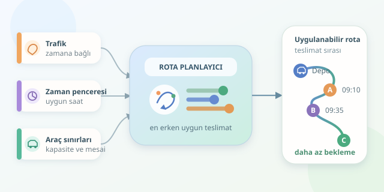

Bir kargo aracının depodan çıkması kolaydır; aynı aracın yoğun trafikte, müşterilerin uygun olduğu saatlerde ve mesai bitmeden bütün paketleri dağıtması ise küçük bir strateji oyunudur. Son kilometre teslimat optimizasyonu, bu oyunun kurallarını matematikle tanımlar. Amaç yalnızca kısa yol bulmak değil, uygulanabilir ve ekonomik bir teslimat planı oluşturmaktır.

``

## Problem aslında nedir?

Bu konu, **zaman pencereli araç rotalama problemi** olarak bilinen VRPTW ailesine girer. Depo başlangıç noktasıdır; müşteriler ziyaret edilecek düğümlerdir. Her teslimatın paket miktarı, hizmet süresi ve kabul edilebilir zaman aralığı vardır. Araçların kapasitesi ve sürücülerin çalışma süreleri de sınırlıdır.

Klasik en kısa yol problemi iki nokta arasındaki güzergâhı seçer. Burada ise hangi aracın hangi müşteriye, hangi sırayla ve ne zaman gideceği belirlenir. Üstelik trafik, yolculuk süresini hareket saatine bağlı hâle getirir. Kuş uçuşu yakınlık, teslimat dünyasında bazen oldukça yanıltıcıdır!

## Matematik direksiyona geçsin

Basitleştirilmiş bir maliyet fonksiyonu şöyle kurulabilir:

$$\min C = \alpha D + \beta T + \gamma N$$

Burada $D$ toplam kilometreyi, $T$ beklemeler dahil toplam çalışma süresini, $N$ kullanılan araç sayısını gösterir. Katsayılar sırasıyla kilometre, dakika ve araç başına parasal maliyetlerdir; böylece farklı birimler aynı hesapta karşılaştırılabilir.

Müşteri $j$ için hizmet başlangıcı ise önceki duraktan hesaplanır:

$$t_j = \max\left(a_j,\ t_i+s_i+\tau_{ij}(t_i+s_i)\right),\qquad t_j\le b_j$$

$a_j$ ve $b_j$ kabul aralığının sınırları, $s_i$ hizmet süresi, $\tau_{ij}$ ise hareket saatine bağlı yolculuk süresidir. Erken varış beklemeye dönüşür. Burada pencere, hizmetin **başlaması** içindir; bitiş de sınırlanacaksa ayrıca kontrol gerekir.

Sert zaman pencereleri ihlal edilemez. Esnek pencerelerde gecikmeye izin verilip maliyete ceza eklenebilir. Bu ayrım, algoritmanın ticari beklentileri doğru temsil etmesini sağlar.

## Trafik neden sıralamayı değiştirir?

Aynı yol sabah yirmi, öğleden sonra sekiz dakika sürebilir. Bu yüzden tek bir sabit mesafe matrisi yeterli değildir.

| Yaklaşım | Dikkate aldığı bilgi | Temel risk |
|---|---|---|
| En yakın müşteri | Mesafe | Zaman penceresini kaçırmak |
| Sabit süreli plan | Ortalama yolculuk | Yoğun saatte gecikmek |
| Zamana bağlı plan | Hareket saati ve trafik | Tahmin hatası |

Adresler önce koordinatlara çevrilir; ardından yönlü yolculuk matrisi hazırlanır. Tek yönlü sokaklar nedeniyle gidiş ve dönüş süreleri eşit olmayabilir. Park yeri arama ve apartmana çıkma süreleri de hizmet tahminlerine eklenmelidir. Paketin kapıya ulaşması, haritada noktanın yanına gelmekten farklıdır.

## Python ile küçük bir planlayıcı

Aşağıdaki örnek, tek araç için her adımda **en erken tamamlanan uygun teslimatı** seçer. Dakikalar gece yarısından itibaren ölçülür; 480, saat 08.00 demektir. Trafik fonksiyonu gerçek veri yerine örnek bir yoğunluk eğrisi kullanır.

```python
roads = {
    'depo': {'A': 12, 'B': 18, 'C': 25},
    'A': {'B': 8, 'C': 16},
    'B': {'A': 8, 'C': 9},
    'C': {'A': 16, 'B': 9},
}
windows = {'A': (490, 535), 'B': (510, 540), 'C': (540, 585)}

def travel(base, departure):
    delay = max(0, 20 - abs(departure - 510) / 3)
    return base + delay

def plan(now=480):
    node, remaining, route = 'depo', set(windows), []
    while remaining:
        choices = []
        for target in remaining:
            arrival = now + travel(roads[node][target], now)
            opening, closing = windows[target]
            start = max(arrival, opening)
            if start <= closing:
                choices.append((start + 5, start, target))
        if not choices:
            break
        now, start, node = min(choices)
        route.append((node, round(start, 1)))
        remaining.remove(node)
    return route, sorted(remaining)

print(plan())
```

Her teslimata beş dakika ayrılır. Algoritma beklemeyi hesaba katar, kapanış saatini kontrol eder ve hareket saatini günceller. Dönen ikinci liste, seçilen kısmi rotadan sonra atanamayan müşterileri gösterir; problemin bütünüyle çözümsüz olduğunu kanıtlamaz.

Bu bir açgözlü sezgiseldir: hızlıdır ama küresel optimum garantisi vermez. Ayrıca kapasiteyi, molaları ve depoya dönüşü henüz denetlemez. Daha kapsamlı uygulamalarda OR-Tools gibi çözücüler kullanılabilir; zamana bağlı sürelerin nasıl modelleneceği ayrıca tasarlanmalıdır.

## Sahaya çıkmadan önce

Planı geçmiş teslimat günlerinde sınayın. Zamanında teslimat oranını, kilometreyi, araç başına çalışma süresini ve atanamayan siparişleri mevcut yöntemle karşılaştırın. Trafik tahminlerini kesin gerçekler değil, belirsiz girdiler olarak değerlendirin; kritik teslimatlara ölçülü tampon süre koyun.

Yeni sipariş veya kaza geldiğinde yalnızca kalan rotayı yeniden planlayın. Tamamlanan durakları sabitleyin, sürücünün mevcut konumunu başlangıç alın. Böylece optimizasyon, kâğıt üzerindeki kusursuz çizgiden çıkıp şehrin değişken ritmine uyum sağlayan pratik bir yardımcıya dönüşür.



