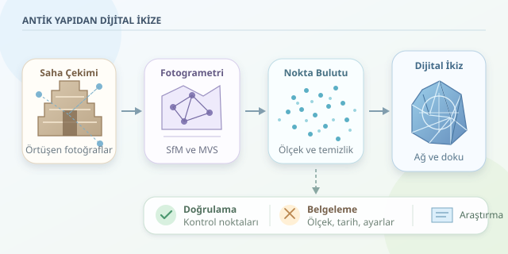

Bir antik tiyatronun basamaklarını, çatlamış sütunlarını ve aşınmış kabartmalarını bilgisayar ekranında dolaşabildiğinizi düşünün. Üstelik yalnızca güzel görünen bir sahne değil, ölçüm yapılabilen bir araştırma modeli! Binlerce fotoğrafı üç boyutlu geometriye dönüştürmek, dijital bir yapboza benzer: Ancak parçalar görüntüler, bağlantılar ise matematiksel ilişkilerdir.

``

## Fotoğraflar derinliği nasıl anlatır?

Tek fotoğraf, derinliği doğrudan vermez. Aynı taş köşesi farklı konumlardan görüntülendiğinde ise kameraların bakış doğrultuları karşılaştırılabilir. Kamera konumları biliniyorsa, bu doğrultulardan **üçgenleme** yoluyla noktanın uzaydaki konumu hesaplanır. Fotogrametri, kameraların konumlarını da görüntülerden tahmin ederek bu problemi birlikte çözer.

İdeal kamera modeli şöyle özetlenir:

$$s\mathbf{x}=K[R\mid t]\mathbf{X}$$

Burada $\mathbf{X}$ homojen dünya noktası, $\mathbf{x}$ homojen görüntü noktasıdır. $K$ kameranın iç parametrelerini, $R$ dönüşünü, $t$ ötelemesini temsil eder. $s$ ise izdüşümün ölçek katsayısıdır. Gerçek objektiflerde mercek bozulması da modellenmelidir; aksi durumda düz duvarlar dijital dünyada hafifçe eğilebilir.

## Önce çekim planı, sonra deklanşör

Başarılı modelleme sahada başlar. Yapıyı çevreleyen çekim rotaları, farklı yükseklikler ve kabartmaları gören eğik açılar planlanır. Başlangıç hedefi olarak yaklaşık yüzde 75–85 ileri, yüzde 60–75 yanal örtüşme kullanılabilir; bunlar değişmez kurallar değildir. Karmaşık yüzeylerde daha fazla örtüşme gerekir.

Sabit odak uzaklığı, düşük hareket bulanıklığı ve dengeli pozlama eşleştirmeyi kolaylaştırır. Sert gölgeler, parlak mermer ve tekrarlayan sütun desenleri algoritmayı şaşırtabilir. Bulutlu hava çoğu zaman iyi bir yardımcıdır. Drone çekimleri için uçuş izinleri, arkeolojik çalışma içinse ilgili kurumun onayı alınmalıdır.

| Yöntem | Güçlü tarafı | Temel sınırlaması |
|---|---|---|
| Fotogrametri | Ayrıntılı renk ve doku | Örtüşme ve yüzey dokusu ister |
| 3D lazer tarama | Doğrudan mesafe ölçümü | Maliyet ve görüş engelleri |
| Birleşik kullanım | Geometri ve görsel zenginlik | Dikkatli hizalama gerektirir |

## Binlerce kareden tek modele

İlk aşama, görüntülerde ayırt edici özellikleri bulup eşleştirmektir. **Structure from Motion**, yani SfM, bu eşleşmelerden kamera pozlarını ve seyrek nokta bulutunu hesaplar. Ardından demet dengelemesi, kamera parametreleriyle noktaları birlikte iyileştirerek yeniden izdüşüm hatasını azaltır.

**Multi-View Stereo**, yani MVS, bilinen kameralardan daha yoğun yüzey bilgisi üretir. COLMAP gibi araçlar bu işlem hattında kullanılabilir. Yoğun bulut temizlenir, üçgen ağ oluşturulur, ardından fotoğraflardan doku kaplanır. Doku kaplama sırasında UV koordinatları, üç boyutlu yüzeyin iki boyutlu görüntüyle ilişkisini tanımlar.

Fotoğraflardan çıkan modelin mutlak ölçeği başlangıçta belirsizdir. Ölçülmüş mesafeler veya koordinatları bilinen kontrol noktaları gerekir. Lazer taramalarıyla birleştirmede önce ölçek ve kaba hizalama çözülür; ICP gibi yöntemler sonrasında ince hizalamaya yardımcı olabilir.

## Python ile nokta bulutundan yüzeye

Aşağıdaki Open3D örneği, önceden **metre birimine ölçeklenmiş** yoğun bulutu sadeleştirir ve Poisson yöntemiyle ağ üretir. Bu kod fotoğrafları işlemez; işlem hattının yüzey oluşturma aşamasına odaklanır.

```python
import numpy as np
import open3d as o3d

bulut = o3d.io.read_point_cloud("yogun_bulut.ply")
if bulut.is_empty():
    raise ValueError("Nokta bulutu boş!")

bulut = bulut.voxel_down_sample(voxel_size=0.01)
bulut, _ = bulut.remove_statistical_outlier(
    nb_neighbors=24, std_ratio=2.0
)
bulut.estimate_normals(
    o3d.geometry.KDTreeSearchParamHybrid(
        radius=0.05, max_nn=40
    )
)
bulut.orient_normals_consistent_tangent_plane(30)

ag, yogunluk = o3d.geometry.TriangleMesh.create_from_point_cloud_poisson(
    bulut, depth=9
)
yogunluk = np.asarray(yogunluk)
ag.remove_vertices_by_mask(
    yogunluk < np.quantile(yogunluk, 0.02)
)
o3d.io.write_triangle_mesh("antik_yapi.ply", ag)
```

Bir santimetrelik voxel boyutu veri yükünü azaltır; küçük yazıtlar için fazla kaba olabilir. Normal vektörleri yerel yüzey yönlerini anlatır. Poisson, bunlardan sürekli yüzey çıkarır; ancak görünmeyen boşlukları kapatarak gerçekte olmayan parçalar üretebilir. Düşük destekli bölgeleri elemek faydalıdır, fakat arkeolojik doğruluk garantisi değildir.

## Güzel görünmek, doğru olmak değildir

Kaliteyi yalnızca ekranda değerlendirmeyin. Ölçeklendirmede kullanılmayan bağımsız kontrol noktalarıyla konum hatasını ölçün. Yeniden izdüşüm hatası piksel cinsindendir; tek başına santimetre doğruluğunu kanıtlamaz. Lazer verisi mevcutsa bulutlar arasındaki mesafeleri inceleyin ve hizalama hatasını ayrıca değerlendirin.

Eksik yüzeyleri, çekim tarihini, koordinat sistemini ve işleme ayarlarını kaydedin. Ham fotoğrafları koruyun; araştırma modelinden ayrı, sadeleştirilmiş bir web modeli hazırlayın. Hassas alanların ayrıntılı konumlarını yayımlamadan önce yetkili kurumlarla değerlendirin. Böylece dijital ikiz, etkileyici bir görsel olmaktan çıkar: Gelecekteki araştırmacıların sorgulayabileceği, karşılaştırabileceği ve güvenle yeniden kullanabileceği belgelenmiş bir bilimsel kaynağa dönüşür.



