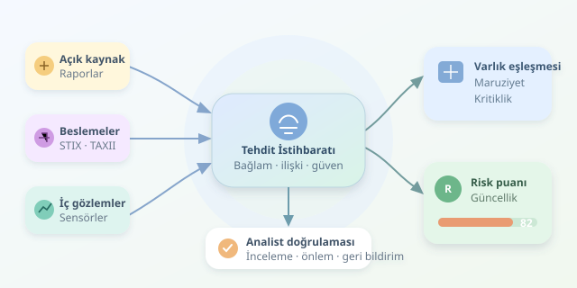

Dünyanın bir köşesinde keşfedilen zararlı alan adı, başka bir köşesindeki şirket için erken uyarı olabilir. Fakat milyonlarca saldırı kaydını toplamak, hangisinin sizin kapınızı çalacağını bilmek değildir. Tehdit istihbaratı platformları tam burada devreye girer: Küresel veriyi kurumun teknolojileri, varlıkları ve iş öncelikleriyle buluşturur. Amaç daha büyük bir gösterge paneli değil, daha isabetli güvenlik kararlarıdır.



``
## Önce teori: Veri ne zaman istihbarat olur?

Bir IP adresi tek başına yalnızca veridir. Adresin belirli bir saldırı kampanyasında kullanılması bilgi; kurumunuzun kayıtlarında görülmesi ve kritik sistemlerle ilişkilendirilmesi ise eyleme dönüştürülebilir istihbarattır. Kısacası istihbarat, **bağlamlandırılmış ve karar vermeyi destekleyen bilgidir**.

Bu süreç bir döngüdür: Gereksinimler belirlenir, veri toplanır, işlenir, analiz edilir, paylaşılır ve sonuçlardan geri bildirim alınır. “Finans uygulamalarımızı hedefleyen tehditler hangileri?” sorusu, “Bütün kötü IP adreslerini indirelim!” yaklaşımından çok daha verimlidir. Çünkü ikinci yaklaşım genellikle güvenlik ekibine dijital bir samanlık hediye eder.

## Küresel verinin mutfağı

Platformlar açık kaynak raporlarından, ticari beslemelerden, sektörel paylaşım topluluklarından ve kurumun kendi güvenlik sensörlerinden beslenir. Veriler aynı biçimde gelmediği için normalleştirme, tekrarları ayıklama ve kaynak bilgisini koruma gerekir.

| Veri türü | Sağladığı bağlam | Temel sınırlama |
|---|---|---|
| IP, alan adı, dosya özeti | Somut tespit göstergeleri | Hızla eskiyebilir |
| Zafiyet ve istismar bilgisi | Hangi sistemlerin hedeflenebileceği | Kurumdaki sürümle eşleşmelidir |
| Saldırgan davranışları | Teknikler ve saldırı örüntüleri | Analiz ve uygun telemetri gerektirir |
| Kurum içi gözlemler | Tehdidin yerel karşılığı | Görünürlük boşlukları bulunabilir |

STIX, tehdit bilgisini yapılandırmak için bir standarttır; TAXII ise bu bilgiyi servisler üzerinden paylaşmayı destekler. MISP gösterge ve olay paylaşımında, OpenCTI ilişkili tehdit bilgisini modellemede kullanılabilir. MITRE ATT&CK, saldırgan tekniklerini ortak bir dille tarif etmeye yardımcı olur; tek başına risk puanı üretmez.

## Kuruma özel risk nasıl çıkarılır?

Kritik adım, dış veriyi **varlık envanteriyle eşleştirmektir**. Kullanmadığınız bir ürünün açığı genellikle doğrudan öncelik değildir. Buna karşılık internete açık, müşteri verisi işleyen ve aktif biçimde istismar edilen bir sürümü çalıştıran sunucu acil inceleme gerektirebilir.

Eşleştirmede ürün sürümleri, ağ görünürlüğü, iş etkisi, mevcut güvenlik kontrolleri ve iç kayıtlardaki gözlemler birlikte değerlendirilir. Aynı göstergeyle karşılaşmak saldırının kesin kanıtı değildir: Paylaşımlı barındırma, yanlış pozitifler ve eski kayıtlar tabloyu değiştirebilir. Kaynak sayısı da tek başına doğruluk sağlamaz; beş besleme aynı hatalı raporu kopyalamış olabilir.

## Açıklanabilir bir öncelik modeli

Basitleştirilmiş bir model kuralım:

$$R = 100(0.35E + 0.25A + 0.25C + 0.15F)$$

Burada $E$ maruziyet, $A$ varlığın iş açısından kritikliği, $C$ kanıta duyulan güven ve $F$ güncelliktir. Bütün girdiler $0$ ile $1$ arasındadır. Güncellik için $F = 0.5^{d/30}$ kullanılabilir; $d$, son gözlemden geçen gün sayısıdır. Böylece güncellik katkısı otuz günde yarıya iner.

Bu puan saldırı olasılığı değildir; açıklanabilir bir sıralama aracıdır. Ağırlıklar ve eşikler geçmiş olaylarla sınanmalı, kurumun ihtiyaçlarına göre ayarlanmalıdır.

```python
from datetime import datetime, timezone
from ipaddress import ip_address


def oncelik(kayit, varlik, simdi):
    ip_address(kayit['ioc'])
    gun = max(0, (simdi - kayit['son_gozlem']).total_seconds() / 86400)
    guncellik = 0.5 ** (gun / 30)
    puan = 100 * (
        0.35 * varlik['maruziyet']
        + 0.25 * varlik['kritiklik']
        + 0.25 * kayit['guven']
        + 0.15 * guncellik
    )
    return round(puan, 1)

simdi = datetime.now(timezone.utc)
kayit = {
    'ioc': '198.51.100.42',
    'son_gozlem': simdi,
    'guven': 0.8,
}
varlik = {'maruziyet': 0.9, 'kritiklik': 1.0}
print(oncelik(kayit, varlik, simdi))
```

Kod, önceden kurum içi bir gözlemle eşleştirilmiş kaydı puanlar; tehdit keşfetmez. IP biçimini denetler, yaşa bağlı güncelliği hesaplar ve ağırlıklı sonucu üretir. Adres, dokümantasyon için ayrılmış örnek aralıktandır. Üretimde ayrıca girdi aralıkları, tarihlerin geçerliliği ve eksik alanlar doğrulanmalıdır.

## Puanı karara dönüştürmek

Yüksek puan otomatik engelleme emri olmamalıdır. Önce analist doğrulaması, ardından gerekirse SIEM sorgusu, uç nokta incelemesi veya yama önceliklendirmesi gelir. Paylaşım sırasında TLP işaretleri, lisans koşulları ve KVKK gibi yükümlülükler gözetilmelidir.

Başarıyı indirilen gösterge sayısıyla değil, yanlış pozitif oranı, inceleme süresi ve önlenen olaylarla ölçün. İyi bir platform dünyadaki bütün tehditleri ezberletmez; kurumunuz için önemli olanları, gerekçeleriyle birlikte masaya getirir.
