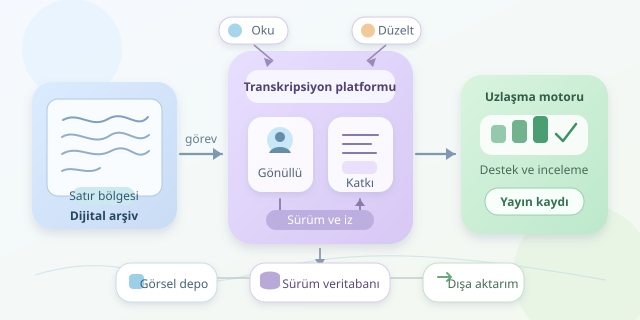

Yüzyıllık bir mektuptaki kıvrımlı harfleri çözmek, bazen dedektiflikten daha zordur. Crowdsourcing platformları bu bulmacayı binlerce gönüllüye dağıtır: biri satırı okur, diğeri düzeltir, üçüncüsü tartışmalı kelimeyi değerlendirir. Ancak başarılı bir sistem, yalnızca görselin yanına metin kutusu koymaz. Katkıları izler, belirsizliği korur ve insan emeğini güvenilir dijital kayıtlara dönüştürür. Gelin bu kolektif arşiv dedektifliğinin yazılım tarafını tasarlayalım.

``

## 1. Temel fikir: Belgeyi değil, işi bölmek

Crowdsourcing, büyük bir görevi bağımsız katkılara ayırarak dağıtılmış insan emeğinden yararlanır. Buradaki çalışma birimi genellikle belgenin tamamı değil, sayfa veya satır bölgesidir. Küçük görevler katılım eşiğini düşürür; aşırı küçük görevler ise bağlamı kaybettirir. Bir kelimenin doğru okunuşu bazen önceki cümlede saklıdır.

Bu nedenle görev ekranı hedef satırı vurgularken komşu satırları da göstermelidir. Gönüllü, okunamayan karakteri işaretleyebilmeli ve tahminini kesin bilgi gibi sunmaya zorlanmamalıdır. Diplomatik transkripsiyon özgün yazımı korurken, normalleştirilmiş metin aramayı kolaylaştırır. Bunları ayrı alanlarda tutmak, geçmişi modern imlaya yanlışlıkla boyamayı önler.

## 2. Mimari: Her parçanın kendi sorumluluğu

Başlangıçta modüler bir monolit yeterlidir. Kullanıcı, görev, transkripsiyon ve inceleme modülleri belirgin sınırlara sahip olduğunda, gerektiğinde ayrı servislere taşınabilir. İlk günden mikroservis kurmak, tek mektubu okumak için küçük bir uzay üssü işletmeye benzeyebilir.

| Bileşen | Sorumluluk | Uygun çözüm |
|---|---|---|
| Görsel deposu | Yüksek çözünürlüklü taramalar | S3 uyumlu nesne depolama |
| İşlemsel veritabanı | Görevler, katkılar, sürümler | PostgreSQL |
| Arka plan işçisi | Küçük görsel ve dışa aktarım üretimi | Görev kuyruğu |
| Web arayüzü | Yakınlaştırma, düzenleme, inceleme | Erişilebilir istemci uygulaması |




IIIF uyumlu görsel sunumu, büyük taramaların yalnızca gereken bölümlerini yüklemeyi kolaylaştırır. PostgreSQL ise görsel dosyalarını değil, dosya adreslerini ve ilgili kayıtları saklar.

## 3. Veri modeli ve görev yaşam döngüsü

Temel ilişkiler şöyle kurulabilir: koleksiyon belgeyi, belge sayfayı, sayfa koordinatlarla tanımlanmış bölgeleri içerir. Her transkripsiyon; bölge kimliği, katkıcı kimliği, metin, zaman ve sürüm numarası taşır. Onaylanan metin, katkı geçmişinden ayrı bir yayın kaydıdır.

Görevler bekliyor, düzenleniyor, incelemede ve yayımlandı durumlarından geçebilir. Düzenleme sırasında süreli rezervasyon kullanılır; tarayıcısını kapatan gönüllü görevi sonsuza kadar kilitlemez. Aynı bölgeye bağımsız okumalar atanacaksa rezervasyon bölgeye değil, ilgili görev atamasına uygulanır.

Eşzamanlı güncellemelerde iyimser kilitleme işe yarar: istemci mevcut sürümü gönderir, sunucu sürüm değişmişse üzerine yazmak yerine çatışma bildirir. Katkı kaydıyla kuyruk olayını aynı veritabanı işleminde yazan outbox deseni de kaybolan bildirimleri azaltır.

## 4. Uzlaşma: Çoğunluk her zaman haklı mı?

Aynı satırı bağımsız gönüllülere okutmak hataları yakalamaya yardımcı olur. Fakat herkes aynı yanıltıcı harfi yanlış okuyabilir. Dolayısıyla uzlaşma, doğruluğun kanıtı değil, inceleme önceliği belirleyen bir sinyaldir.

Bir aday metnin ağırlıklı desteğini şöyle hesaplayabiliriz:

$$S(t)=\frac{\sum_{u\in U}w_u I(t_u=t)}{\sum_{u\in U}w_u}$$

Burada $w_u$ katkıcının ağırlığı, $I$ ise eşleşmede bir, diğer durumda sıfırdır. Başlangıçta eşit ağırlıklar kullanılabilir; sonradan doğrulanmış örneklerle kalibrasyon yapılır.

| Yaklaşım | Avantaj | Risk |
|---|---|---|
| Tek katkıyı kabul etmek | Hızlı ilerleme | Görünmeyen hatalar |
| Bağımsız çoğunluk | Daha güçlü kontrol | Ortak yanılgılar |
| Uzman incelemesi | Bağlamsal değerlendirme | Darboğaz oluşması |

## 5. Python ile küçük bir uzlaşma çekirdeği

Aşağıdaki fonksiyon, aynı kullanıcının tekrar oy vermesini reddeder. Unicode normalizasyonu uygular; ancak tarihsel yazımı değiştirebilecek küçük harfe dönüştürme veya noktalama temizliği yapmaz.

```python
from collections import defaultdict
from unicodedata import normalize


def consensus(votes):
    scores = defaultdict(float)
    users = set()
    for user_id, text, weight in votes:
        if user_id in users:
            raise ValueError('Tekrarlanan katkıcı')
        if not 0 < weight <= 1:
            raise ValueError('Geçersiz ağırlık')
        users.add(user_id)
        scores[normalize('NFC', text)] += weight

    if not scores:
        return None, 0.0, False

    candidate = max(scores, key=scores.get)
    support = scores[candidate] / sum(scores.values())
    ready = len(users) >= 3 and support >= 0.85
    return candidate, support, ready
```

Fonksiyon aday metni, destek oranını ve incelemeye hazır olma durumunu döndürür. Üç bağımsız katkı ve yüzde 85 destek, örnek politika değerleridir; olasılıksal doğruluk garantisi değildir. Ağırlıklar istemciden değil, sunucudaki güvenilir kayıtlardan alınmalıdır.

## 6. Yayına giden son kilometre

Katkıcıları birbirinin cevabını görmeden çalıştırmak bağımsızlığı güçlendirir. Yetkilendirme, hız sınırlama ve denetim kayıtları kötüye kullanımı azaltır. Tekrarlanan kuyruk mesajları için idempotent işçiler gerekir.

Son olarak TEI-XML gibi bir formatla dışa aktarım sunun; belirsizlikleri, alternatif okumaları ve kaynak koordinatlarını koruyun. Başarıyı yalnızca tamamlanan satır sayısıyla değil, uzmanların bulduğu hata oranı ve gönüllülerin devamlılığıyla ölçün. Böylece arşiv yalnızca dijitalleşmez; güvenilir, izlenebilir ve yeniden kullanılabilir hale gelir.
