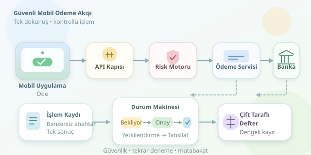

Telefonunuzda “Öde” düğmesine dokunuyorsunuz; birkaç saniye sonra yeşil bir onay beliriyor. Görünürde tek hareket, arka planda ise kimlik doğrulama, risk değerlendirmesi, banka iletişimi ve muhasebe kayıtlarından oluşan koordineli bir operasyon var. Üstelik internet bağlantınız tam o anda kesilebilir! Peki sistem, hem hızlı davranıp hem de paranızı yanlışlıkla iki kez göndermemeyi nasıl başarıyor?

``

## Önce kavramları ayıralım

Bir ödeme, yalnızca veritabanındaki bakiyeyi azaltmak değildir. Kartlı işlemlerde **yetkilendirme**, tutarın kullanılabilirliğinin onaylanmasıdır; **tahsilat** ve **mutabakat** ise farklı aşamalardır. Kullanıcının gördüğü başarı mesajı, bankalar arasındaki nihai hesaplaşmanın tamamlandığı anlamına gelmeyebilir.

Temel tasarım hedefi, dağıtık bileşenler arasında para hareketinin anlamını korumaktır. Bunun için ödeme durumu açıkça modellenir: `pending → authorized → captured`; başarısızlık, iptal ve iade ayrı geçişlerdir. Her işlem bütün aşamalardan geçmez; örneğin uygulama içi cüzdan transferi farklı bir akış kullanabilir.

| Kavram | Ne ifade eder? | Ne değildir? |
|---|---|---|
| Yetkilendirme | Ödeme için onay alınması | Nihai hesaplaşma |
| Tahsilat | Yetkilendirilen tutarın çekilmesi | İade |
| Mutabakat | İç kayıtlarla dış kayıtların karşılaştırılması | Kullanıcıya anlık bildirim |
| Idempotency | Tekrarlanan isteğin aynı sonucu üretmesi | İstekleri hiç tekrarlamamak |

## Bir isteğin saniyelik yolculuğu

1. **API katmanı**, erişim belirtecini doğrular; tutar, para birimi ve alıcı gibi alanları denetler. Kimliği doğrulanmış olmak, her hesaptan ödeme yapabilmek demek değildir: yetki kontrolü ayrıca gerekir.
2. **Ödeme servisi**, isteği benzersiz bir anahtarla kaydeder. Böylece yeniden denemeler aynı işlemle ilişkilendirilir.
3. **Risk motoru**, cihaz geçmişi, işlem sıklığı ve alışılmadık tutarlar gibi sinyalleri değerlendirir. Gerektiğinde ek doğrulama ister.
4. **Sağlayıcı adaptörü**, banka veya ödeme kuruluşuyla konuşur. Zaman aşımı, kesin başarısızlık sayılmaz; karşı taraf işlemi kabul etmiş olabilir.
5. **Durum makinesi**, yanıtı veya doğrulanmış webhook bildirimini işler. Mobil uygulama güncel durumu sorgulayabilir ya da bildirim alabilir.

Toplam gecikmeyi kabaca $L = L_{ağ} + L_{risk} + L_{sağlayıcı} + L_{kayıt}$ şeklinde düşünebiliriz. Bağımsız kontroller paralelleştirilebilir; ancak güvenlik kontrolleri sırf hız uğruna atlanamaz.

## Paranın hafızası: çift taraflı defter

Muhasebe defteri, yalnızca güncel bakiyeyi değil, bakiyeyi oluşturan hareketleri saklar. Çift taraflı kayıtta her hareketin karşılığı bulunur. Aynı para birimindeki dengeli bir muhasebe işlemi için:

$$\sum_{i=1}^{n} e_i = 0$$

Burada $e_i$, işaretli kayıt tutarıdır. Ücretler de ayrı hesaplarla dengelenir. Para, kayan noktalı sayılarla değil, kuruş gibi en küçük birimin tamsayı karşılığıyla veya uygun sabit hassasiyetli türlerle tutulmalıdır. Farklı para birimleri doğrudan toplanmaz; kur dönüşümü ayrıca modellenir.

## Çift tıklamaya dayanıklı işlem başlatma

Aşağıdaki Python örneği, PostgreSQL ve Psycopg kullanarak ödeme kaydıyla iş kuyruğu kaydını aynı yerel transaction içinde oluşturur. Örnek yalnızca TRY işlemlerini varsayar; tutar ve alıcı doğrulaması önceden yapılmıştır. `payments.id` otomatik üretilir ve `(user_id, idem_key)` üzerinde benzersiz kısıt bulunur.

```python
def baslat(conn, user_id, key, amount, target):
    with conn.transaction():
        row = conn.execute(
            "INSERT INTO payments "
            "(user_id, idem_key, amount_minor, target_id, status) "
            "VALUES (%s, %s, %s, %s, 'pending') "
            "ON CONFLICT (user_id, idem_key) DO NOTHING RETURNING id",
            (user_id, key, amount, target)
        ).fetchone()
        if row:
            conn.execute(
                "INSERT INTO outbox (payment_id, event_type) "
                "VALUES (%s, 'payment_requested')", (row[0],)
            )
            return row[0], "pending"
        old = conn.execute(
            "SELECT id, amount_minor, target_id, status FROM payments "
            "WHERE user_id = %s AND idem_key = %s", (user_id, key)
        ).fetchone()
        if old[1:3] != (amount, target):
            raise ValueError("Anahtar farklı bir istekle kullanılmış")
        return old[0], old[3]
```

**Outbox deseni**, kaydedilmiş ödemenin gönderim işinin kaybolmasını önler. Çalışan süreç olayı tekrar gönderebileceğinden tüketici ve sağlayıcı çağrısı da idempotent olmalıdır. Yerel transaction, bankayı kapsayan küresel bir transaction değildir.

## Güvenlik ve toparlanma

TLS, tokenizasyon, sır yönetimi ve hassas verilerin loglardan çıkarılması temel önlemlerdir. Webhook imzası doğrulanmalı, tekrar gönderimleri ayıklanmalıdır. Periyodik mutabakat, eksik bildirimleri ve tutarsız kayıtları yakalar.

Sonuç: hızlı ödeme, her şeyi tek seferde bitirmek değil; belirsizlikleri güvenle yönetmektir. Yeşil tikin arkasındaki gerçek kahramanlar, sağlam kayıtlar ve kontrollü yeniden denemelerdir.
