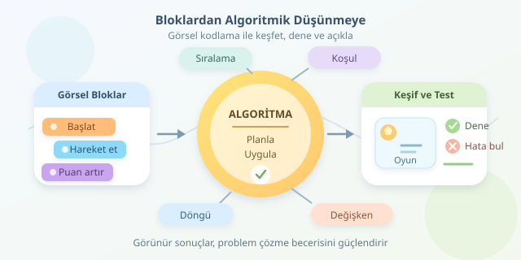

Bir kediyi dans ettirmek, uzay gemisini hareket ettirmek veya kendi oyununu tasarlamak… Çocuklar için programlamaya giriş, noktalı virgüllerle mücadele etmek zorunda değil. Scratch gibi blok tabanlı araçlar, komutları renkli yapboz parçalarına dönüştürerek dikkati yazım kurallarından problem çözmeye taşır. Ancak asıl kazanım, ekrandaki karakterin hareket etmesi değil, çocuğun bu hareketi nasıl planladığıdır.




``

## Blokların arkasındaki düşünme biçimi

Algoritma, bir hedefe ulaşmak için tanımlanan, sıralı ve yeterince açık adımlar bütünüdür. “Karakteri kazandır” bir hedef belirtir; fakat nasıl kazanacağını açıklamaz. “Yıldızı bul, üzerine tıkla, puanı artır; beş puanda oyunu bitir” ise uygulanabilir bir yol tarif eder.

Algoritmik düşünme; problemi küçük parçalara ayırmayı, tekrarları fark etmeyi, koşullara göre karar vermeyi ve çözümü sınamayı içerir. Scratch, bu soyut kavramlara görülebilen sonuçlar kazandırır. Yanlış sıraya yerleştirilen bir blok, karakterin beklenmedik davranışıyla hemen kendini belli eder.

| Kavram | Günlük yaşam karşılığı | Kodlama karşılığı |
|---|---|---|
| Sıralama | Önce çorabı, sonra ayakkabıyı giy | Komutları sırayla çalıştır |
| Koşul | Yağmur varsa şemsiye al | Eğer koşul doğruysa işlem yap |
| Döngü | Her basamakta aynı hareketi yap | İşlemi tekrar et |
| Değişken | Kumbaradaki para miktarı | Değişen değeri sakla |

Bu eşleştirmeler, çocuğun yeni kavramı bildiği bir deneyime bağlamasını sağlar. Bilgisayarın “niyetimizi” değil, verdiğimiz talimatları uyguladığını anlamak da önemli bir keşiftir.

## Görsel araçlar neyi kolaylaştırır?

Blokların şekilleri, hangi parçaların birleşebileceğini gösterir. Böylece birçok sözdizimi hatası daha oluşmadan engellenir. Çocuk, parantez aramak yerine “Bu koşul neden gerçekleşmedi?” sorusuna odaklanabilir.

Yine de görsellik, programın mutlaka doğru olduğu anlamına gelmez. Yanlış koşullar, sonsuz döngüler ve hatalı değişken güncellemeleri bloklarla da mümkündür. Bu nedenle araç, düşünmenin yerine geçmez; düşünmeyi görünür hale getirir.

| Araç | Öne çıkan yaklaşım | Uygun başlangıç |
|---|---|---|
| ScratchJr | Daha sade, simge ağırlıklı bloklar | Kısa hareketli hikâyeler |
| Scratch | Olaylar, değişkenler ve etkileşim | Oyunlar ve animasyonlar |
| MakeCode | Bloklarla cihaz veya simülasyon kontrolü | Donanım odaklı etkinlikler |

Seçim yaparken yalnızca yaşa değil; okuma becerisine, ilgi alanına ve kullanılacak cihazlara da bakmak gerekir.

## Mini proje: Beş yıldızı yakala!

Scratch’te bir yıldız kuklası ve `puan` değişkeni oluşturalım. Oyuncu yıldızın üzerine tıkladıkça puan kazansın; yıldız başka bir konuma taşınsın. Beş puana ulaşınca oyun sona ersin.

Aşağıdaki örnek, Scratch bloklarının akışını anlatan sözde koddur; metin olarak doğrudan çalıştırılmaz. Yıldız kuklasının betiği şöyle kurulabilir:

```text
Yeşil bayrak tıklandığında:
    puanı 0 yap
    puan = 5 olana kadar tekrarla:
        x: rastgele(-200, 200)
        y: rastgele(-140, 140) konumuna git
        fare basılı VE fare imlecine değiyor olana kadar bekle
        puanı 1 artır
        fare basılı değil olana kadar bekle
    "Tebrikler, kazandın!" de
```

Burada başlangıç olayı, değişken, döngü ve birleşik koşul aynı projede buluşur. Fare düğmesinin bırakılmasını beklemek özellikle önemlidir: Tek bir uzun basışın birden fazla tıklama gibi değerlendirilmesini önler.

Puan güncellemesini matematikle de ifade edebiliriz:

$$P_{yeni}=P_{eski}+1$$

Başlangıçta $P=0$ olduğunda, beş başarılı yakalamadan sonra $P=5$ olur. Böylece çocuk, değişkenin yalnızca bir kutu olmadığını; programın ilerleyişini temsil eden bir durum bilgisi olduğunu görür.

## Öğretirken cevaptan çok soruya odaklanın

Önce çocuktan akışı kâğıda çizmesini isteyin. Ardından “Hangi adımlar tekrar ediyor?”, “Oyunu bitiren koşul hangisi?” ve “Puanı sıfırlamazsak ne olur?” sorularıyla tasarımını açıklamasına yardımcı olun. Blokları yetişkinin yerleştirmesi yerine, çocuğun karar vermesine alan açın.

Test aşamasında yalnızca başarılı tıklamaları denemeyin. Boş alana tıklamak, fareyi basılı tutmak ve oyunu yeniden başlatmak da değerlidir. Hata bulmak başarısızlık değil, algoritmanın eksik varsayımlarını keşfetmektir. Küçük değişiklikler yapıp sonucu gözlemlemek, rastgele blok değiştirmekten daha öğreticidir.

## Metin tabanlı kodlamaya köprü

Bloklarla öğrenilen koşullar, döngüler ve değişkenler Python veya JavaScript’te de bulunur; değişen şey çoğunlukla ifade biçimidir. Bununla birlikte, aktarım kendiliğinden gerçekleşmeyebilir. Aynı algoritmanın iki ortamda karşılaştırılması, kavramların yeni sözdizimiyle ilişkilendirilmesini kolaylaştırır.

Son hedef, mümkün olduğunca erken metin yazdırmak değildir. Çocuğun çözümünü açıklayabilmesi, hatasını araştırabilmesi ve farklı bir probleme uyarlayabilmesidir. Dans eden kedi eğlenceli başlangıçtır; asıl başarı, onun neden dans ettiğini anlatabilen küçük programcıdır.
