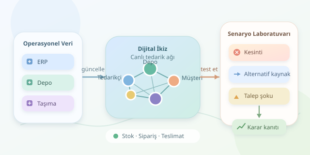

Bir liman kapandığında, kritik tedarikçiniz üretimi durdurduğunda veya talep bir gecede yükseldiğinde ne yaparsınız? Gerçek tedarik zincirinde deneme yapmak pahalıdır; üstelik müşteriler deney faresi olmayı pek sevmez. Dijital ikiz, bu krizleri sanal ortamda prova etmenizi sağlar. Amaç geleceği kusursuz tahmin etmek değil, hangi kararların hangi koşullarda işe yaradığını anlamaktır.




``

## Dijital ikiz, süslü bir şema değildir

Tedarik ağını bir yönlü çizge olarak düşünebiliriz: düğümler tedarikçileri, depoları ve müşterileri; kenarlar malzeme akışlarını temsil eder. Her bağlantının kapasitesi, taşıma süresi ve maliyeti vardır. Stoklar, siparişler ve teslimatlar ise zamanla değişen durum değişkenleridir.

Klasik simülasyon belirli varsayımlarla çalışır. Dijital ikiz, gerçek sistemden gelen verilerle güncellenerek bu varsayımları mevcut operasyonla ilişkilendirir. Yani yalnızca harita değil, hareket eden bir haritadır.

| Yaklaşım | Veri ilişkisi | Temel kullanım |
|---|---|---|
| Statik ağ modeli | Sabit varsayımlar | Yapıyı anlamak |
| Simülasyon | Senaryoya özel girdiler | Olasılıkları denemek |
| Dijital ikiz | Düzenli operasyonel güncelleme | Güncel durumdan karar üretmek |

Depodaki akışın temel denklemi şöyledir:

$$I_{t+1}=I_t+A_t-X_t$$

Burada $I_t$ stok, $A_t$ gelen ürün, $X_t$ karşılanan taleptir. Bekleyen siparişleri $B_t$, yeni talebi $D_t$ ile gösterirsek, teslimat miktarı $X_t=\min(I_t+A_t,B_t+D_t)$ olur. Böylece ürün yokken hayali teslimat yapmayız!

## Önce veriyi, sonra felaketi hazırlayın

ERP sisteminden stokları ve açık siparişleri; depo sisteminden kabul hareketlerini; taşıma sisteminden teslimat sürelerini alın. Ürün kodlarını, zaman damgalarını ve ölçü birimlerini eşleştirin. Koli ile adedi karıştıran bir ikiz, gerçeğin değil yanlış hesabın kopyasıdır.

Sonrasında normal koşullardaki çıktıları geçmiş operasyonlarla karşılaştırın. Model gerçek teslimat performansını açıklayamıyorsa, kriz tahminlerine güvenmek için henüz erkendir.

## Python ile küçük bir kriz laboratuvarı

Aşağıdaki örnekte iki tedarikçi, bir depo ve müşteri talebi bulunuyor. Günlük adımlarla çalışan model, on günlük kesintiyi ve alternatif tedarikçi kapasitesini karşılaştırıyor.

```python
from collections import defaultdict
from random import Random


def simulate(crisis=False, backup=25):
    rng = Random(42)
    arrivals = defaultdict(int)
    stock, backlog = 240, 0
    total_demand, total_served = 0, 0

    for day in range(30):
        stock += arrivals.pop(day, 0)
        demand = max(0, round(rng.gauss(80, 5)))
        served = min(stock, backlog + demand)
        stock -= served
        backlog += demand - served
        total_demand += demand
        total_served += served

        capacity_a = 0 if crisis and 8 <= day < 18 else 70
        # Stok ve yoldaki ürünleri hedefe tamamla.
        needed = max(
            0, 240 + backlog - stock - sum(arrivals.values())
        )
        for capacity, lead_time in [(capacity_a, 2), (backup, 5)]:
            order = min(needed, capacity)
            arrivals[day + lead_time] += order
            needed -= order

    return {
        "fill_rate": round(total_served / total_demand, 3),
        "ending_backlog": backlog,
    }


print("Normal:", simulate())
print("Kesinti:", simulate(crisis=True))
print("Alternatif:", simulate(crisis=True, backup=60))
```

`arrivals`, gelecekte ulaşacak sevkiyatları tutar; siparişler anında ışınlanmaz. `backlog`, karşılanamayan talebi sonraki güne taşır. Aynı rastgele tohum, üç çalıştırmada aynı talep dizisini üretir: böylece farkları talep şansından değil, senaryodan kaynaklanan etkiler üzerinden karşılaştırabiliriz. Alternatif kapasite, bu örnekte bütün dönem boyunca kullanılabilir.

## Hangi senaryoları karşılaştırmalı?

| Senaryo | Değişiklik | İncelenecek sonuç |
|---|---|---|
| Normal operasyon | Kesinti yok | Referans performans |
| Tedarikçi kesintisi | Ana kapasite on gün sıfır | Biriken siparişler |
| Alternatif kaynak | İkinci kapasite 25 yerine 60 | Hizmet düzeyindeki iyileşme |
| Talep şoku | Ortalama talebi artırma | Stok tamponunun dayanıklılığı |

Kod ilk üç senaryoyu çalıştırır; talep şoku için talep parametresini değiştirebilirsiniz. Buradaki `fill_rate`, dönem içindeki toplam teslimatın toplam talebe oranıdır; zamanında teslimat oranı değildir. Ayrıca maliyet hesaplanmadığından, yüksek kapasitenin ekonomik olarak en iyi seçenek olduğu söylenemez.

## Güvenilir karar için sınırlarınızı bilin

Tek koşu yerine çok sayıda tohumla deney yapın; her tohumda politikaları aynı talep dizisiyle karşılaştırın. Ortalama sonuçla birlikte kötü durum yüzdeliklerini de raporlayın. Taşıma gecikmeleri, ortak tedarikçi bağımlılıkları ve kapasite sözleşmeleri sonuçları değiştirebilir.

Bu kod, veri bağlantısı olmayan basitleştirilmiş bir senaryo simülatörüdür. Gerçek dijital ikize dönüşmesi için operasyonel verilerle beslenmesi, doğrulanması ve güncel tutulması gerekir. İyi bir ikiz kahin değildir: kriz toplantısına sezgilerin yanında ölçülebilir kanıt getirir.
