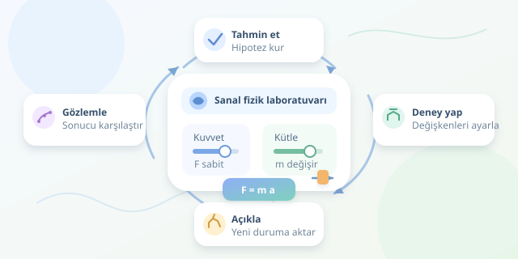

Bir molekülün içinde yürümek, elektrik alanını görünür çizgilerle incelemek veya bir kuvvetin cismi nasıl hızlandırdığını bizzat denemek… Sanal gerçeklik, ders kitabındaki soyut kavramları etkileşimli deneylere dönüştürebilir. Ancak etkili eğitim, öğrenciye yalnızca gözlük taktırmak değildir; doğru soruları, anlaşılır modelleri ve anlamlı geri bildirimleri aynı ortamda buluşturmaktır. Kısacası hedef, gösterişli bir dijital lunapark değil, düşünmeyi destekleyen bir laboratuvardır.
``
## Deneyim neden öğrenmeyi destekler?

Sanal gerçekliğin temel avantajı, öğrencinin bir sistemi farklı açılardan gözlemleyebilmesi ve değişkenlerine müdahale edebilmesidir. Uzamsal ilişkiler, özellikle anatomi, mekanik ve geometrik dönüşümler gibi konularda önemlidir. Öğrenci yalnızca açıklamayı okumaz; nesneyi döndürür, parçaları karşılaştırır ve yaptığı değişikliğin sonucunu görür.

Bu yaklaşım, deneyimsel öğrenmenin döngüsüyle uyumludur: deneyim yaşa, gözlemini değerlendir, bir açıklama oluştur ve açıklamanı yeni deneyle sınayarak geliştir. Örneğin öğrenci önce ağır cismin daha yavaş hızlanacağını tahmin eder, ardından aynı kuvveti farklı kütlelere uygular. Öğretmenin görevi, deneyimin hangi kavramı gösterdiğini görünür kılmaktır.

Yine de sürükleyicilik, otomatik olarak öğrenme anlamına gelmez. Gereksiz animasyonlar, karmaşık menüler ve sürekli bildirimler bilişsel yükü artırabilir. Tasarımda temel soru şudur: Bu unsur kavramı açıklıyor mu, yoksa yalnızca dikkat mi çekiyor?

## Bir fizik kavramını yaşanabilir hâle getirmek

Newton’un ikinci yasasını ele alalım:

$$F = ma, \qquad a = F / m$$

Burada $F$ net kuvveti, $m$ kütleyi, $a$ ise ivmeyi ifade eder. Sanal laboratuvarda öğrenci kuvveti sabit tutup kütleyi artırdığında ivmenin azaldığını gözlemleyebilir. Böylece formül, rastgele harflerden oluşan bir şifre olmaktan çıkar.

Deneyi önce sadeleştirmek yararlıdır: yerçekimi, sürtünme ve çarpışmalar devre dışı bırakılır. Sabit kuvvet altında hız değişimi de şu ilişkiyle tahmin edilir:

$$\Delta v = F\Delta t / m$$

Bu sadeleştirmelerin öğrenciye açıkça belirtilmesi gerekir. Aksi hâlde simülasyonun kuralları, gerçek dünyanın eksiksiz kuralları sanılabilir. Temel ilişki anlaşıldıktan sonra sürtünme eklenerek modelin kapsamı genişletilebilir.

## Hangi araç, hangi öğrenme amacı?

| Yaklaşım | Güçlü tarafı | Dikkat edilmesi gereken |
|---|---|---|
| Kitap ve çizim | Hızlı, erişilebilir kavramsal anlatım | Uzamsal ilişkiler zor canlandırılabilir |
| Masaüstü 3B simülasyon | Değişkenleri kontrollü değiştirme | Etkileşim fare ve ekranla sınırlıdır |
| Sanal gerçeklik | Çevreyi ölçekli ve bedensel keşfetme | Donanım, erişilebilirlik ve konfor önemlidir |

Bu seçenekler rakip olmak zorunda değildir. Kısa bir açıklama, masaüstü alıştırma ve VR deneyi aynı öğrenme akışında birbirini tamamlayabilir. Özellikle üç boyutlu inceleme gerekmiyorsa, daha basit bir araç daha iyi seçim olabilir.

## Unity ile kontrollü bir deney kurmak

Aşağıdaki Unity 6 örneği, bir cisme sürekli yatay kuvvet uygular. Öğrenci arayüzdeki kaydırıcılarla kuvveti ve kütleyi değiştirir; sıfırlama düğmesi deneyi başlangıç durumuna döndürür.

```csharp
using UnityEngine;

[RequireComponent(typeof(Rigidbody))]
public class ForceExperiment : MonoBehaviour
{
    private Rigidbody body;
    private Vector3 origin;
    private float forceN;

    void Awake()
    {
        body = GetComponent<Rigidbody>();
        origin = body.position;
        body.useGravity = false;
        body.linearDamping = 0f;
    }

    public void SetForce(float value) =>
        forceN = Mathf.Clamp(value, 0f, 20f);

    public void SetMass(float value) =>
        body.mass = Mathf.Clamp(value, 0.2f, 10f);

    void FixedUpdate() =>
        body.AddForce(Vector3.right * forceN, ForceMode.Force);

    public void ResetTrial()
    {
        forceN = 0f;
        body.position = origin;
        body.linearVelocity = Vector3.zero;
        body.angularVelocity = Vector3.zero;
    }
}
```

`FixedUpdate`, kuvvet uygulamasını fizik güncellemeleriyle eşleştirir. `ForceMode.Force`, kütleyi hesaba katar; sınırlandırılmış değerler ise kontrolsüz denemeleri azaltır. XR Interaction Toolkit ile hazırlanmış etkileşimli arayüz, bu metotlara bağlanabilir. Çarpışmasız bir deney alanı kullanın; ölçümleri aynı süre boyunca alarak karşılaştırın.

## Başarıyı gözlüğün içinde değil, öğrenmede ölçün

Öğrenciden deney öncesinde tahmin, sonrasında gerekçe isteyin. Ardından farklı kütle ve kuvvet değerleriyle yeni bir problem verin. Başarı ölçütü, nesneyi hareket ettirmek değil; ilişkiyi açıklamak ve yeni duruma aktarabilmektir. Deneyden hemen sonraki başarıyı, daha sonraki bir hatırlama göreviyle tamamlamak da yararlıdır.

Konfor için kısa oturumlar, mola seçenekleri ve ani kamera hareketlerinden kaçınma önemlidir. VR kullanamayan öğrenciler için masaüstü alternatif sunun. Hareket ve performans kayıtlarında yalnızca gerekli verileri toplayın.

En iyi sürükleyici eğitim ortamı, öğrenciyi etkileyen değil, ona açıklama kurduran ortamdır. Gözlük çıkarıldığında geriye yalnızca “çok havalıydı” değil, “neden böyle olduğunu artık biliyorum” kalmalıdır.
