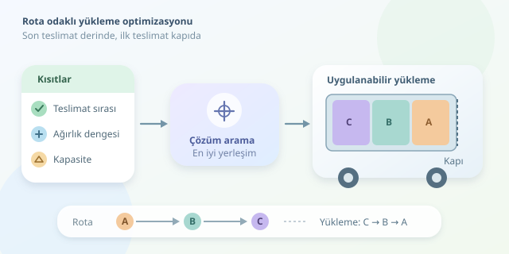

Bir kamyonu doldurmak, boşluklara kutu yerleştirmekten ibaret değildir. İlk müşterinin paleti en dipte kalırsa, teslimat sırasında bütün yükü dışarı çıkarmak gerekebilir. İşte kombinatorik optimizasyon, bu lojistik Tetris oyununda devreye girer: Teslimat rotasını, yüklerin erişilebilirliğini ve ağırlık dağılımını birlikte değerlendirerek daha uygulanabilir bir yükleme planı üretir.

``

## Temel fikir: Son teslimatı önce yükle

Kamyonun yalnızca arka kapısından boşaltıldığını, paletlerin tek sıra halinde durduğunu ve üst üste konmadığını düşünelim. Rota $A \rightarrow B \rightarrow C$ ise doğal yükleme sırası $C \rightarrow B \rightarrow A$ olur. Böylece ilk müşterinin paleti kapıya en yakın konumda bulunur.

Bu düzen, yazılımdaki **LIFO**, yani son giren ilk çıkar mantığına benzer. Ancak yan kapılar, farklı boyutlar, kırılgan ürünler ve aks yükleri devreye girdiğinde ters sıralama tek başına yeterli değildir. Artık yalnızca liste çevirmiyoruz; kısıtlar altında çözüm arıyoruz.

## Problemi matematiksel olarak kurmak

Her palet için teslimat sırasını $d_i$, ağırlığı $w_i$, yerleşim konumunu $p_i$ ile gösterelim. Eş boyutlu paletlerde konumlar $0,\ldots,n-1$ olsun; sıfır kamyonun en derin noktasını, son konum arka kapıyı temsil etsin.

Erişilebilirlik kuralımız:

$$d_i>d_j \Rightarrow p_i<p_j$$

Yani daha geç teslim edilecek palet daha içeride bulunmalıdır. Ayrıca her palet farklı bir konuma atanır ve toplam ağırlık kapasiteyi aşmaz:

$$\operatorname{AllDifferent}(p_1,\ldots,p_n),\qquad \sum_i w_i\leq Q$$

Aynı müşteriye giden paletler arasında ise serbestlik vardır. Optimizasyon bu serbestliği kullanarak ağırlık dağılımını iyileştirebilir. Basitleştirilmiş hedefimiz, yükün ağırlık merkezini kasanın geometrik merkezine yaklaştırmaktır:

$$\min\left\vert \sum_i w_i(2p_i+1)-n\sum_i w_i\right\vert $$

Buradaki $2p_i+1$, palet merkezinin ikiyle ölçeklenmiş koordinatıdır. Böylece kesirli konumlar yerine tamsayılarla çalışabiliriz. Gerçek araçta ideal merkez, aks konumları ve izin verilen aks yüklerine göre belirlenmelidir.

| Yaklaşım | Avantaj | Sınırlama |
|---|---|---|
| Rotayı ters sıralama | Hızlı ve anlaşılır | Fiziksel kısıtları tek başına çözmez |
| Kısıt programlama | Erişim ve dengeyi birlikte modeller | Modelleme ve çözüm süresi gerektirir |
| Rota ve yüklemeyi birlikte çözme | Daha geniş iyileştirme alanı sunar | Arama uzayı büyür |




## Python ile küçük bir optimizasyon modeli

Aşağıdaki örnek, OR-Tools CP-SAT kullanır. Kurulum için `pip install ortools` yeterlidir. Beş eş boy paletimiz vardır; teslimat numarası büyüdükçe müşteri rotada daha sonra ziyaret edilir. Toplam ağırlığın araç kapasitesine uygun olduğu önceden kontrol edilmiş kabul edilir.

```python
from ortools.sat.python import cp_model

# Kimlik, teslimat sırası, ağırlık (kg)
pallets = [('C1', 3, 120), ('C2', 3, 80),
           ('B1', 2, 100), ('A1', 1, 110), ('A2', 1, 90)]
n = len(pallets)
W = sum(item[2] for item in pallets)
model = cp_model.CpModel()
p = [model.new_int_var(0, n - 1, f'p{i}') for i in range(n)]
model.add_all_different(p)

for i in range(n):
    for j in range(n):
        if pallets[i][1] > pallets[j][1]:
            model.add(p[i] < p[j])

moment = sum(pallets[i][2] * (2 * p[i] + 1) for i in range(n))
error = model.new_int_var(0, W * (2 * n - 1), 'sapma')
model.add_abs_equality(error, moment - n * W)
model.minimize(error)

solver = cp_model.CpSolver()
solver.parameters.max_time_in_seconds = 5
status = solver.solve(model)
if status in (cp_model.OPTIMAL, cp_model.FEASIBLE):
    order = sorted(range(n), key=lambda i: solver.value(p[i]))
    print('Yükleme:', [pallets[i][0] for i in order])
    print('Durum:', solver.status_name(status))
```

Kod, önce paletlere benzersiz konumlar atar. Ardından teslimat önceliklerini zorunlu kılar ve merkez sapmasını küçültür. Çıktı, derinden kapıya doğru yerleşimi gösterir; bu basitleştirilmiş düzende aynı sıra yükleme sırasıdır. `FEASIBLE`, uygulanabilir çözüm bulunduğunu; `OPTIMAL`, en iyi çözümün kanıtlandığını belirtir. Süre sınırı, optimum garantisi değildir.

## Gerçek depoya geçerken

Modelimiz erişilebilirliği kesin kısıt olarak ele aldığı için yeniden elleçlemeye izin vermez. Gerçekte bazı durumlarda bir paleti geçici olarak indirmek kabul edilebilir; bunun işçilik ve gecikme maliyeti amaç fonksiyonuna eklenebilir.

Üretim ortamında ayrıca şu ayrıntılar gerekir:

- **Geometri:** Palet boyutları, yönleri ve kapı açıklığı kontrol edilmelidir.
- **Güvenlik:** Aks yükleri, yük sabitleme ve istif dayanımı zorunlu kısıtlardır.
- **Operasyon:** Forklift erişimi ve depo hazırlama sırası hesaba katılmalıdır.

Sonuç olarak sabit rota ve basit erişim koşullarında ters sıralama iyi bir başlangıçtır. Kombinatorik optimizasyonun asıl değeri, birden fazla uygulanabilir yerleşim arasından operasyonel açıdan daha iyi olanı seçmesidir. Hedef yalnızca kamyonu doldurmak değil, her durakta doğru yükü güvenle ve zahmetsizce indirebilmektir.
