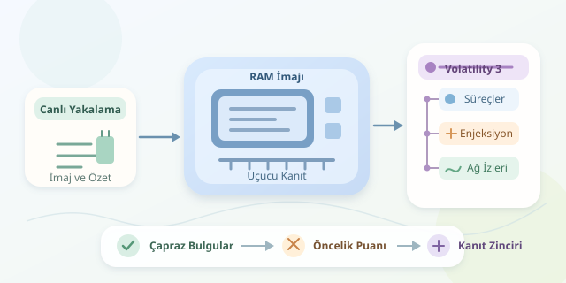

Bir bilgisayarın diski arşiv dolabıysa, RAM’i masanın üzerinde açık duran dosyalardır. Çalışan süreçler, bağlantılar ve henüz diske yazılmamış veriler burada bulunabilir. Bellek adli analizi, bu geçici sahnenin fotoğrafını çekerek görünürde normal çalışan bir sistemin arkasındaki şüpheli faaliyetleri araştırır. Haydi dijital dedektif şapkamızı takalım; fakat büyüteç yerine bellek imajı kullanacağız!

``

## RAM neden güçlü bir delil kaynağıdır?

İşletim sistemi, süreçlerin kodunu ve verilerini sanal adres alanlarında tutar. Sayfa tabloları, bu sanal adreslerin fiziksel bellekteki karşılıklarını belirler. Analiz araçları yalnızca okunabilir metin aramaz; işletim sisteminin veri yapılarını yorumlayarak süreçleri, bellek bölgelerini ve diğer nesneleri yeniden oluşturur.

Bu ayrım önemlidir: Diskte bulunmayan bir zararlı bile çalışan kodunu bellekte tutmak zorundadır. Ancak bellek imajı her şeyi kapsamayabilir. Diske taşınmış sayfalar, eksik yakalama veya korumalı bölgeler görünürlüğü azaltabilir.

Bazı rootkit’ler süreç kayıtlarını işletim sisteminin normal listelerinden çıkarır. Bu yaklaşım, **DKOM**, yani çekirdek nesnelerinin doğrudan değiştirilmesi olarak bilinir. Dolayısıyla tek bir süreç listesine güvenmek, saklambaç oyununda yalnızca kapının arkasına bakmaya benzer.

## Önce fotoğrafı çek, sonra incele

İlk hedef, yetkili olduğunuz sistemden güvenilir bir bellek imajı almaktır. Windows ortamında WinPmem, Linux tarafında uygun çekirdek desteğiyle LiME kullanılabilir. Araç seçimi; işletim sistemi sürümüne, güvenlik özelliklerine ve kurumun prosedürlerine bağlıdır.

Mümkünse sistemi kapatmadan yakalama yapın; kapanış uçucu verileri kaybettirir. Bununla birlikte, yakalama aracı da RAM’i değiştirir. Bu nedenle kullanılan araç, sürüm, zaman ve yapılan işlemler kaydedilmelidir. Bellek toplama, tamamen iz bırakmayan bir işlem değildir.

İmajın SHA-256 özetini alın, özgün dosyayı koruyun ve çalışma kopyasını inceleyin. Hash, dosyanın sonradan değişip değişmediğini denetler; yakalamanın eksiksiz olduğunu kanıtlamaz. RAM parola ve kişisel veri içerebildiğinden erişimi sınırlandırın.

## Volatility 3 ile ilk tarama

Volatility 3, bellek imajından işletim sistemi yapılarını çıkaran bir analiz çatısıdır. Aşağıdaki Bash betiği, araç deposundaki `vol.py` dosyasının bulunduğu dizinde çalıştırılır. İlk argüman çalışma kopyasının yoludur; raporlar ayrı dosyalara yazılır.

```bash
#!/usr/bin/env bash
set -euo pipefail
image="${1:?Kullanım: bash incele.sh bellek.raw}"
out="rapor-$(date +%Y%m%d-%H%M%S)"
mkdir -p "$out"
sha256sum "$image" > "$out/imaj.sha256"
plugins=(windows.info windows.pslist windows.psscan
         windows.pstree windows.cmdline windows.netscan)
for plugin in "${plugins[@]}"; do
  python3 vol.py -f "$image" "$plugin" \
    > "$out/${plugin}.txt"
done
```

`windows.info`, imajın yorumlanmasına ilişkin temel bilgileri verir. `pslist` normal süreç listesini, `psscan` ise bellekteki süreç nesnelerini tarar. `pstree` ebeveyn ilişkilerini, `cmdline` komut satırlarını, `netscan` ağ nesnelerini gösterir. Betik hata durumunda durur; başarısız eklentinin çıktısını tamamlanmış rapor sanmayın.

Eklenti desteği, semboller ve imaj uyumluluğu sonucu etkiler. Kullanılabilir seçenekleri `python3 vol.py -h` ile kontrol edin. Boş çıktı her zaman “tehdit yok” anlamına gelmez.

## Gizlenmeyi çapraz bulgularla yakalamak

Asıl güç, farklı kaynakları karşılaştırmaktır. Tek bir anormallik alarm zili olabilir; mahkeme kararı değildir.

| İnceleme | Şüpheli bulgu | Masum açıklama |
|---|---|---|
| `pslist` / `psscan` | Yalnızca taramada görünen süreç | Sonlanmış süreç kalıntısı |
| Süreç ağacı | Beklenmeyen ebeveyn ilişkisi | Başlatıcı veya hizmet davranışı |
| Bellek izinleri | Yazılabilir ve yürütülebilir bölge | JIT derleyicisi |
| Ağ bağlantıları | Alışılmadık uzak adres | Güncelleme veya bulut hizmeti |




Kod enjeksiyonunda saldırgan, başka bir sürecin adres alanına kod yerleştirebilir. Malfind türü eklentiler şüpheli yürütülebilir bölgeleri işaretlemeye yardımcı olur; kesin zararlı sınıflandırması yapmaz. Ayrıca her enjeksiyon yazılabilir-yürütülebilir sayfa bırakmaz.

Örneğin bir tarayıcıdaki yürütülebilir özel bellek bölgesi tek başına şaşırtıcı değildir. Aynı bölgede şüpheli kod, beklenmedik komut satırı ve açıklanamayan bağlantı birlikte görülüyorsa inceleme önceliği yükselir.

## Bulgudan sonuca: Kanıt zincirini kurmak

Örnek bir önceliklendirme puanı şöyle tanımlanabilir:

$$S = 2H + 2I + N + P$$

Burada $H$ süreç listesi tutarsızlığını, $I$ enjeksiyon belirtisini, $N$ şüpheli ağ etkinliğini, $P$ beklenmedik ebeveyn ilişkisini temsil eden ikili göstergelerdir. Ağırlıklar tamamen örnektir; bu puan bir olasılık hesabı veya doğrulanmış tespit modeli değildir.

Yüksek puanlı süreçlerde ilgili bellek bölgelerini dışa aktarın; dizgiler, kod yapısı ve bilinen göstergeler üzerinden inceleyin. Ardından bulguları disk dosyaları, olay günlükleri ve ağ kayıtlarıyla ilişkilendirin.

Raporda PID’leri, zamanları, kullanılan komutları, dosya özetlerini ve alternatif açıklamaları belirtin. Bellek adli analizinin başarısı, “gizli zararlıyı buldum!” demekten çok, başka bir analistin aynı kanıtlarla aynı sonuca ulaşabilmesidir.
