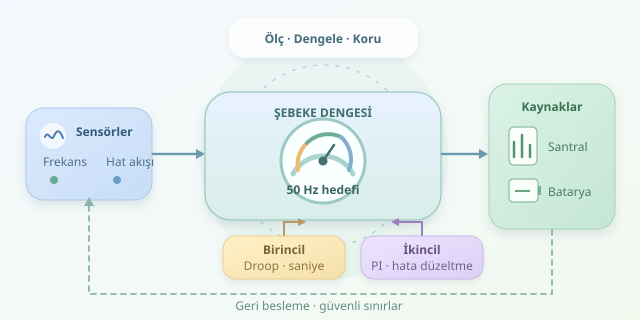

Elektrik şebekesi, milyonlarca cihazın aynı orkestrada çaldığı dev bir sistemdir. Bir fabrika aniden devreye girdiğinde tüketim yükselir; bir santral durduğunda üretim düşer. Orkestra şefi ise tek bir bilgisayar değildir: sensörler, yerel kontrolörler ve merkezi optimizasyon yazılımları birlikte çalışarak şebekenin ritmini, yani frekansını korur.

``

## Frekans neden değişir?

Türkiye gibi 50 Hz kullanan senkron şebekelerde frekans, üretim ve tüketim dengesinin önemli bir göstergesidir. Tüketim üretimi aşarsa senkron makinelerin dönme enerjisi azalır ve frekans düşer. Üretim fazlaysa tersi gerçekleşir. Ancak frekansın normal görünmesi, her hattın güvenli yükte olduğu anlamına gelmez; bölgesel darboğazlar ayrıca izlenmelidir.

Basitleştirilmiş toplu sistem modeli şöyledir:

$$\frac{2H}{f_0}\frac{d\Delta f}{dt}=\Delta p_g-\Delta p_l-D\Delta f$$

Burada $H$ eşdeğer atalet sabiti, $f_0$ nominal frekans, $\Delta p_g$ üretim değişimi ve $\Delta p_l$ tüketim değişimidir. Güçler ortak bir bazda birim değer olarak ifade edilir; $D$, frekansa bağlı yük tepkisini temsil eder.

Bu denklem kritik bir gerçeği anlatır: Yazılım enerji yaratmaz. Ölçümden hareketle santralleri, bataryaları veya esnek yükleri yönlendirir. İlk anda fiziksel atalet zaman kazandırır; kontrol algoritmaları bu zamanı değerlendirmek zorundadır.

## Tek kontrolör değil, katmanlı savunma

Şebeke dengelemesini, taşan lavaboya verilen tepkiler gibi düşünün: önce akışı yavaşlatırsınız, sonra seviyeyi düzeltirsiniz, ardından tesisatın çalışma planını değiştirirsiniz.

| Katman | Tipik zaman ölçeği | Temel görev |
|---|---|---|
| Birincil kontrol | Saniyeler | Frekans sapmasını sınırlamak |
| İkincil kontrol | Onlarca saniye–dakikalar | Frekansı ve bölgesel alışverişi hedefe döndürmek |
| Üçüncül kontrol | Dakikalar ve sonrası | Rezervleri yenilemek, üretimi yeniden dağıtmak |

Bu süreler sistem tasarımına göre değişir. Birincil kontrolde yaygın yaklaşım **droop**, yani frekans düştükçe güç artırma davranışıdır:

$$\Delta P=-K_f\Delta f$$

Birincil kontrol genellikle frekansı tam hedefe getirmez. İkincil kontrol, kalıcı hatayı gidermek için integral etkisinden yararlanır. Birden fazla kontrol bölgesinde yalnızca frekansa bakılmaz; planlanan ve gerçekleşen bağlantı hattı alışverişleri de hesaba katılır. Bu birleşik göstergeye **alan kontrol hatası**, yani ACE denir.

## Python ile sınırlı bir PI kontrolör

Aşağıdaki örnek, tek bölgenin frekansını izleyen öğretici bir PI kontrolörüdür. Üretim komutunu hesaplarken güç kapasitesini ve rampa hızını sınırlar. Gerçek bir AGC sisteminin tüm haberleşme, rezerv paylaşımı ve güvenlik işlevlerini içermez.

```python
def komut(frekans, dt, durum, temel=100.0):
    if dt <= 0:
        raise ValueError("dt pozitif olmalı")

    hata = 50.0 - frekans
    ham = temel + 40.0 * hata + durum["integral"]

    # Kapasite: 0–200 MW; rampa: 5 MW/s
    hedef = max(0.0, min(200.0, ham))
    adim = 5.0 * dt
    guc = max(durum["guc"] - adim,
              min(durum["guc"] + adim, hedef))

    # Anti-windup: uygulanamayan komutu geri besle
    durum["integral"] += (
        8.0 * hata + 0.5 * (guc - ham)
    ) * dt
    durum["guc"] = guc
    return guc

 durum = {"integral": 0.0, "guc": 100.0}
```

Örneği çalıştırırken son satırın başındaki boşluğu kaldırarak başlangıç durumunu tanımlayın; ardından `komut(49.90, 1.0, durum)` çağrısını yapın. İlk komut 104 MW olur: 0,10 Hz eksik frekans, oransal terim üzerinden 4 MW artış ister.

Oransal kazancın birimi MW/Hz, integral kazancının birimi MW/(Hz·s) olarak düşünülebilir. İntegral terimi geçmiş hatayı biriktirir. **Anti-windup**, kapasite veya rampa sınırları yüzünden uygulanamayan isteğin integrali aşırı büyütmesini önler. Buradaki kazançlar örnektir; saha ayarı değildir.

## Algoritmayı sahaya hazırlamak

İyi bir dengeleme yazılımı yalnızca doğru formülü kullanmaz. Zaman damgalarını doğrular, bozuk ölçümleri ayıklar ve haberleşme gecikmelerini hesaba katar. Gürültüyü filtrelemek yararlıdır; fakat aşırı filtreleme müdahaleyi geciktirir. Hız ile güvenilirlik arasında gerçek bir mühendislik pazarlığı vardır.

Komutlar kaynakların fiziksel sınırlarına uymalıdır. Bataryanın doluluk oranı, türbinin rampa kapasitesi ve kullanılabilir rezerv miktarı sürekli izlenir. Ekonomik optimizasyon daha ucuz kaynakları seçebilir; ancak hat akış limitleri ve güvenlik koşulları maliyetten önce gelir.

Üretime geçmeden önce yük sıçramaları, kaynak kayıpları, ölçüm kesintileri ve gecikmeler simülasyonda denenmelidir. Başarı yalnızca frekansı düzeltmek değildir: bunu salınım üretmeden, rezervleri tüketmeden ve ekipmanı zorlamadan yapmaktır. Şebekenin iyi yazılımı, en gösterişli kod değil, en sakin çalışan koddur.



