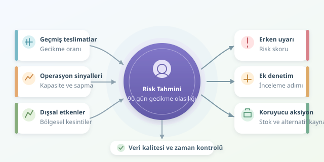

Bir fabrikanın üretimini bazen dev bir makine değil, zamanında gelmeyen küçücük bir vida durdurur. Tedarik zinciri risk analizi, bu sürprizleri azaltmayı hedefler. Makine öğrenmesi ise geçmiş teslimatları, kalite kayıtlarını ve operasyonel göstergeleri inceleyerek hangi tedarikçilerde sorun çıkabileceğine dair erken uyarılar üretir. Ancak bu kristal kürenin pili veri kalitesidir!

``

## Önce riski ölçülebilir hale getirin

“Tedarikçi riskli mi?” sorusu fazla geniştir. Bunun yerine hedefi şöyle tanımlayabiliriz: **Önümüzdeki 90 gün içinde, planlanan teslimatlardan en az biri yedi günden fazla gecikecek mi?** Böylece her tedarikçi ve değerlendirme tarihi için bir gözlem oluştururuz.

Bu olay gerçekleşirse etiket $y=1$, gerçekleşmezse $y=0$ olur. Gelecek dönemde teslimatı bulunmayan tedarikçiler bu hedef açısından ayrıca ele alınmalıdır; sipariş verilmemesi, güvenilirlik kanıtı değildir. Kalite problemi veya iflas gibi farklı riskler de farklı etiketlerle modellenmelidir. Tek bir puana her şeyi doldurmak, çorbaya tatlı eklemek gibidir.

## Geçmişi özelliklere dönüştürmek

Model, ham sipariş listesinden çok anlamlı özetlerle çalışır. Örneğin son 180 gündeki gecikme oranı, teslimat sürelerinin standart sapması ve kapasite kullanımı davranış örüntülerini görünür kılar.

| Özellik | Yakalamaya çalıştığı sinyal | Dikkat edilmesi gereken |
|---|---|---|
| Geçmiş gecikme oranı | Teslimat güvenilirliği | Az siparişte oynak olabilir |
| Teslimat süresi sapması | Operasyonel belirsizlik | Ürün türüne göre değişebilir |
| Kapasite kullanımı | Aşırı yüklenme | Güncelliği önemlidir |
| Bölgesel kesintiler | Dışsal maruziyet | Sonradan öğrenilen bilgi kullanılmamalıdır |




Temel kural şudur: Tahmin gününde bilinmeyen hiçbir bilgi modele giremez. Gelecekteki gecikmeden sonra güncellenen bir performans puanını kullanmak **veri sızıntısıdır**. Sonuçlar harika görünür, gerçek hayatta ise modelin sihri kaybolur.

## Model aslında ne öğrenir?

Lojistik regresyon, özellikleri ağırlıklı olarak birleştirir: $z=b+\sum_i w_i x_i$. Ardından $p=1/(1+e^{-z})$ dönüşümüyle sıfır ile bir arasında bir skor üretir. Bu skorun amaçlanan yorumu, tanımladığımız olayın gerçekleşme olasılığıdır.

Ağaç tabanlı gradyan artırma modelleri daha karmaşık etkileşimleri yakalayabilir. Örneğin yüksek kapasite kullanımı yalnızca belirli ürün gruplarında güçlü bir uyarı olabilir. Yine de basit, açıklanabilir bir başlangıç modeli karşılaştırma yapmak için değerlidir.

## Python ile zaman duyarlı başlangıç

Aşağıdaki örnek, önceden hazırlanmış haftalık özellik tablosunu kullanır. Eksikleri tamamlar, kategorileri kodlar ve geçmiş gözlemlerle lojistik regresyon eğitir.

```python
import pandas as pd
from sklearn.compose import ColumnTransformer
from sklearn.impute import SimpleImputer
from sklearn.linear_model import LogisticRegression
from sklearn.metrics import average_precision_score, recall_score
from sklearn.pipeline import make_pipeline
from sklearn.preprocessing import OneHotEncoder, StandardScaler

df = pd.read_csv("tedarikci_haftalik.csv")
df["tarih"] = pd.to_datetime(df["tarih"])
cutoff = pd.Timestamp("2025-01-01")

num = ["gecikme_orani_180g", "teslimat_std_180g", "kapasite_kullanimi"]
cat = ["ulke", "urun_grubu"]
features = num + cat

train = df[df["tarih"] < cutoff - pd.Timedelta(days=90)]
test = df[(df["tarih"] >= cutoff) &
          (df["tarih"] < cutoff + pd.Timedelta(days=90))]

prep = ColumnTransformer([
    ("num", make_pipeline(SimpleImputer(strategy="median"),
                         StandardScaler()), num),
    ("cat", make_pipeline(SimpleImputer(strategy="most_frequent"),
                         OneHotEncoder(handle_unknown="ignore")), cat)
])
model = make_pipeline(prep, LogisticRegression(max_iter=1000))
model.fit(train[features], train["gecikme_90g"])
p = model.predict_proba(test[features])[:, 1]
print("AP:", average_precision_score(test["gecikme_90g"], p))
print("Recall:", recall_score(test["gecikme_90g"], p >= 0.30))
```

Aradaki 90 günlük boşluk, eğitim etiketlerinin test başlangıcından önce tamamlanmasını sağlar. Test etiketlerinin de değerlendirme anında olgunlaşmış olması gerekir. Ön işleme yalnızca eğitim verisinde öğrenilir. Buradaki 0,30 eşiği örnektir; gerçek eşik ayrı, zaman sıralı doğrulama döneminde seçilmelidir.

## Başarı, doğruluktan fazlasıdır

Riskli olaylar nadirse her tedarikçiye “sorunsuz” diyen model yüksek doğruluk gösterebilir. Bu yüzden ortalama kesinlik (AP), kesinlik ve duyarlılık birlikte incelenmelidir. Duyarlılık, gerçek risklerin ne kadarını yakaladığımızı; kesinlik, uyarıların ne kadarının isabetli olduğunu gösterir.

Olasılık kalibrasyonu da önemlidir: Yüzde 30 risk verilen gözlemlerin yaklaşık yüzde 30’unda olay gerçekleşmelidir. Basitleştirilmiş hata maliyetleriyle karar eşiği $t=C_{FP}/(C_{FP}+C_{FN})$ olabilir. Yanlış alarm maliyeti $C_{FP}$, kaçırılan risk maliyeti $C_{FN}$ büyüdükçe farklı kararlar doğurur. Bu hesap kalibre edilmiş olasılık gerektirir.

## Tahmini operasyona bağlamak

Yüksek risk puanı otomatik tedarikçi eleme kararı olmamalıdır. Uyarı; ek denetim, güvenlik stoğu veya alternatif kaynak araştırmasını tetikleyebilir. Açıklamalar nedensellik kanıtı değildir; ülke gibi değişkenlerin haksız genellemelere dönüşmesi denetlenmelidir.

Son olarak veri kaymasını, uyarı isabetini ve gerçekleşen kayıpları düzenli izleyin. Modelin görevi geleceği kesin bilmek değil, satın alma ekibine daha erken ve daha ölçülü hareket etme fırsatı vermektir.
