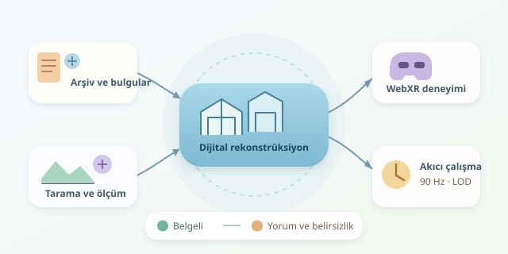

Yüzyıllar önce yıkılmış bir sarayın kapısından geçtiğinizi düşünün. Tavandaki bezemelere bakıyor, avludaki çeşmenin sesini duyuyorsunuz. Üstelik ortada gerçek bir saray yok! Sanal gerçeklik, kayıp tarihi yapıları dijital ortamda yeniden kurarak ziyaretçiyi pasif izleyiciden mekânın içinde dolaşan bir araştırmacıya dönüştürüyor. Peki bu zaman makinesinin kaputunun altında neler var?

``

## Yeniden inşa mı, tarihsel tahmin mi?

Dijital rekonstrüksiyon, eski bir binanın güzel görünen kopyasını üretmekten fazlasıdır. Amaç, arkeolojik bulgular ve tarihsel belgeler üzerinden savunulabilir bir mekân modeli oluşturmaktır. Eski planlar, gravürler, fotoğraflar ve kazı raporları aynı bulmacanın farklı parçalarıdır.

Buradaki temel ayrım, **kanıt ile yorum** arasındadır. Bir duvarın konumu temelden biliniyor olabilir; çatının biçimi ise benzer dönem yapılarından çıkarılabilir. İkisini aynı kesinlikle sunmak, ziyaretçiye yanlış bir tarih anlatır. Bu nedenle modelin hangi bölümlerinin belgeli, hangilerinin varsayımsal olduğu açıkça gösterilmelidir.

## Arşivden üç boyutlu dünyaya

Üretim hattını dört adımda düşünebiliriz:

1. **Veriyi toplayın:** Belgelerin tarihini, kaynağını ve ölçeğini kaydedin. Farklı dönemlere ait planları yanlışlıkla birleştirmeyin.
2. **Geometriyi oluşturun:** Mevcut kalıntıları fotogrametri veya lazer taramayla ölçün. Fotogrametri, örtüşen fotoğraflardaki ortak noktalar üzerinden yüzey geometrisini hesaplar; kayıp bölümleri tek başına geri getiremez.
3. **Eksikleri yorumlayın:** Blender gibi araçlarda duvarları, çatıyı ve bezemeleri modelleyin. Arkeolog ve mimarlık tarihçisiyle alternatifleri değerlendirin.
4. **Deneyime aktarın:** Modeli glTF gibi bir biçimde dışa aktararak Unity, Unreal Engine veya WebXR tabanlı bir uygulamada kullanın.

Modeli tek bir dosya olarak değil, kaynaklarla bağlantılı parçalardan oluşan bir veri kümesi olarak saklamak sonraki düzeltmeleri kolaylaştırır.

| Yöntem | Güçlü tarafı | Temel sınırı |
|---|---|---|
| Fotogrametri | Gerçek yüzey ayrıntıları | Mevcut görüntülere bağımlıdır |
| Lazer tarama | Hassas geometrik ölçüm | Yok olmuş bölümleri ölçemez |
| Belge tabanlı modelleme | Kayıp mekânları tamamlar | Yorum ve belirsizlik içerir |

## Gerçekçi görünmek yetmez, akıcı çalışmalı

VR başlığı, baş hareketlerine gecikmeden tepki vermelidir. Hedef yenileme hızı $f$ ise yaklaşık kare süresi bütçesi şöyle hesaplanır:

$$t_{\text{kare}} = \frac{1000}{f}\ \text{ms}$$

Örneğin $90$ Hz için yaklaşık $11{,}1$ milisaniye vardır. Bu bütçeye sahne çizimi ve uygulama işlemleri sığmalıdır. Çok ayrıntılı taş süslemeler bu nedenle yakında yüksek, uzakta düşük ayrıntıyla gösterilebilir. Buna LOD denir. Önceden hesaplanmış aydınlatma ve sıkıştırılmış dokular da performansa yardım eder. Ölçüm yapmadan optimizasyon ise biraz gözler kapalı restorasyona benzer!

## WebXR ile küçük bir prototip

Aşağıdaki örnek, Three.js kullanarak tarihi yapı modelini yükler ve desteklenen cihazlarda VR oturumunu başlatan düğmeyi ekler. Kod, `three` paketinin kurulu olduğu Vite benzeri bir projede çalıştırılabilir. Modelin metre ölçeğinde ve başlangıç noktasının ziyaret edilebilir bir alanda olması beklenir.

```javascript
import * as THREE from 'three';
import { VRButton } from 'three/addons/webxr/VRButton.js';
import { GLTFLoader } from 'three/addons/loaders/GLTFLoader.js';

const scene = new THREE.Scene();
scene.background = new THREE.Color(0xdce5ed);
const camera = new THREE.PerspectiveCamera(
  70, innerWidth / innerHeight, 0.1, 500
);
camera.position.set(0, 1.6, 0);

const renderer = new THREE.WebGLRenderer({ antialias: true });
renderer.setSize(innerWidth, innerHeight);
renderer.xr.enabled = true;
document.body.appendChild(renderer.domElement);
document.body.appendChild(VRButton.createButton(renderer));

scene.add(new THREE.HemisphereLight(0xffffff, 0x665544, 2));
const loader = new GLTFLoader();
loader.load('/models/kayip-yapi.glb', ({ scene: model }) => {
  scene.add(model);
}, undefined, console.error);

renderer.setAnimationLoop(() => {
  renderer.render(scene, camera);
});
```

`GLTFLoader` geometriyi ve malzemeleri getirir; `setAnimationLoop` çizimi WebXR oturumuyla uyumlu yürütür. Bu, tamamlanmış bir müze uygulaması değil, başlangıç iskeletidir. Yürüme, ışınlanma, çarpışma denetimi ve bilgi panoları ayrıca geliştirilmelidir. WebXR için HTTPS veya yerel geliştirmede localhost gerekir; cihaz ve tarayıcı desteği de kontrol edilmelidir.

## Ziyaretçiye yalnızca duvar göstermeyin

İyi deneyim, mimariyi günlük yaşamla ilişkilendirir: Bu avluyu kim kullanıyordu? Bu kapı neden dardı? Mekânsal ses ve kısa anlatılar, ayrıntıların anlamını görünür kılar.

Belirsiz bölümler açılıp kapatılabilen renk katmanlarıyla gösterilebilir. Böylece ziyaretçi hem yapıyı gezer hem de araştırmanın nasıl ilerlediğini görür. Renkler, açıklama metinleriyle desteklenmelidir; herkes renkleri aynı biçimde ayırt etmez.

Konfor için ışınlanarak hareket, oturarak kullanım ve kısa oturum seçenekleri sunun. Başlığa erişemeyenler için ekran üzerinden gezinme de sağlayın. Başarı, yalnızca etkileyici grafikler değildir: Ziyaretçinin tarihsel bilgiyi doğru anlaması, rahat hissetmesi ve merakla yeni sorular sormasıdır.
