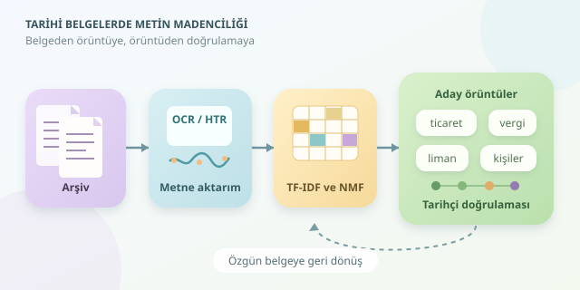

Tozlu bir arşivdeki binlerce mektubu düşünün: değişen ticaret yolları, tekrar eden şikâyetler, unutulmuş yer adları… Hepsini tek tek okumak yıllar sürebilir. Metin madenciliği, bu belgeleri tarihçinin yerine yorumlayan sihirli bir makine değildir; nerelere dikkatle bakılması gerektiğini gösteren, yorulmak bilmeyen bir araştırma asistanıdır. Gelin bu asistanın nasıl çalıştığını inceleyelim.

``

## Önce görüntüden metne: Zorlu ilk adım

Doğal dil işleme, görüntüler üzerinde değil, çoğunlukla metin temsilleri üzerinde çalışır. Bu nedenle taranmış belgeler önce yazıya aktarılmalıdır. Basılı metinlerde OCR, el yazmalarında ise HTR, yani el yazısı tanıma sistemleri kullanılır. Mürekkep lekeleri, eğik satırlar ve birbirine benzeyen harfler bu aşamada ciddi hata kaynaklarıdır. Tarihsel yazı sistemlerinde modern dil modellerinin başarısı doğrudan varsayılamaz; uzman tarafından doğrulanmış örneklerle ölçülmelidir.

| Yaklaşım | Güçlü olduğu alan | Temel sınırlama |
|---|---|---|
| OCR | Düzenli basılı belgeler | El yazısında zorlanır |
| HTR | El yazması sayfalar | Yazıcıya özgü eğitim gerekebilir |
| İnsan transkripsiyonu | Bağlamlı çözümleme | Zaman ve uzmanlık ister |

Örneğin “liman” sözcüğü sürekli yanlış okunuyorsa, deniz ticaretinin arşivdeki görünürlüğü yapay olarak azalır. Dolayısıyla metin madenciliğinin güvenilirliği, veri hazırlığının güvenilirliğine bağlıdır.

## Temizlemek, geçmişi silmek değildir

Her belgeye kimlik, tarih, arşiv referansı ve mümkünse yazıcı bilgisi ekleyin. Özgün görüntüyü ve ham transkripsiyonu koruyun; analiz için ayrı bir normalleştirilmiş sürüm üretin. Böylece araştırmacı, modelin kullandığı sözcüğün aslına geri dönebilir.

Tarihsel yazım çeşitliliği özellikle önemlidir. Aynı yer farklı dönemlerde farklı adlarla anılabilir; aynı sözcük birkaç yazımla karşınıza çıkabilir. Bunları birleştirmek sayımları iyileştirirken dönemsel farklılıkları silebilir. Bu yüzden dönüşümleri belgelenmiş bir sözlükle uygulayın. Modern Türkçe durak sözcüklerini de körlemesine kullanmayın: Arşivdeki kalıplaşmış ifadeler bazen belgenin türünü veya idari ilişkileri anlatır.

## Sözcüklerden örüntülere

İlk adım, belgeleri sayısal vektörlere dönüştürmektir. TF-IDF, bir belgede sık görülen fakat koleksiyonun tamamında daha seyrek bulunan sözcüklere yüksek ağırlık verir. Yaygın bir yumuşatılmış tanım şöyledir:

$$\mathrm{tfidf}(t,d)=\mathrm{tf}(t,d)\left[\log\frac{N+1}{\mathrm{df}(t)+1}+1\right]$$

Burada $N$ belge sayısı, $\mathrm{df}(t)$ ise sözcüğün geçtiği belge sayısıdır. Böylece her yerde bulunan bir hitap ifadesi yerine, belirli belgeleri ayırt eden “gümrük” gibi sözcükler öne çıkabilir. Ancak yüksek ağırlık, tarihsel önemle aynı şey değildir: Nadir bir tanıma hatası da yüksek puan alabilir.

Konu modelleme için NMF kullanılabilir. Belge-sözcük matrisi yaklaşık olarak $X \approx WH$ biçiminde ayrıştırılır. $W$, belgelerin konu ağırlıklarını; $H$ ise konuların sözcük ağırlıklarını temsil eder.

## Python ile küçük bir keşif

Aşağıdaki örnek, Latin harflerine aktarılmış, onlarca belge içeren bir koleksiyon varsayar. CSV dosyasının `belge_id`, `tarih` ve `metin` sütunları bulunmalıdır. Kod, Türkçeye uygun küçük harf dönüşümü yapar ve dört aday konu çıkarır:

```python
import unicodedata
import pandas as pd
from sklearn.feature_extraction.text import TfidfVectorizer
from sklearn.decomposition import NMF

 def normalize(text):
    text = unicodedata.normalize("NFC", text)
    text = text.replace("İ", "i").replace("I", "ı")
    return " ".join(text.lower().split())
```

Fonksiyon tanımını girintisiz kullanarak analiz akışını şöyle tamamlayın:

```python
def normalize(text):
    text = unicodedata.normalize("NFC", text)
    text = text.replace("İ", "i").replace("I", "ı")
    return " ".join(text.lower().split())

belgeler = pd.read_csv("arsiv.csv").dropna(subset=["metin"])
vectorizer = TfidfVectorizer(
    preprocessor=normalize,
    ngram_range=(1, 2),
    min_df=2,
    max_df=0.95
)
X = vectorizer.fit_transform(belgeler["metin"])
model = NMF(n_components=4, init="nndsvda", random_state=42)
W = model.fit_transform(X)
kelimeler = vectorizer.get_feature_names_out()

for konu, agirliklar in enumerate(model.components_):
    indeksler = agirliklar.argsort()[-8:][::-1]
    print(konu, ", ".join(kelimeler[indeksler]))
```

İkili sözcük grupları, “gümrük vergisi” gibi ifadeleri yakalar. `min_df`, tek belgede görülen gürültüyü azaltır; ancak nadir tarihsel terimleri de dışlayabilir. Dört konu yalnızca başlangıç tercihidir, tarihsel gerçekliğin sayısı değildir.

## Sonuçları tarihçi gibi sorgulamak

Bir konu “vergi, borç, tahsil” sözcüklerini içeriyorsa hemen “ekonomik kriz” etiketi yapıştırmayın. Önce yüksek ağırlıklı belgeleri okuyun. Zaman içindeki değişimleri incelerken belge sayısını, türünü ve arşivde korunma koşullarını hesaba katın. Bir yıldaki artış, gerçek bir toplumsal dönüşümden değil, daha fazla belgenin günümüze ulaşmasından kaynaklanabilir.

Varlık tanıma ile kişi ve yer ağları da kurulabilir; fakat aynı adın farklı kişilere ait olması ilişkileri karıştırabilir. Değerlendirmede uzmanların işaretlediği örneklerden yararlanın, kopya belgeleri eğitim ve test kümelerine dağıtmayın. Ham veriyi, dönüşümleri ve model ayarlarını kaydedin. En iyi sonuç, algoritmanın önerdiği örüntüyü özgün belgeye dönerek doğrulamaktır: Bilgisayar ipucunu bulur, tarihçi anlamını tartışır.
