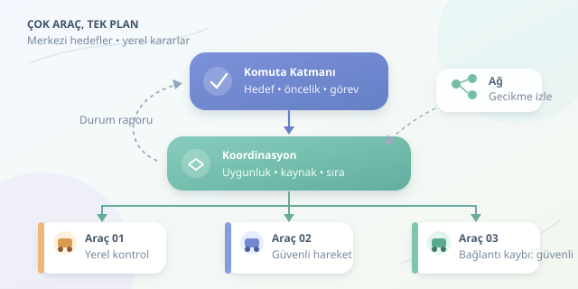

Bir depoda onlarca taşıma robotunun aynı anda çalıştığını düşünün: biri paket topluyor, diğeri şarj oluyor, üçüncüsü koridorda bekliyor. Hepsine ayrı ayrı bağırmak yerine ortak bir plan gerekiyor. Dağıtık sistemlerde komuta kontrol mimarisi, bağımsız araçları merkezi hedefler etrafında koordine eder. Ancak merkez, her tekerleğin dönüşünü yönetmek zorunda değildir!

``

## Merkezi Komuta Gerçekte Ne Demek?

Merkezileşme, bütün yazılımın tek bilgisayarda çalışması değil, karar yetkisinin mantıksal olarak belirli bir yerde toplanmasıdır. Komuta katmanı görevleri dağıtır; araçlar görevleri yerel koşullara göre yürütür ve sonuçlarını bildirir.

Bu ayrım iki kontrol döngüsü oluşturur: merkezde daha yavaş görev planlama, araçta daha hızlı hareket ve güvenlik kontrolü. Ağ bağlantısındaki gecikme, aracın engelden kaçınmasını bekletmemelidir. Orkestra şefi tempoyu belirler; kemanın her yay hareketini uzaktan yapmaz.

## Mimariyi Katmanlara Ayıralım

İşlevlerin ayrılması, hem testleri kolaylaştırır hem de bir katmandaki sorunun diğerlerine yayılmasını sınırlar:

- **Komuta katmanı:** Hedefleri, öncelikleri ve görevlerin yaşam döngüsünü yönetir. Örneğin acil teslimatı sıradan taşımanın önüne alır.
- **Koordinasyon katmanı:** Araç uygunluğunu, batarya seviyesini ve paylaşılan kaynakları değerlendirir. Aynı dar koridoru iki araca eşzamanlı ayırmaz.
- **Araç katmanı:** Komutları doğrular, yerel kontrolü yürütür ve durum raporlar. Bağlantı kaybında önceden tanımlanmış güvenli davranışa geçer.

| Yaklaşım | Karar noktası | Güçlü tarafı | Temel riski |
|---|---|---|---|
| Merkezi | Tek mantıksal otorite | Küresel optimizasyon | Merkeze bağımlılık |
| Hiyerarşik | Merkez ve bölgesel yöneticiler | Ölçeklenebilirlik | Katmanlar arası gecikme |
| Dağıtık | Araçlar arası uzlaşma | Yerel dayanıklılık | Koordinasyon karmaşıklığı |

Seçim yalnızca araç sayısına bağlı değildir. Görevlerin birbirine bağımlılığı, ağ kalitesi ve güvenlik gereksinimleri de belirleyicidir.

## Ağ Güvenilmezse Plan Ne Olur?

Bir komutun gecikme bütçesini kabaca şöyle yazabiliriz:

$$T_{tepki} = T_{ag} + T_{kuyruk} + T_{islem}$$

Toplam süre görevin toleransını aşıyorsa, eski komutu çalıştırmak doğru değildir. Bu yüzden komutlarda kimlik, sıra numarası ve geçerlilik süresi bulunmalıdır. Kalp atışı mesajları bağlantı durumunu izlemeye yardım eder; fakat sessizlik, aracın kesinlikle bozulduğunu kanıtlamaz.

Komuta servisi yedeklenebilir. Yalnız iki sunucunun aynı anda lider olduğunu düşünmesi, yani **split-brain**, çelişkili emirler üretir. Çoğunluk tabanlı uzlaşma ve uygun noktalarda doğrulanan liderlik belirteçleri bu riski azaltır. Çökme tipi $f$ arızaya dayanabilen tipik çoğunluk düzeni için:

$$n >= 2f + 1$$

Ağ bölünmesinde her tarafta yeni görev kabul etmek yerine bazı işlemleri durdurmak gerekebilir. Erişilebilirlik ile tutarlılık arasındaki tercih, güvenlik gereksinimine göre yapılmalıdır.

## Python ile Küçük Bir Koordinasyon Deneyi

Aşağıdaki simülasyon iki araca kuyruk üzerinden görev gönderir. Her araç, eskimiş veya yinelenen sıra numaralarını ve geçerlilik süresi dolmuş komutları eler:

```python
import asyncio
import time

async def vehicle(name, inbox):
    last_seq = 0
    while True:
        command = await inbox.get()
        if command is None:
            return
        if command["seq"] <= last_seq:
            continue
        if time.monotonic() > command["expires"]:
            continue
        last_seq = command["seq"]
        print(f"{name}: {command['task']}")
        await asyncio.sleep(0.1)

async def main():
    inboxes = {n: asyncio.Queue() for n in ("arac-1", "arac-2")}
    workers = [asyncio.create_task(vehicle(n, q))
               for n, q in inboxes.items()]
    tasks = [("arac-1", "paket-topla"), ("arac-2", "sarj-ol")]
    for seq, (name, task) in enumerate(tasks, start=1):
        await inboxes[name].put({
            "seq": seq, "task": task,
            "expires": time.monotonic() + 2
        })
    for queue in inboxes.values():
        await queue.put(None)
    await asyncio.gather(*workers)

asyncio.run(main())
```

`asyncio`, araçların bekleme sırasında birbirini engellemeden ilerlemesini sağlar. Kuyruklar iletişim kanalını temsil eder; `None`, çalışanı kapatır. Buradaki saat yalnızca aynı süreçteki simülasyon için uygundur; makineler arasında doğrudan karşılaştırılamaz.

Örnek, teslim garantisi veya kalıcı hata kurtarma sağlamaz. Üretimde komut günlüğü, alındı ve tamamlandı bildirimleri, yeniden deneme ve idempotent işlemler gerekir. Bellekteki sıra numarası yeniden başlatmada kaybolduğu için tek başına yeterli değildir. Ayrıca zaman aşımı, burada yalnızca göreve başlamadan önce denetlenir.

## Güvenlik ve Gözlemlenebilirlik

Merkezi komuta güçlüdür; ele geçirilirse hata da merkezi olarak yayılabilir. Karşılıklı kimlik doğrulama, şifreli iletişim ve görev bazlı yetkilendirme uygulanmalıdır. Her komutun kim tarafından gönderildiği, hangi araçta kabul edildiği ve nasıl sonuçlandığı izlenebilmelidir.

Gecikme dağılımı, kuyruk uzunluğu ve başarısız görev oranı izlenmelidir. Kontrollü duruş gibi güvenli durumlar, araç türüne göre önceden doğrulanmalıdır. Bağlantı kesildiğinde aracın rastgele karar üretmesi, dayanıklılık değildir.

## Sonuç: Merkez Planlasın, Araç Düşünsün

İyi komuta kontrol mimarisi, ortak hedefleri merkezi olarak yönetirken hızlı ve güvenlik açısından kritik kararları yerelde tutar. Başarı, bütün araçların aynı anda hareket etmesi değil; gecikme, tekrar ve arıza altında bile birbirleriyle çelişmeden çalışmasıdır.



