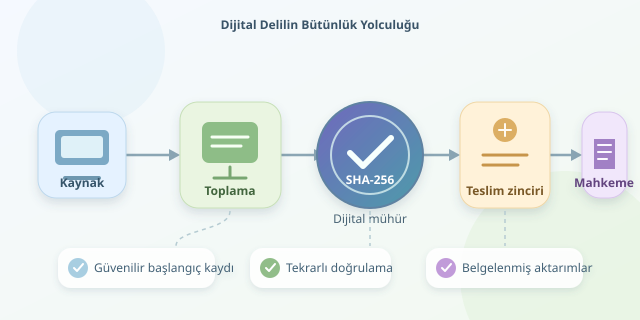

Bir bilgisayardan çıkan dosyanın mahkeme salonuna ulaşana kadar değiştirilmediğini nasıl gösterirsiniz? “Vallahi dokunmadım” teknik rapor sayılmaz. Dijital adli bilişimde hash değerleri, delilin bütünlüğünü kontrol etmek için kullanılır. Ancak iş yalnızca uzun bir karakter dizisini hesaplamak değildir: güvenilir toplama, kayıt tutma ve teslim zinciri de aynı hikâyenin parçalarıdır.

``

## Hash: dijital parmak izi, noter değil

Kriptografik hash fonksiyonu, değişken uzunluktaki veriyi sabit uzunlukta bir özete dönüştürür. SHA-256 için çıktı 256 bittir; genellikle 64 onaltılık karakterle gösterilir. Dosyadaki tek bitlik değişiklik bile çıktıyı büyük ölçüde farklılaştırır. Aynı veri, aynı algoritmayla her zaman aynı özeti üretir.

Toplama sırasında hesaplanan değer $h_0 = H(D_0)$, sonraki kontrolde hesaplanan değer ise $h_1 = H(D_1)$ olsun:

$$h_0 = h_1$$

Bu eşitlik, güvenilir başlangıç kaydı ve uygun algoritma kullanıldığında, karşılaştırılan baytların değişmediğine çok güçlü güvence sağlar. Matematiksel olarak farklı girdilerin aynı özeti üretmesi mümkündür; buna **çakışma** denir. Güvenlik, böyle bir çakışmayı bulmanın uygulanabilir olmamasına dayanır.

| Algoritma | Çıktı uzunluğu | Adli kullanım açısından yaklaşım |
|---|---:|---|
| MD5 | 128 bit | Çakışma zayıflıkları nedeniyle tek başına tercih edilmez |
| SHA-1 | 160 bit | Yeni bütünlük kayıtlarında kullanılmaması önerilir |
| SHA-256 | 256 bit | Güncel ve yaygın bir tercih |

Önemli ayrım: Hash, dosyanın **kim tarafından oluşturulduğunu** veya içeriğinin **doğru olduğunu** kanıtlamaz. Yalnızca belirli bir referansla bütünlük karşılaştırmasına yardımcı olur.

## Sağlam bir toplama süreci nasıl kurulur?

1. **Yetkiyi ve kapsamı belirleyin.** İnceleme dayanağını, cihazı, seri numarasını, görevliyi ve işlem zamanını kaydedin. Gereksiz veri toplamaktan kaçının; kapsam dışına çıkmak teknik başarıyı hukuki soruna dönüştürebilir.
2. **Kaynağı koruyun.** Uygun durumlarda doğrulanmış yazma engelleyici kullanın. Canlı sistemler, şifreleme ve uçucu bellek farklı yöntemler gerektirebilir; yapılan müdahaleleri açıkça belgeleyin.
3. **Adli kopya oluşturun.** Gereksinime göre fiziksel imaj veya mantıksal toplama yapın. Kullanılan aracın sürümünü, ayarlarını, hataları ve okunamayan sektörleri rapora ekleyin. Fiziksel imaj tüm adreslenebilir alanı hedeflerken mantıksal toplama seçili dosya ve yapıları kapsar.
4. **Doğru veriyi karşılaştırın.** Ham imaj, kaynakla aynı bayt dizisini temsil ediyorsa özetler karşılaştırılabilir. E01 gibi kapsayıcıların dosya hash'i, içlerindeki disk verisinin hash'iyle aynı kavram değildir.
5. **Başlangıç kaydını güvenceye alın.** Hash değerini delil kimliği, zaman, algoritma ve görevli bilgisiyle ilişkilendirin. İmzalı kayıtlar, uygun zaman damgaları ve erişim kontrolleri kaydın sonradan değiştirilmesini zorlaştırır.
6. **Her aktarımı belgeleyin.** Kim, ne zaman, kimden teslim aldı? Depolama, kopyalama ve analiz öncesi kontrolleri kaydedin. İşte bu kayıt dizisi, delilin teslim zinciridir.

## Python ile büyük dosyalarda doğrulama

Aşağıdaki örnek dosyayı belleğe tamamen yüklemek yerine 1 MiB parçalarla okur. Güvenilir başlangıç kaydındaki `sha256` alanını yeniden hesaplanan değerle karşılaştırır. Örneği orijinal cihazda değil, uygun biçimde korunmuş ve yazmaya kapalı bir kopyada çalıştırın; dosyanın işlem sırasında değişmemesi gerekir.

```python
import hashlib
import hmac
import json
import sys
from pathlib import Path


def sha256_file(path: Path) -> str:
    digest = hashlib.sha256()
    with path.open("rb") as stream:
        for block in iter(lambda: stream.read(1024 * 1024), b""):
            digest.update(block)
    return digest.hexdigest()


image = Path(sys.argv[1])
record = json.loads(Path(sys.argv[2]).read_text(encoding="utf-8"))
expected = record["sha256"].strip().lower()
actual = sha256_file(image)

if not hmac.compare_digest(expected, actual):
    raise SystemExit("UYARI: Hash değerleri uyuşmuyor!")

print("Hash eşleşti:", actual)
```

Çalıştırma biçimi: `python dogrula.py disk.raw ilk_kayit.json`. Kayıt dosyası `sha256` anahtarını içermelidir. `hashlib` özeti hesaplar; `compare_digest` karşılaştırmayı yapar. Bu kod kayıt dosyasının dijital imzasını doğrulamaz. Dolayısıyla başlangıç değerinin güvenilirliği ayrı bir süreçle sağlanmalıdır. Çıktıyı, tarih ve delil kimliğiyle inceleme günlüğüne ekleyin.

## Mahkemede hash neden tek başına yetmez?

Bir kişi hem delili hem kayıtlı hash'i değiştirebiliyorsa, yeni bir hash hesaplayarak sahte bir eşleşme oluşturabilir. Ayrıca ilk hash alınmadan önce yapılan değişiklikler, sonraki eşleşmelerle ortaya çıkarılamaz. Referans noktasının güvenilirliği bu nedenle kritiktir.

Hash uyuşmazlığı da otomatik olarak kötü niyet demek değildir: aktarım hatası, bozuk ortam veya yanlış kapsam karşılaştırması araştırılmalıdır. Dosya içeriği hash'i, dosya adı ve harici dosya sistemi metaverisinin değişmediğini tek başına göstermez.

Delilin kabulü ülkeye, usule ve somut olaya bağlıdır; hash eşleşmesi otomatik geçerlilik bileti değildir. Güçlü sonuç, **doğru toplama + korunmuş referans + belgelenmiş teslim zinciri + tekrarlanabilir doğrulama** birleşimidir. Dijital mühür değerlidir; ama mührün kimin elinde olduğunu da bilmek gerekir.
