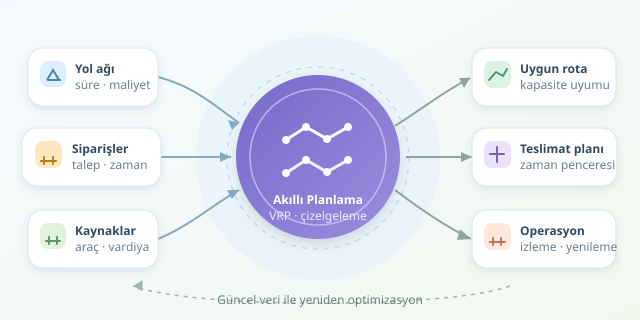

Bir kamyonun en kısa yolu bulması, lojistik probleminin yalnızca başlangıcıdır. Asıl mesele; doğru yükü, uygun araçla, sürücünün mesaisi bitmeden ve müşterinin kabul saatini kaçırmadan teslim etmektir. Üstelik depodaki yükleme kapısı da boş olmalıdır. Kısacası lojistik optimizasyonu, parçaları sürekli hareket eden bir Tetris oyunudur.



``

## Önce Problemin Haritasını Çıkaralım

Rota planlamasında müşteriler ve depolar bir grafın düğümlerini, yollar ise kenarlarını oluşturur. Her kenarın mesafe, süre veya parasal maliyet gibi ağırlıkları vardır. Ancak en kısa yol algoritması, tek başına bütün teslimatların hangi araçlara dağıtılacağını çözmez.

Burada **Araç Rotalama Problemi**, yani VRP devreye girer. Kapasiteli sürümü CVRP, teslimat saatlerini içeren sürümü ise VRPTW olarak bilinir. Kaynak planlama da bu modele araç uygunluğu, sürücü vardiyası ve depo kapasitesi gibi kararları ekler. Sonuç, birbirine bağlı rota ve çizelgeleme problemleridir.

| Problem | Temel karar | Önemli sınır |
|---|---|---|
| En kısa yol | Hangi yoldan gidilmeli? | Yol erişilebilirliği |
| CVRP | Müşterileri hangi araç gezmeli? | Taşıma kapasitesi |
| VRPTW | Ziyaretler ne zaman yapılmalı? | Teslimat aralığı |
| Kaynak çizelgeleme | Hangi kaynak ne zaman çalışmalı? | Eşzamanlı kullanım |

## Amaç Fonksiyonu ve Kısıtlar

Modelin amacı yalnızca kilometreyi azaltmak değildir. Daha az araç kullanmak, fazla mesaiyi önlemek ve hizmet kalitesini korumak da önemlidir. Basit bir maliyet modeli şöyle yazılabilir:

$$\min C = \sum_k f_k y_k + \sum_{i,j,k} c_{ijk} x_{ijk}$$

Burada $y_k$, araç kullanılıyorsa 1; $x_{ijk}$, araç ilgili bağlantıyı geçiyorsa 1 olur. $f_k$ sabit araç maliyetini, $c_{ijk}$ ise yolculuk maliyetini gösterir.

Kapasite için $\sum_i q_i z_{ik} \le Q_k$ gerekir. $z_{ik}$ müşteri atamasını, $q_i$ talebi belirtir. Ayrıca her müşteri atanmalı, araç akışı korunmalı ve depodan kopuk alt turlar engellenmelidir. Zaman pencereleri, servis süreleri ve vardiyalar da fizibiliteyi belirler. Sert kısıtlar ihlal edilemez; gecikme cezası ancak işletme gecikmeye izin veriyorsa kullanılmalıdır.

## Hangi Algoritma, Ne Zaman?

Karma tamsayılı programlama, kararları ikili değişkenlerle ifade eder. Dal-sınır ve kesme düzlemleri gibi yöntemler, uygun ölçekteki modellerde optimal çözüm veya kanıtlanabilir bir optimalite açığı sunabilir. Büyük örneklerde ise süre sınırına ulaşmak mümkündür.

Bu nedenle pratik sistemler sıklıkla sezgisellerden yararlanır. En ucuz ekleme hızlı bir başlangıç üretir; 2-opt rota içindeki bağlantıları değiştirir. Tabu arama ve büyük komşuluk araması, müşterileri taşıyarak daha geniş çözüm alanlarını araştırır. Özellikle büyük komşuluk araması, planın bir kısmını söküp yeniden kurar: Düzenli bir dağıtım operasyonunda kontrollü bir “yeniden yerleştirme” çalışması gibi düşünülebilir.

## Python ile Kapasite ve Vardiya Kontrollü Ekleme

Aşağıdaki örnek, iki araca müşterileri yerleştirir. Mesafeler yerine dakika cinsinden yolculuk süreleri kullanılır; her teslimat beş dakika sürer.

```python
travel = [
    [0, 20, 25, 15, 30],
    [20, 0, 10, 18, 22],
    [25, 10, 0, 12, 15],
    [15, 18, 12, 0, 20],
    [30, 22, 15, 20, 0],
]
demand = [0, 3, 2, 4, 1]
capacity, shift, service = 6, 100, 5
routes = [[0, 0] for _ in range(2)]

def duration(route):
    driving = sum(travel[a][b] for a, b in zip(route, route[1:]))
    return driving + service * (len(route) - 2)

for customer in sorted(range(1, 5), key=lambda c: -demand[c]):
    options = []
    for vehicle, route in enumerate(routes):
        if sum(demand[i] for i in route) + demand[customer] > capacity:
            continue
        for position in range(1, len(route)):
            candidate = route[:position] + [customer] + route[position:]
            if duration(candidate) <= shift:
                extra = duration(candidate) - duration(route)
                options.append((extra, vehicle, candidate))
    if not options:
        raise ValueError("Ekleme başarısız; yeniden planlama gerekli.")
    _, vehicle, candidate = min(options)
    routes[vehicle] = candidate

print(routes)
```

Depo, `0` ile temsil edilir. Algoritma büyük talepleri önce ele alır ve uygulanabilir seçeneklerden süreyi en az artıranı seçer. Depoya dönüş de vardiya hesabına dahildir. Ancak bu açgözlü yaklaşım optimal değildir; ekleme başarısızlığı, problemin çözümsüz olduğunu kanıtlamaz. Örnek müşteri zaman pencerelerini modellemez; bunlar için varış, bekleme ve servis başlangıcı ayrıca hesaplanmalıdır.

## Rotadan Operasyona Geçiş

İyi rotalar, kötü kaynak çizelgesiyle depoda kuyruk oluşturabilir. Tek yükleme kapısında aynı anda iki araç çalışamaz. Bu nedenle yükleme bitişleri, araç çıkışları ve sürücü uygunluğu birlikte değerlendirilmelidir. Soğuk zincir veya araç türü gibi uyumluluk koşulları da müşteri atamalarını sınırlar.

Operasyon başladığında trafik ve yeni siparişler planı değiştirir. Yuvarlanan ufuk yaklaşımı, yakın kararları sabitleyip kalan işleri güncel verilerle yeniden optimize eder. Başarıyı yalnızca kilometreyle değil; toplam maliyet, zamanında teslimat, kaynak kullanım oranı ve planın değişken koşullara dayanıklılığıyla ölçmek gerekir.
