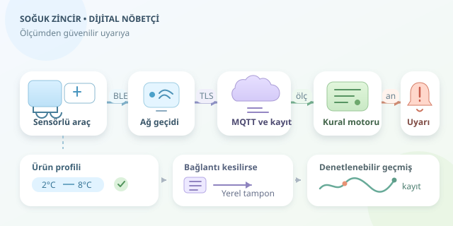

Bir kamyon dolusu yoğurt veya sıcaklığa hassas ilaç düşünün: Yolculuk sorunsuz görünürken açık kalan bir kapı bütün hikâyeyi değiştirebilir. Soğuk zincir takibi, ürünün yalnızca teslimatta değil, yolculuk boyunca uygun koşullarda kaldığını izler. IoT sensörleri burada dijital nöbetçi gibi çalışır: Ölçer, haber verir ve sorun büyümeden müdahale fırsatı sunar.

``

## Önce teori: Soğuk zincir neyi korur?

Sıcaklık, gıdalardaki mikrobiyal gelişimi ve ilaçların kimyasal kararlılığını etkileyebilir. Ancak bütün ürünlerin aynı sıcaklığı sevdiğini varsaymak hatadır. Bazı ürünler donmaya, bazıları ısınmaya duyarlıdır. Kabul aralığı; üretici talimatları, ürün özellikleri ve ilgili taşıma prosedürleri üzerinden belirlenmelidir. Örneğin aşağıdaki kodda kullanılan 2–8 °C aralığı, yalnızca bu aralık için tanımlanmış örnek bir ürün profiline aittir.

Temel koşul $T_{min} \le T(t) \le T_{max}$ şeklindedir. Burada sıcaklık, zamanın bir fonksiyonudur. Tek bir uygunsuz ölçüm önemlidir; fakat sapmanın süresi, büyüklüğü ve tekrarlanması da değerlendirilmelidir. Kısa bir yükseliş ile saatler süren sıcaklık ihlali aynı olay değildir. Yine de herhangi bir tolerans süresi, yazılımcının keyfine göre değil, onaylanmış ürün prosedürüne göre seçilmelidir.

## Sensörden ekrana: Verinin yolculuğu

Tipik mimaride sıcaklık probu bir mikrodenetleyiciye bağlanır. Cihaz ölçümleri zaman damgası, sensör kimliği ve sevkiyat numarasıyla paketler. BLE veya LoRa bağlantısı veriyi ağ geçidine, hücresel bağlantı ise sunucuya taşıyabilir. MQTT üzerinden gelen mesajlar zaman serisi veritabanına yazılır; kural motoru gerektiğinde sürücüyü ve operasyon ekibini bilgilendirir.

Sensörün konumu kritik önemdedir: Soğutucu çıkışındaki hava sıcaklığı, kutuların içindeki ürün sıcaklığıyla aynı değildir. Yerleşim, sıcaklık haritalamasıyla doğrulanmalıdır. Kalibrasyon, ölçüm belirsizliği ve probun tepki süresi de hesaba katılır; hızlı haberleşme, yavaş tepki veren sensörü sihirli biçimde hızlandırmaz.

| Durum | Tespit yaklaşımı | Operasyonel karşılık |
|---|---|---|
| Sıcaklık sınırı aşıldı | Ürün profiliyle karşılaştırma | Sapma kaydı oluşturma |
| Sapma uzadı | Ardışık ölçümlerin süresi | Onaylı kurala göre alarm |
| Ölçüm gelmiyor | Beklenen aralık kontrolü | Telemetri kaybı uyarısı |
| Bağlantı kesildi | Yerel tampon ve yeniden gönderim | Geçmiş kayıtları tamamlama |




## İhlali nasıl yakalarız?

Bir kural motoru, ölçümü yalnızca eşikle karşılaştırmakla yetinmez. Ölçümün geçerli olup olmadığını, hangi zamanda alındığını ve önceki kayıtla arasındaki boşluğu denetler. Sapma süresi $\Delta t = t_{son} - t_{ilk}$ olarak hesaplanabilir. Ancak seyrek örnekleme nedeniyle bu değer, kesintisiz fiziksel ihlalin kesin kanıtı değil, gözlenen sapmanın süre tahminidir.

Aşağıdaki Python üreteci, zaman sıralı ve önceden doğrulanmış ölçümleri işler. Aynı yöndeki sapma belirlenen süreyi aşınca tek alarm üretir; uzun veri boşluğunda süre takibini sıfırlar. Süre parametresi yalnızca gösterim amaçlıdır.

```python
def izle(okumalar, alt=2.0, ust=8.0, sure=120, bosluk=90):
    onceki = baslangic = taraf = None
    bildirildi = False

    for zaman, sicaklik in okumalar:
        if onceki is not None:
            fark = (zaman - onceki).total_seconds()
            if fark <= 0:
                raise ValueError("Zamanlar artan sırada olmalı")
            if fark > bosluk:
                yield ("veri_boslugu", zaman)
                baslangic = taraf = None
                bildirildi = False
        onceki = zaman

        yeni = "alt" if sicaklik < alt else (
            "ust" if sicaklik > ust else None
        )
        if yeni != taraf:
            taraf = yeni
            baslangic = zaman if yeni else None
            bildirildi = False

        if baslangic is not None and not bildirildi:
            gecen = (zaman - baslangic).total_seconds()
            if gecen >= sure:
                yield ("sicaklik_ihlali", taraf, zaman, sicaklik)
                bildirildi = True
```

Burada `okumalar`, saat dilimi bilgili zaman nesneleri ve sıcaklık değerlerinden oluşur. Güvenli aralığa dönüş veya sapma yönünün değişmesi sayacı yeniler. Üretimde alarmın kapanması ayrıca histerezisle yönetilebilir: Açılma ve kapanma eşiklerini ayırmak, sınır çevresindeki dalgalanmaların bildirim fırtınasına dönüşmesini önler.

## Gerçek zamanlı demek, her zaman çevrimiçi demek değildir

Tünelde bağlantı kesilebilir. Cihaz bu yüzden kayıtları yerelde saklamalı, bağlantı gelince ölçüm zamanlarıyla göndermelidir. Sunucu, mesajın geliş zamanı ile ölçüm zamanını ayırmalı; yinelenen kayıtları benzersiz kimliklerle elemelidir. Ayrıca sessizlik güvenli sıcaklık anlamına gelmez: Canlı sistem, yeni mesaj gelmese bile çalışan ayrı bir zamanlayıcıyla iletişim kaybını yakalamalıdır.

Son olarak TLS, cihaz kimlik doğrulaması, pil takibi ve denetlenebilir alarm geçmişi ekleyin. Alarm, ürünün otomatik olarak kullanılabilir veya kullanılamaz olduğuna karar vermez; kalite ekibinin incelemesini başlatır. Başarı, renkli grafiklerden çok, doğru kişiye zamanında ulaşan güvenilir uyarıdır. Dijital nöbetçi bağırmak için değil, doğru anda konuşmak için vardır.
