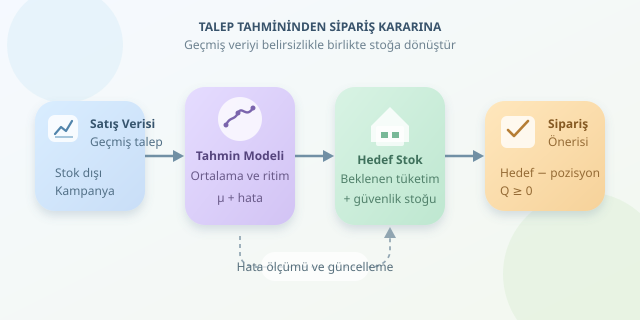

Bir e-ticaret mağazasında en sevilen ürünün tükenmesi müşteriyi, satılmayan kolilerin depoyu doldurması ise muhasebeciyi üzer. Talep tahmini, bu iki mutsuzluğu dengelemeye çalışır. Amaç geleceği kusursuz bilmek değil; geçmiş satışlardan makul bir beklenti üretmek, belirsizliği ölçmek ve bunu uygulanabilir bir sipariş kararına dönüştürmektir.

``

## Satış, talep ve belirsizlik aynı şey değildir

İlk kritik ayrım şudur: Satış verisi her zaman gerçek talebi göstermez. Ürün stokta yokken kaydedilen sıfır satış, müşterilerin ürünü istemediği anlamına gelmez. Bu yüzden stok tükenmeleri, iadeler, kampanyalar ve eksik kayıtlar ayrıca işaretlenmelidir.

Basit bir modelde günlük talep, beklenen seviye ile rastlantısal sapmanın toplamıdır:

$$D_t = μ_t + ε_t$$

Burada $μ_t$ beklenen talebi, $ε_t$ ise modelin açıklayamadığı değişimi temsil eder. Trend, haftalık ritim ve fiyat değişiklikleri beklentiyi etkileyebilir. Rastlantısal bölümse güvenlik stoğunun neden gerekli olduğunu anlatır: Ortalama, tek başına şemsiye değildir!

## Hangi tahmin yöntemiyle başlamalı?

| Yöntem | Temel mantık | Uygun durum | Zayıf noktası |
|---|---|---|---|
| Hareketli ortalama | Son dönemlerin ortalaması | Görece durağan talep | Ani değişimleri geç izler |
| Üstel düzeltme | Yeni verilere daha fazla ağırlık | Seviye değişimleri | Mevsimsellik ayrıca modellenmelidir |
| Mevsimsel model | Tekrarlayan dönemleri öğrenir | Haftalık veya yıllık döngüler | Yeterli geçmiş gerekir |
| Regresyon | Talebi açıklayıcı değişkenlerle ilişkilendirir | Fiyat ve kampanya etkileri | Gelecek girdiler de bilinmelidir |

Başlangıçta karmaşık model yerine güçlü bir referans model kurun. Örneğin son 28 günün ortalaması, dört haftalık günlük örüntüyü kısmen dengeler. Ancak cumartesi satışları sistematik olarak yüksekse, tek ortalama günlük farklılıkları yeterince temsil etmez.

## Tahminden sipariş miktarına geçiş

Stoğu haftada bir gözden geçirdiğinizi düşünün. Tedarik süresi $L$, gözden geçirme aralığı $R$ ise korunması gereken dönem $H=L+R$ gündür. Çünkü yeni sipariş fırsatına kadar geçen süre de hesaba katılmalıdır.

Günlük ortalama talep $μ$, günlük tahmin hatasının standart sapması $σ_e$ olsun. Hataların yaklaşık bağımsız, sıfır ortalamalı ve durağan olduğu basitleştirmesiyle hedef stok seviyesi:

$$S = Hμ + z_α σ_e \sqrt{H}$$

İlk terim beklenen tüketimdir; ikinci terim güvenlik stoğudur. $z_α$, seçilen çevrim hizmet düzeyinin normal dağılımdaki karşılığıdır. Örneğin yüzde 95 için yaklaşık 1,645 kullanılır. Bu düzey, çevrim boyunca stok tükenmemesi olasılığıdır; taleplerin yüzde 95'inin karşılanacağı anlamına gelmez.

Stok pozisyonu, eldeki stok artı yoldaki siparişler eksi karşılanmamış yükümlülüklerdir. Sipariş miktarı ise:

$$Q = \max(0, \lceil S-IP \rceil)$$

## Python ile küçük bir model

Aşağıdaki kod, `tarih` ve `adet` sütunlu günlük satış dosyasından geçmişe bakan tahminler üretir. Ardından hata ölçeğini kullanarak periyodik gözden geçirme için sipariş önerir.

```python
import math
from statistics import NormalDist
import pandas as pd

veri = pd.read_csv('satis.csv', parse_dates=['tarih'])
satis = (
    veri.groupby('tarih')['adet'].sum()
    .sort_index().asfreq('D')
)

if satis.isna().any() or len(satis) < 84:
    raise ValueError('Eksiksiz en az 84 günlük veri gerekir.')

# Her günün tahmini yalnızca önceki günlerden oluşur.
tahmin = satis.rolling(28).mean().shift(1)
hata = satis - tahmin

# Son 28 gün, yürüyen tek-adımlı değerlendirme dönemidir.
mae = hata.iloc[-28:].abs().mean()
sigma = hata.iloc[:-28].dropna().std(ddof=1)
mu = satis.iloc[-28:].mean()

L, R = 4, 7
H = L + R
z = NormalDist().inv_cdf(0.95)
hedef = H * mu + z * sigma * math.sqrt(H)

eldeki, yoldaki, bekleyen = 120, 40, 10
pozisyon = eldeki + yoldaki - bekleyen
siparis = max(0, math.ceil(hedef - pozisyon))

print(f'MAE: {mae:.2f}, Sipariş: {siparis}')
```

`shift(1)`, tahmin edilen günün satışının kendi tahminine sızmasını önler. Son dönem değerlendirmesinde her yeni gerçek satış, sonraki tahmine katılır. Hata standart sapması önceki dönemden hesaplanırken güncel talep seviyesi son 28 günden alınır.

Örneğin $μ=20$, $σ_e=6$ ve $H=11$ için hedef yaklaşık 253 birimdir. Stok pozisyonu 150 olduğunda öneri 103 birim olur. Tedarikçinin koli büyüklüğü varsa sonuç ayrıca koli katına yuvarlanır.

## Modeli depoya bırakmadan önce

MAE, ortalama mutlak hatayı gösterir; fakat sürekli düşük tahmin yapan bir modeli tek başına teşhis etmez. Ortalama hatayı da izleyin ve test dönemlerini zaman sırasıyla ilerletin. Veriyi rastgele karıştırmak, geleceğin geçmişe sızmasına neden olabilir.

Ayrıca $\sqrt{H}$ yaklaşımı evrensel değildir. Çok-adımlı hatalar ilişkiliyse, tedarik süresi değişkense veya talep seyrekse dönem toplamlarını doğrudan modellemek ya da simülasyon yapmak daha uygundur. Son olarak geçmiş üzerinde stok hareketlerini canlandırıp stok tükenmesini, elde tutma maliyetini ve hizmet düzeyini birlikte ölçün. İyi tahmin, depoda işe yarayan tahmindir.



