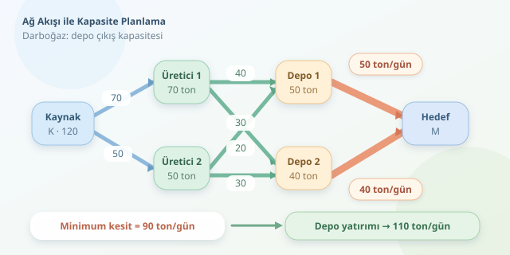

Fabrikalarınız üretmeye hazır, depolarınız açık, kamyonlarınız çalışıyor… Peki müşterilere gerçekten ne kadar ürün ulaştırabilirsiniz? Üretim kapasitelerini toplamak tek başına yeterli değildir: Aradaki bir depo veya taşıma hattı bütün ağı yavaşlatabilir. Ağ akış teorisi, bu lojistik trafik sıkışıklığını matematiksel olarak görünür kılar ve kapasite yatırımlarını daha bilinçli planlamanızı sağlar.

``

## Tedarik ağını grafa dönüştürmek

Bir tedarik ağını yönlü graf olarak modelleyelim. **Düğümler** üreticileri, depoları ve teslimat noktalarını; **kenarlar** ürünün ilerleyebileceği bağlantıları temsil eder. Her kenarın kapasitesi, belirli bir zaman diliminde taşıyabileceği üst sınırdır.

Örneğimizde bütün kapasiteler ton/gün cinsindendir. İki üreticiyi, iki depoyu ve toplam teslimatı temsil eden bir hedefi kullanacağız. Yapay kaynak düğümü `K`, üretim kapasitesini ağa aktarır; hedef `M` ise teslim edilen miktarı toplar. Böylece farklı tesisleri tek bir akış hesabında birleştiririz.

| Bağlantı | Kapasite | Anlamı |
|---|---:|---|
| K → U1 | 70 | Birinci üreticinin kapasitesi |
| K → U2 | 50 | İkinci üreticinin kapasitesi |
| U1 → D1 | 40 | Taşıma hattı |
| U1 → D2 | 30 | Taşıma hattı |
| U2 → D1 | 20 | Taşıma hattı |
| U2 → D2 | 30 | Taşıma hattı |
| D1 → M | 50 | Birinci deponun sevkiyat kapasitesi |
| D2 → M | 40 | İkinci deponun sevkiyat kapasitesi |

## Akışın iki temel kuralı

Bir kenarın kapasitesi $c(u,v)$, üzerindeki akış ise $f(u,v)$ olsun. İlk kural, kapasiteyi aşmamaktır:

$$0 \le f(u,v) \le c(u,v)$$

İkinci kural, ara düğümlerde **akış korunumu**dur. Kaynak ve hedef dışındaki her düğüme giren toplam miktar, çıkan toplam miktara eşittir:

$$\sum_u f(u,v)=\sum_w f(v,w)$$

Bu modelde ürün kaybolmaz, üretilmez veya dönem sonunda depoda birikmez. Amaç, kaynaktan çıkan toplam akışı, yani $\vert f\vert $ değerini en büyük yapmaktır.

Üretim toplamı $70+50=120$ olsa da depo çıkışları yalnızca $50+40=90$ taşır. Dolayısıyla 120 ton üretim kapasitesi, 120 ton teslimat anlamına gelmez. Maksimum akış burada **90 ton/gün**dür; örneğin U1 üzerinden D1'e 40, D2'ye 30; U2 üzerinden ise her depoya 10 ton gönderilebilir.

## Algoritma darboğazı nasıl bulur?

Edmonds–Karp algoritması, kaynak ile hedef arasında **artık kapasitesi** bulunan yolları genişlik öncelikli aramayla bulur. Her turda, yolun en küçük artık kapasitesi kadar akış eklenir. Artık ağdaki ters kenarlar, önceki tahsisleri geri alıp farklı rotalara yönlendirmeyi sağlar. Bu, kamyonları fiziksel olarak geri çağırmak değil, planı yeniden düzenlemektir!

| Algoritma | Yol seçimi | Genel zaman karmaşıklığı |
|---|---|---|
| Edmonds–Karp | BFS ile en az kenarlı yol | $O(VE^2)$ |
| Dinic | Seviye grafında bloklayıcı akış | $O(V^2E)$ |

Burada $V$ düğüm, $E$ kenar sayısıdır. Büyük ağlarda algoritma seçimi, hesaplama süresini belirgin biçimde etkileyebilir.

**Maksimum akış–minimum kesit teoremi**, en büyük akışın en küçük kesitin kapasitesine eşit olduğunu söyler. Kesit, kaynağı hedeften ayıran bir düğüm bölünmesidir. Örneğimizde iki depo çıkışını kesmek, 90 kapasiteli bir minimum kesit oluşturur.

## Python ile hesaplayalım

Önce `pip install networkx` komutuyla kütüphaneyi kurun. Aşağıdaki kod ağı oluşturur, Edmonds–Karp ile maksimum akışı hesaplar ve minimum kesitle sonucu doğrular. `flow` sözlüğü, her bağlantıdaki planlanan miktarı içerir.

```python
import networkx as nx
from networkx.algorithms.flow import edmonds_karp

edges = [
    ("K", "U1", 70), ("K", "U2", 50),
    ("U1", "D1", 40), ("U1", "D2", 30),
    ("U2", "D1", 20), ("U2", "D2", 30),
    ("D1", "M", 50), ("D2", "M", 40),
]
G = nx.DiGraph()
for u, v, capacity in edges:
    G.add_edge(u, v, capacity=capacity)

value, flow = nx.maximum_flow(
    G, "K", "M", flow_func=edmonds_karp
)
cut_value, partition = nx.minimum_cut(G, "K", "M")
assert value == cut_value
print("Maksimum akış:", value)  # 90

H = G.copy()
H["D1"]["M"]["capacity"] = 60
H["D2"]["M"]["capacity"] = 50
print("Yeni kapasite:", nx.maximum_flow_value(H, "K", "M"))
# 110
```

## Sonucu yatırım kararına çevirmek

Günlük talep 110 tonsa başlangıç planında 20 tonluk açık vardır. Kodun ikinci senaryosunda depo çıkışları artırıldığında toplam kapasite 110'a ulaşır. Sadece üretimi artırmak ise mevcut 90 tonluk kesiti değiştirmediğinden teslimatı yükseltmez. Darboğaz başka yerdeyken fabrikaya yatırım yapmak, geniş bir musluğa dar bir hortum bağlamaya benzer.

Yine de minimum kesit, otomatik olarak en ucuz yatırım önerisi değildir. Kapasite artışlarının maliyetlerini ayrıca değerlendirmek gerekir. Birden fazla minimum kesit varsa yalnızca birini genişletmek de yeterli olmayabilir.

Son olarak bu model, tek ve homojen bir ürün akışını varsayar. Teslimat maliyetleri için minimum maliyetli akış; dönemler arası stok için zaman genişletilmiş ağlar düşünülebilir. Farklı ürünler ortak kapasiteyi paylaşıyorsa daha kapsamlı optimizasyon gerekir. Maksimum akışın cevabı nettir: **Mevcut ağdan en fazla ne geçebilir?**



