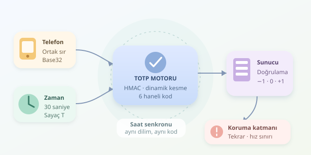

Telefonunuzdaki altı haneli kodun her otuz saniyede değişmesi küçük bir sihir gösterisi gibi görünebilir. Oysa perde arkasında saat, ortak bir sır ve kriptografik bir hesaplama vardır. Gelin bu mekanizmayı açıp hem üretimi hem doğrulamayı inceleyelim.




``

## İki faktör gerçekten ne demek?

Kimlik doğrulama faktörleri; bildiğiniz şey, sahip olduğunuz şey ve biyometrik özelliğiniz olarak sınıflandırılır. Parola ilk gruptadır; TOTP sırrını taşıyan doğrulayıcı uygulama ikinci grubu temsil eder. Dolayısıyla iki farklı parola kullanmak, iki faktörlü doğrulama değildir.

TOTP, RFC 6238 ile tanımlanır ve sayaç tabanlı HOTP algoritmasının zamanla çalışan türevidir.

| Yöntem | Değişen girdi | Temel özellik |
|---|---|---|
| HOTP | Artan sayaç | Sayaçların eşleşmesi gerekir |
| TOTP | Zaman dilimi | Saatlerin yakın olması gerekir |
| WebAuthn | Sunucunun meydan okuması | Alan adına bağlanarak oltalamaya direnç sağlar |

## Saatten sayaca: zamanın dilimlenmesi

Telefon ile sunucu, kullanıcıya özel aynı gizli anahtarı paylaşır. Anahtar genellikle kurulum sırasında QR koduyla aktarılır; uygulama kod üretirken sunucuyla konuşmak zorunda değildir.

Unix zamanı $t$, başlangıç zamanı $T_0$ ve adım uzunluğu $X$ kullanılarak sayaç hesaplanır:

$$T = \lfloor (t - T_0) / X \rfloor$$

Yaygın seçimler $T_0 = 0$ ve $X = 30$ saniyedir. Aynı dilimdeki zamanlar aynı sayacı verir. Saat diliminiz değil, cihazınızın gerçek zamanının doğruluğu önemlidir.

## HMAC: ortak sırrın mutfağı

Sayaç, sekiz baytlık büyük uçlu bir sayı olarak kodlanır. Ardından gizli anahtar $K$ ile HMAC hesaplanır. Yaygın seçenek HMAC-SHA-1 olsa da standart SHA-256 ve SHA-512 kullanımını da tanımlar; istemci ve sunucu aynı seçimi yapmalıdır.

Özetin son baytındaki düşük dört bit, dinamik kesmenin başlangıç konumunu belirler. Buradan alınan dört baytın en yüksek biti temizlenerek 31 bitlik pozitif sayı elde edilir:

$$OTP = B \bmod 10^d$$

Burada $d$, basamak sayısıdır. Sonuç sıfırlarla tamamlanır: `004821`, geçerli bir altı haneli koddur.

## Python ile üretim ve doğrulama

Aşağıdaki örnek, standart kütüphaneyle altı haneli TOTP üretir. Doğrulayıcı, eşleşen zaman sayacını döndürür; bu bilgi tekrar kullanımın engellenmesinde işe yarar.

```python
import base64
import hashlib
import hmac
import struct
import time


def totp(secret, timestamp):
    normalized = secret.strip().upper()
    padding = "=" * ((-len(normalized)) % 8)
    key = base64.b32decode(normalized + padding)
    counter = int(timestamp // 30)
    message = struct.pack(">Q", counter)
    digest = hmac.new(key, message, hashlib.sha1).digest()
    offset = digest[-1] & 0x0F
    value = int.from_bytes(digest[offset:offset + 4], "big")
    value &= 0x7FFFFFFF
    return f"{value % 1_000_000:06d}"


def matching_counter(secret, code, now=None):
    if not isinstance(code, str):
        return None
    if len(code) != 6 or not code.isascii() or not code.isdigit():
        return None
    now = time.time() if now is None else now
    current = int(now // 30)
    for delta in (-1, 0, 1):
        counter = current + delta
        expected = totp(secret, counter * 30)
        if hmac.compare_digest(expected, code):
            return counter
    return None
```

`struct.pack`, sayacı HMAC için doğru bayt biçimine dönüştürür. Bit maskeleri dinamik kesmeyi uygular; `compare_digest` ise kod karşılaştırmasındaki zamanlama sızıntısını azaltır. Eşleşme kontrolünde `is not None` kullanın.

Doğrulama penceresi önceki, mevcut ve sonraki dilimi kapsar. Bu tolerans saat kaymalarını karşılar; ancak kabul edilebilecek kod sayısını da artırır. Altı hane ve üç dilim için rastgele tek denemenin başarı olasılığı yaklaşık $3/10^6$ olur.

## Üretimde eksik bırakılmaması gerekenler

- **Sır yönetimi:** Her kullanıcı için kriptografik rastgelelik kullanın; örneğin `secrets.token_bytes(20)` ile anahtar üretip Base32 kodlayın. Base32 şifreleme değildir. Sunucu sırrı geri okuyabilmelidir; bu yüzden parola gibi yalnızca özetleyemezsiniz. Şifreleyin ve erişimi sınırlandırın.
- **Tekrar kullanımı:** Kabul edilen sayacı kullanıcıyla ilişkilendirin. Daha önce tüketilmiş dilimleri reddetme ve yeni sayacı kaydetme işlemini atomik yapın; aksi hâlde eşzamanlı istekler aynı kodu kullanabilir.
- **Deneme sınırı:** Hesap bazlı hız sınırlaması, kademeli gecikme ve güvenlik kayıtları uygulayın. Sunucu saatini güvenilir zaman senkronizasyonuyla koruyun.
- **Kurulum ve kurtarma:** Faktörü etkinleştirmeden önce bir kod doğrulatın. Yedek kodları tek kullanımlık üretip özetleyerek saklayın. Faktör değişikliğinde yeniden kimlik doğrulaması isteyin; sırları ve QR içeriklerini günlüklemeyin.

TOTP, çalınan parolaya karşı güçlü bir ek katmandır; fakat kodlar sahte sitelere aktarılabilir. Oltalama direnci gerekiyorsa WebAuthn tercih edin: güvenliğin son patronu yalnızca altı rakam değildir!
