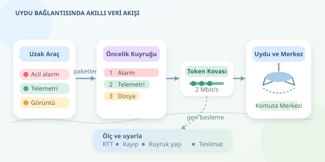

Okyanustaki bir araştırma gemisi, çöldeki otonom araç veya dağların arasındaki keşif robotu düşünün. Hepsi komuta merkezine veri göndermek istiyor; fakat aralarında kilometrelerce boşluk, hareketli bağlantılar ve sınırlı kapasite var. Uydu haberleşmesinde başarı, yalnızca güçlü bir antenle değil, hangi verinin ne zaman gönderileceğine doğru karar vermekle geliyor.
``

## Gecikmenin anatomisi: Mesafe pazarlık kabul etmez

Tek yönlü gecikmeyi kabaca şu şekilde ayırabiliriz:

$$T = d/c + L/R + T_q + T_p$$

Burada $d$ sinyalin izlediği mesafe, $c$ ışık hızı, $L$ paket uzunluğu, $R$ iletim hızı, $T_q$ kuyrukta bekleme ve $T_p$ işleme süresidir. İlk terim fizik kurallarına bağlıdır; diğerlerini ağ tasarımıyla iyileştirebiliriz. Büyük bir görüntü paketi, küçük bir alarmın önünde bekliyorsa sorun yalnızca uzayda değildir!

Jeostatik yörüngedeki bir uydunun yüksekliği yaklaşık 35.786 kilometredir. Araç–uydu–yer istasyonu güzergâhında gidiş-dönüş yayılım gecikmesinin ideal alt sınırı yaklaşık $4h/c = 0.477$ saniyedir. Gerçek rota, işleme ve kuyruklar bu değeri artırır. **RTT**, paketin gidip yanıtının dönmesi için geçen toplam süredir.

| Özellik | GEO | LEO |
|---|---|---|
| Yörünge | Jeostatik, yüksek | Alçak, hareketli |
| Yayılım gecikmesi | Daha yüksek | Genellikle daha düşük |
| Kapsama | Geniş ve görece sabit | Takımyıldızına bağlı |
| Yönetim zorluğu | Uzun RTT | Uydu geçişleri ve değişken rota |

## Bant genişliği ile gerçek veri hızı aynı değildir

Frekans bant genişliği hertz, veri hızı ise bit/saniye cinsinden ölçülür. İdeal kanal kapasitesini Shannon bağıntısı açıklar:

$$C = B \log_2(1 + S/N)$$

$B$ frekans bant genişliği, $S/N$ sinyal-gürültü oranıdır. Ancak protokol başlıkları, hata düzeltme, yeniden iletimler ve hava koşulları kullanılabilir uygulama hızını düşürür. Yağmur zayıflaması gibi etkilerde modem daha dayanıklı bir kodlamaya geçebilir; bağlantı korunurken kapasite azalır.

Bir başka kritik değer **bant genişliği–gecikme çarpımıdır**: $BDP = R \times RTT$. Hızı 2 Mbit/s, RTT değeri 0,6 saniye olan bağlantıda yaklaşık 150 kB veri aynı anda yolda bulunabilir. Aktarım penceresi bunu desteklemelidir; fakat gereksiz büyük kuyruklar gecikmeyi şişirir.

## Önceliklendirme: Alarm önce, manzara sonra

Araçtan merkeze gönderilen veriyi sınıflandırın: acil olaylar, düzenli telemetri ve büyük dosyalar. Aşağıdaki Python örneği, öncelik kuyruğunu **token bucket** hız sınırlayıcısıyla birleştirir. Küçük öncelik sayısı daha önemlidir.

```python
import heapq
import itertools
import time

class LinkScheduler:
    def __init__(self, rate=250_000, burst=64_000):
        self.rate, self.burst = rate, burst
        self.tokens = float(burst)
        self.updated = time.monotonic()
        self.queue = []
        self.sequence = itertools.count()

    def enqueue(self, priority, payload):
        if len(payload) > self.burst:
            raise ValueError("Veriyi küçük parçalara bölün")
        heapq.heappush(self.queue,
                      (priority, next(self.sequence), payload))

    def next_packet(self):
        now = time.monotonic()
        self.tokens = min(self.burst, self.tokens +
                          (now - self.updated) * self.rate)
        self.updated = now
        if not self.queue:
            return None
        payload = self.queue[0][2]
        if len(payload) > self.tokens:
            return None
        self.tokens -= len(payload)
        return heapq.heappop(self.queue)[2]
```

Varsayılan hız 250.000 bayt/saniye, yani 2 Mbit/s’dir. Tokenlar gönderim bütçesini temsil eder; sıra numarası eşit öncelikleri geliş sırasına göre düzenler. Çağıran döngü, dönen paketi modeme verir; `None` geldiğinde bekler. Bu, öğretici bir iskelettir: üretimde kuyruk sınırı, süre aşımı ve düşük öncelikli trafiğin sürekli beklemesini önleyen ağırlıklı paylaşım eklenmelidir.

## Her veri aynı güvenilirliği istemez

Konum güncellemelerinde bazen en yeni ölçüm, kaybolan eski ölçümden değerlidir. Dosyalarda ise bütünlük gerekir. UDP tek başına teslim garantisi vermez; TCP güvenilir aktarım sağlar, ancak uzun RTT ve kayıplar performansını etkiler. QUIC de sihirli bir gecikme silgisi değildir: tıkanıklık kontrolü ve bağlantı koşulları hâlâ önemlidir.

- Telemetriye zaman damgası ve sıra numarası ekleyin.
- Kritik işlemlerde onay, kimlik doğrulama ve tekrarları ayıklama kullanın.
- Kopmalarda veriyi yerelde saklayıp bağlantı dönünce aktarın.
- Süresi geçmiş komutları çalıştırmayın; güvenli davranışı araçta tanımlayın.

## Küçük bir kapasite bütçesi

2 Mbit/s bağlantıda 100 aracın her saniye 250 bayt telemetri üretmesi, başlıklar hariç 200 kbit/s tüketir. Acil olaylara 100 kbit/s, görüntülere 1,3 Mbit/s ayırıp 400 kbit/s pay bırakabilirsiniz. Bu pay protokol yükü ve dalgalanmalar içindir; ölçümlerle güncellenmelidir.

Görüntülere ayrılan hızda 1 MB dosyanın ideal aktarımı yaklaşık 6,2 saniyedir. Dosyayı küçük parçalara bölmek, alarmların araya girmesini kolaylaştırır. Fark verilerini göndermek ve yerelde özet çıkarmak da maliyeti azaltır.

Son olarak RTT’yi, paket kaybını, kuyruk yaşını ve gerçekten teslim edilen uygulama verisini izleyin. Hedef, hattı sürekli doldurmak değil; komuta merkezine **doğru veriyi, işe yarayacağı zamanda** ulaştırmaktır.



