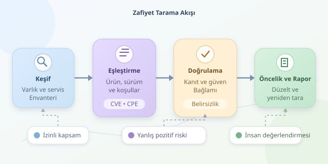

Bir zafiyet tarayıcısı, sunucunuza bakıp sihirli biçimde “Burada açık var!” diyen bir kristal küre değildir. Daha çok envanter çıkaran, ipuçlarını güvenlik duyurularıyla karşılaştıran ve şüpheli durumları raporlayan dijital bir dedektiftir. Peki bu dedektif hangi izleri takip eder, bulgularına ne kadar güvenebiliriz ve otomasyon nerede durmalıdır?

``

## 1. Önce sistemi tanımak: keşif ve envanter

Taramanın başlangıcı, hangi varlıkların inceleneceğini belirlemektir. IP adresleri, alan adları, sunucular, konteyner imajları ve kurulu paketler bu kapsamın parçaları olabilir. Tarama yalnızca izin verilen sistemlerde, belirlenmiş zaman aralıkları ve hız sınırlarıyla yürütülmelidir.

Ağ tabanlı araçlar erişilebilir servisleri ve bağlantı noktalarını araştırır. Ardından protokol yanıtları, HTTP başlıkları veya servis banner’ları üzerinden ürün ve sürüm tahmini yapar. Ancak banner, nüfus cüzdanı değildir: gizlenebilir, yanlış yapılandırılabilir veya güncel olmayan bilgiler taşıyabilir.

## 2. Bilinen açıklarla eşleştirme

Keşfedilen bilgiler, üretici duyuruları ve zafiyet veri kaynaklarıyla karşılaştırılır. **CVE**, bir açıklığın ortak kimliğidir; **CPE** ise ürünleri adlandırmak için kullanılan standartlaştırılmış bir yapıdır. Bunlar aynı şey değildir: biri güvenlik problemini, diğeri ilgili yazılımı tanımlar.

Temel mantık şöyle gösterilebilir:

$$Bulgular = Varlıklar \bowtie_{ürün,\ sürüm,\ koşullar} ZafiyetKuralları$$

Buradaki birleştirme, yalnızca sürüm karşılaştırması değildir. İşletim sistemi, etkin özellikler, paket kaynağı ve yapılandırma koşulları da sonucu değiştirebilir. Tarayıcı eklentileri bu koşulları değerlendiren kontrolleri içerir.

| Yaklaşım | Bilgi kaynağı | Güçlü yanı | Sınırlaması |
|---|---|---|---|
| Kimlik bilgisiz tarama | Dışarıdan görülen yanıtlar | Saldırı yüzeyini gösterir | İçerideki paketleri göremeyebilir |
| Kimlik bilgili tarama | Yetkili hesapla yerel inceleme | Paket ve yama bilgisi daha nettir | Güvenli hesap yönetimi gerekir |
| Pasif gözlem | Mevcut trafik ve kayıtlar | Ek sorgu üretmez | Görülmeyen servisleri kaçırabilir |

## 3. Küçük bir eşleştirme motoru

Aşağıdaki Python örneği ağ taraması yapmaz; hazırlanmış envanteri yerel kurallarla karşılaştırıp JSON raporu üretir. `DEMO-001` tamamen sentetiktir, gerçek bir CVE değildir. Bağımlılık için `pip install packaging` komutu yeterlidir.

```python
import json
from packaging.version import Version, InvalidVersion

assets = [
    {"host": "lab-01", "product": "ornek-web", "version": "2.3.0"}
]
rules = [
    {"id": "DEMO-001", "product": "ornek-web",
     "introduced": "2.0.0", "fixed": "2.4.1"}
]
findings = []

for asset in assets:
    for rule in rules:
        if asset["product"] != rule["product"]:
            continue
        try:
            version = Version(asset["version"])
            affected = (
                Version(rule["introduced"]) <= version
                < Version(rule["fixed"])
            )
            if not affected:
                continue
            status = "potansiyel zafiyet"
        except InvalidVersion:
            status = "sürüm doğrulanamadı"
        findings.append({**asset, "rule": rule["id"], "status": status})

print(json.dumps(findings, ensure_ascii=False, indent=2))
```

Kod, ürün adı eşleştiğinde sürümün etkilenen aralıkta bulunup bulunmadığını denetler. Ayrıştırılamayan sürümleri güvenli saymak yerine belirsiz olarak raporlar. Gerçek araçlarda ürün takma adları, farklı sürüm şemaları ve dağıtıcı yamaları için çok daha ayrıntılı kurallar gerekir; `packaging` bütün üreticilerin sürüm biçimlerini kapsamaz.

## 4. Bulgu neden kesin kanıt değildir?

Bazı Linux dağıtımları güvenlik düzeltmesini eski sürüme taşır; buna **backport** denir. Dolayısıyla eski görünen sürüm mutlaka savunmasız değildir. Tersi de mümkündür: sürüm gizlendiği için tarayıcı gerçek bir açığı kaçırabilir.

Yanlış pozitif, gerçekte bulunmayan bir açığın raporlanmasıdır. Yanlış negatif ise mevcut açığın atlanmasıdır. Bu nedenle iyi raporlar kullanılan kontrolü, elde edilen kanıtı ve güven düzeyini gösterir. Kontrollü doğrulama yardımcı olabilir; ancak açıklığı sömürmek taramanın zorunlu adımı değildir ve ayrıca yetkilendirilmelidir.

## 5. Raporlama ve önceliklendirme

**CVSS**, teknik ciddiyeti ifade eder; tek başına saldırıya uğrama olasılığı değildir. İnternete açık kritik bir servisle izole laboratuvar makinesi aynı operasyonel önceliğe sahip olmayabilir.

Örnek bir öncelik modeli:

$$P = 0.4S + 0.3E + 0.2A + 0.1K$$

Burada tüm değerler $[0,1]$ aralığındadır: $S$ normalize edilmiş ciddiyet, $E$ dış erişilebilirlik, $A$ varlık önemi, $K$ ise bilinen aktif istismar göstergesidir. Bu öğretici formül, standart CVSS hesabı veya ölçülmüş olasılık değildir.

Kullanışlı rapor; varlığı, ilgili CVE’yi veya kuralı, kanıtı, etkilenen bileşeni ve düzeltme önerisini birlikte sunar. Üretici yaması, yapılandırma değişikliği veya geçici erişim kısıtlaması uygulanabilir. Ardından yeniden tarama yapılarak bulgunun kapandığı doğrulanır.

Sonuçta tarayıcı, güvenliğin otomatik pilotu değil, yardımcı pilotudur. Kapsamı doğru tanımlamak, bulguları bağlamla değerlendirmek ve düzeltmeleri doğrulamak insan sorumluluğundadır. “Bulgu yok” ifadesi de “açık yok” garantisi vermez; yalnızca kullanılan kontrollerin o anda bir şey saptamadığını söyler.
