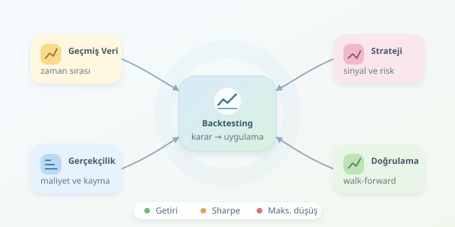

Bir ticaret algoritması geçmiş grafikte kusursuz görünüyorsa hemen kutlama yapmayın: Belki de cevap anahtarını gizlice okuyordur! Backtesting, stratejinin geçmiş piyasa verilerinde nasıl davranacağını simüle eder. Ancak amaç yalnızca yüksek getiri bulmak değil; bu getirinin hangi varsayımlarla oluştuğunu ve farklı koşullarda ne kadar dayanıklı olduğunu anlamaktır.

``

## Backtesting aslında neyi ölçer?

Bir strateji; sinyal üretimi, pozisyon büyüklüğü, emir gerçekleştirme ve risk kurallarından oluşur. Test motoru bunları zaman sırasıyla çalıştırır. Temel şart şudur: Her karar, yalnızca o anda bilinebilecek veriyi kullanmalıdır.

Örneğin, 20 günlük hareketli ortalama 60 günlük ortalamanın üzerindeyken piyasada kalan bir strateji düşünelim. Bu yaklaşım, trendlerin bir süre devam edebileceği varsayımına dayanır. Yatay piyasada ise sık işlem yaparak maliyet üretmesi beklenebilir. Dolayısıyla test, sadece sonucu değil, stratejinin ekonomik mantığını da sorgulamalıdır.

| Yaklaşım | Güzel görünen sonuç | Güvenilir değerlendirme |
|---|---|---|
| İşlem fiyatı | Sinyalin oluştuğu kapanış | Sonraki uygulanabilir fiyat |
| Maliyet | Sıfır komisyon | Komisyon, spread ve kayma |
| Veri seçimi | Bugünün başarılı şirketleri | Dönemin yatırım evreni |
| Parametre | En yüksek geçmiş getiri | Farklı dönemlerde tutarlılık |

## Verinin küçük hileleri, büyük sonuçları

**İleriye bakma yanlılığı**, henüz açıklanmamış bilginin kararlara sızmasıdır. **Hayatta kalma yanlılığı**, iflas eden veya borsadan çıkan şirketlerin veri setinden kaybolmasıdır. İkisi de stratejiyi olduğundan başarılı gösterebilir.

Zaman damgalarını, eksik kayıtları ve şirket işlemlerini kontrol edin. Açılış ve kapanış fiyatları aynı bölünme düzeltmesini kullanmalıdır. Temettüler ayrıca muhasebeleştirilmelidir. Veriyi temizlerken gelecekteki değerlerle geçmiş boşlukları doldurmak da bilgi sızıntısı yaratabilir.

Test başlamadan önce kuralları, maliyetleri ve başarı ölçütlerini yazın. Böylece sonuç kötü gelince kale direklerini taşıma alışkanlığından uzaklaşırsınız.

## Python ile zamanlaması açık bir simülasyon

Aşağıdaki örnekte `df`, günlük `open` ve `close` sütunlarını içerir. Kapanışta hesaplanan sinyal ertesi açılışta uygulanır; pozisyonun getirisi o açılıştan sonraki açılışa kadar ölçülür. Yalnızca uzun pozisyon veya nakit kullanılır.

```python
import numpy as np
import pandas as pd

d = df.sort_index().copy()
d["fast"] = d["close"].rolling(20).mean()
d["slow"] = d["close"].rolling(60).mean()
d = d.dropna(subset=["fast", "slow"])

signal = (d["fast"] > d["slow"]).astype(float)
position = signal.shift(1).fillna(0)
forward_return = d["open"].shift(-1) / d["open"] - 1
turnover = position.diff().abs().fillna(position.abs())
r = (position * forward_return - turnover * 0.001).dropna()

if len(r) < 2:
    raise ValueError("Değerlendirme için yeterli veri yok.")

equity = pd.concat([
    pd.Series([1.0]),
    (1 + r).cumprod().reset_index(drop=True)
], ignore_index=True)
volatility = r.std(ddof=1)
metrics = {
    "cagr": equity.iloc[-1] ** (252 / len(r)) - 1,
    "sharpe": np.sqrt(252) * r.mean() / volatility
              if volatility > 0 else np.nan,
    "max_drawdown": (equity / equity.cummax() - 1).min()
}
print(metrics)
```

`shift(1)` karar ile uygulamayı ayırır; `turnover` ise pozisyon değiştiğinde maliyet üretir. Burada her giriş veya çıkış için yaklaşık %0,1 maliyet varsayılmıştır. Isınma dönemi değerlendirmeden çıkarılır; başlangıç sermayesi düşüş hesabına eklenir. Örnek temettüyü, nakit faizini ve dönem sonunda zorunlu tasfiye maliyetini içermez. Gerçekçi uygulamada likidite, gerçekleşmeyen emirler ve hacme bağlı kayma da modellenmelidir.

## Getiri tek başına karne değildir

CAGR, büyümenin yıllıklaştırılmış hızını verir. Sharpe, ortalama getiriyi oynaklıkla karşılaştırır. Sıfır risksiz getiri ve yılda 252 işlem günü varsayımıyla:

$$S = \frac{\mu_r}{\sigma_r}\sqrt{252}$$

Bu yıllıklaştırma, güçlü seri bağımlılığı varsa yanıltıcı olabilir. Maksimum düşüş ise sermayenin önceki zirvesinden en kötü gerilemesini gösterir:

$$DD_{max}=\min_t\left(\frac{E_t}{\max_{u\le t}E_u}-1\right)$$

| Ölçüt | Yanıtladığı soru |
|---|---|
| CAGR | Sermaye hangi hızla büyüdü? |
| Sharpe | Getiri, oynaklığı karşılıyor mu? |
| Maksimum düşüş | En kötü gerileme ne kadardı? |
| İşlem sayısı | Sonuç birkaç şanslı işleme mi dayanıyor? |

## Güvenilirlik: Geçmişin dışına çıkmak

Veriyi kronolojik olarak eğitim, doğrulama ve dokunulmamış test dönemlerine ayırın. Parametreleri eğitimde seçin, doğrulamada değerlendirin; son testi tekrar tekrar kullanmayın. Rastgele bölme, zaman serilerinde geleceğin geçmişe karışmasına yol açabilir.

**Walk-forward** testte pencereyi ilerleterek yalnızca önceki verilerle yeniden seçim yaparsınız. Çok sayıda strateji denediyseniz, kazananın tesadüfen bulunabileceğini unutmayın. Maliyetleri ikiye katlayın, parametreleri biraz değiştirin, kriz ve yatay dönemleri ayrı inceleyin. Getirilerdeki bağımlılığı koruyan blok bootstrap, belirsizlik aralıklarını değerlendirmeye yardımcı olabilir.

Son olarak al-tut yaklaşımıyla ve benzer risk düzeyiyle karşılaştırın. Backtesting bir gelecek garantisi değil, yanlış fikirleri eleme aracıdır. Sağlam görünen stratejiyi önce sanal işlemlerde, ardından sınırlı sermaye ve açık risk sınırlarıyla izlemek daha sağlıklı bir devam adımıdır.
