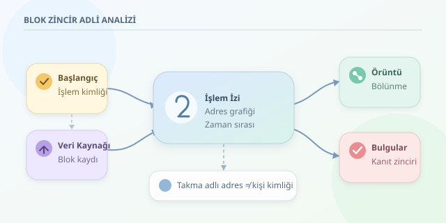

Bir kripto para işlemi kaybolmuş gibi görünebilir; ancak açık blok zincirlerde genellikle arkasında kalıcı bir iz bırakır. Blok zincir adli analizi, bu izleri anlamlandırarak şüpheli hareketleri inceleme işidir. Dedektifin büyüteci burada işlem kimliği, adres grafiği ve zaman çizelgesidir. Yalnız önemli bir fark var: Bir adresi bulmak, sahibini teşhis etmek değildir.

``

## Teorik temel: Şeffaf kayıt, takma adlı kullanıcı

Bitcoin ve Ethereum gibi açık ağlarda işlemler herkes tarafından incelenebilir. Kriptografik bağlantılar ve ağın uzlaşma mekanizması, geçmiş kayıtların değiştirilmesini zorlaştırır. Bununla birlikte zincir, çoğunlukla kişinin adını değil adresini gösterir. Bu nedenle sistem anonim olmaktan çok **takma adlıdır**.

Bitcoin’de UTXO modeli kullanılır: İşlemler önceki harcanmamış çıktıları tüketir ve yeni çıktılar oluşturur. Normal bir işlemde değer dengesi şöyledir:

$$\sum V_{girdi}=\sum V_{çıktı}+F_{işlem}$$

Ethereum’da ise hesap bakiyeleri ve akıllı sözleşme etkileşimleri öne çıkar. Token hareketleri için yalnızca işlemin ana değer alanına bakmak yetmez; olay günlükleri de incelenmelidir.

| Özellik | Bitcoin | Ethereum |
|---|---|---|
| Temel model | UTXO | Hesap tabanlı |
| İncelenen kayıt | Girdiler ve çıktılar | İşlemler, günlükler, yürütme izleri |
| Yaygın belirsizlik | Para üstü çıktısı | Sözleşme üzerinden dolaylı hareket |

## Şüpheli işlem nasıl takip edilir?

İyi bir inceleme, rastgele adres aratmakla değil, kapsamı belirlemekle başlar:

1. **Başlangıcı doğrula:** İşlem kimliğini, ağı, blok yüksekliğini ve varlığı kaydet. Aynı adres biçimi farklı ağlarda görülebilir.
2. **Veriyi topla:** Blok gezgini, düğüm veya indeksleyici kullan. Kaynağı ve erişim zamanını belgeleyerek veriyi sakla.
3. **Grafik oluştur:** Adresleri düğüm, değer hareketlerini yönlü kenar olarak temsil et. Tutar, varlık ve işlem sırasını koru.
4. **Örüntüleri araştır:** Hızlı bölünme, tekrar birleşme ve aracı hizmetlere aktarım gibi hareketleri incele. Bunlar tek başına suç göstergesi değildir.
5. **Bağlamla karşılaştır:** Etiketleri bağımsız kaynaklarla doğrula. Bir borsa adresine ulaşılması, müşteri kimliğinin zincirde bulunduğu anlamına gelmez.

## Python ile küçük bir izleme motoru

Aşağıdaki örnek, normalize edilmiş transfer kayıtlarında aynı varlığın zaman sırasına uygun yollarını arar. `order`, blok, işlem ve olay sırasından türetilmiş artan bir sayı; `amount` ise temel birimden dönüştürülmüş ondalık metindir.

```python
from collections import defaultdict, deque
from decimal import Decimal


def izle(kayitlar, baslangic, varlik, derinlik=3):
    komsular = defaultdict(list)
    for r in kayitlar:
        if r["asset"] != varlik:
            continue
        tutar = Decimal(r["amount"])
        if tutar > 0:
            komsular[r["from"]].append(
                (r["to"], tutar, int(r["order"]), r["tx"])
            )

    kuyruk = deque([(baslangic, -1, [baslangic])])
    bulgular = []
    while kuyruk:
        adres, son_sira, yol = kuyruk.popleft()
        if len(yol) - 1 >= derinlik:
            continue
        for hedef, tutar, sira, tx in komsular[adres]:
            if sira <= son_sira or hedef in yol:
                continue
            yeni_yol = yol + [hedef]
            bulgular.append({
                "yol": yeni_yol, "tx": tx,
                "son_transfer": str(tutar)
            })
            kuyruk.append((hedef, sira, yeni_yol))
    return bulgular
```

Kuyruk, yolları adım adım genişletir; derinlik sınırı aramayı kısıtlar. `Decimal`, kayan nokta yuvarlama hatalarını azaltır. Varlık kimliği ağ bilgisini de içermelidir. Çıktıdaki tutar son transferin değeridir; başlangıçtaki paranın aynı miktarda ilerlediğini kanıtlamaz. Özellikle hesap bakiyelerinde fonlar karışabileceğinden bu kod bir ilişki keşif aracıdır, kesin kaynak atama motoru değildir.

## Dedektifin tuzakları

| Gözlem | Olası yorum | Neden kesin değil? |
|---|---|---|
| Ortak işlem girdileri | Ortak kontrol | CoinJoin bunu bozabilir |
| Yeni çıktı adresi | Para üstü | Ödeme alıcısı da olabilir |
| Borsa etiketi | Hizmete aktarım | Etiket eski veya hatalı olabilir |
| Köprü kullanımı | Başka ağa geçiş | Hedef ağda ayrıca eşleştirme gerekir |

Karıştırıcılar, gizlilik odaklı protokoller ve zincirler arası geçişler takibi zorlaştırabilir. Zaman ve tutar benzerliği yalnızca destekleyici işarettir. FIFO veya oransal dağıtım gibi kaynak atama yöntemleri de varsayımdır; doğrudan zincir gerçeği değildir. Aynı veriye farklı yöntemler uygulandığında farklı sonuçlar çıkabilir.

## Bulguyu kanıta dönüştürmek

Rapor; kullanılan sorguları, ham kayıtları, dosya özetlerini, zaman çizelgesini ve belirsizlikleri içermelidir. Yeniden üretilebilirlik önemlidir: Başka bir uzman aynı adımlarla aynı gözlemleri elde edebilmelidir. Zincir yeniden düzenlenmeleri nedeniyle kesinleşme durumu da kaydedilmelidir. Kişiyle bağlantı kurmak için hizmet sağlayıcı kayıtları ve uygun hukuki süreçler gerekebilir.

Sonuçta zincir analizi sihirli bir kimlik bulucu değildir. Gücü, doğrulanabilir hareketleri görünür kılmasındadır. İyi analist, yalnızca okun yönünü değil, o okun neyi **kanıtlamadığını** da anlatır.
