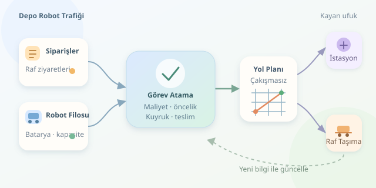

Bir depoda yüzlerce robotun aynı anda hareket ettiğini düşünün: Biri raf taşıyor, diğeri şarja gidiyor, üçüncüsü kavşakta bekliyor. Üstelik müşteriler sipariş vermeyi durdurmuyor! Amazon tarzı robotik depolarda bu koreografinin sırrı, tek bir süper algoritma değil; görev atama, zamanlama ve çakışmasız yol planlamasının birlikte çalışmasıdır. Depodaki görünmez trafik müdürünü biraz yakından tanıyalım.

``

## Önce iş modelini anlayalım

Yaygın yaklaşım **ürünün insana gelmesi**, yani *goods-to-person* modelidir. Mobil robotlar taşınabilir rafları toplama istasyonlarına getirir; ürünleri raftan alma işlemini insanlar veya ayrı robotik sistemler gerçekleştirebilir. Dolayısıyla mobil robotun görevi çoğunlukla ürünü doğrudan kavramak değil, doğru rafı doğru istasyona ulaştırmaktır.

Bir sipariş birden fazla raftaki ürünleri gerektirebilir. Tersine, aynı raftaki ürünler birkaç siparişe hizmet edebilir. Bu yüzden sistem önce siparişleri raf ziyaretlerine dönüştürür, uygun ziyaretleri gruplar ve ardından robotlara dağıtır. Böylece üç sipariş için aynı rafı üç kez dolaştırmak yerine tek ziyaret yeterli olabilir.

## Matematik: En yakın robot her zaman doğru robot değildir

Bu problem, çok robotlu görev atama ve çizelgeleme ailesine girer. Robotları $R$, görevleri $G$ ile gösterelim. $x_{ij}=1$, robot $i$ için görev $j$ seçildiği anlamına gelsin. Basitleştirilmiş hedef, toplam atama maliyetini azaltmaktır:

$$\min_x \sum_{i,j} c_{ij}x_{ij}$$

Örnek maliyet fonksiyonumuz şöyle olabilir:

$$c_{ij}=\alpha d_{ij}+\beta q_j+\gamma\max(0,t+d_{ij}+q_j+s_j-D_j)$$

Burada $d_{ij}$ tahmini seyahat süresi, $q_j$ istasyon kuyruğu, $s_j$ hizmet süresi, $D_j$ teslim hedefi, $t$ ise mevcut zamandır. Ağırlıklar işletmenin önceliklerini belirler. Büyük $\gamma$, gecikmeyi daha pahalı hale getirir.

Tek karar turunda her robot en fazla bir görev alır; seçilen her görev de bir robota atanır. Batarya, taşıma kapasitesi ve rafın müsaitliği ayrıca uygunluk kısıtlarıdır. Bunları yalnızca maliyet artırarak değil, gerektiğinde atamayı yasaklayarak modellemek gerekir.

## Hangi algoritma hangi katmanda?

| Yaklaşım | Kullanıldığı katman | Gücü | Sınırlaması |
|---|---|---|---|
| Açgözlü seçim | Görev atama | Çok hızlı karar | Yerel tercihler toplam maliyeti büyütebilir |
| Macar algoritması | Bire bir atama | Verilen matriste optimum eşleşme | Trafiği kendiliğinden çözmez |
| Öncelikli planlama | Çok robotlu yol bulma | Pratik ve hızlı | Öncelik sırası sonucu etkiler |
| CBS | Çok robotlu yol bulma | Uygun koşullarda optimal çözüm | Yoğun senaryolarda hesaplama pahalılaşabilir |

Gerçek zamanlı sistemlerde **kayan ufuk** yaklaşımı kullanışlıdır: Yakın geleceği planla, küçük bir kısmını uygula, yeni bilgi gelince yeniden hesapla. Bu bir atama algoritmasından çok, kararları sürekli yenileme stratejisidir.

## Python ile küçük bir atama motoru

Aşağıdaki örnekte üç robotu üç raf ziyaretine eşleştiriyoruz. Sürelerin birimi dakika; teslim hedefleri şu andan itibaren ölçülüyor. SciPy kurulmuş olmalıdır. Seyahat matrisi, rafı alma ve istasyona götürme süresinin tahminini temsil eder.

```python
import numpy as np
from scipy.optimize import linear_sum_assignment

# Satırlar robotlar, sütunlar raf ziyaretleridir.
travel = np.array([
    [4, 7, 3],
    [6, 2, 5],
    [3, 5, 8],
], dtype=float)
queue = np.array([0, 4, 1], dtype=float)
deadline = np.array([8, 9, 6], dtype=float)
service = 2.0

completion = travel + queue[None, :] + service
lateness = np.maximum(completion - deadline[None, :], 0)
cost = travel + queue[None, :] + 4 * lateness

robots, tasks = linear_sum_assignment(cost)
for robot, task in zip(robots, tasks):
    print(f"Robot {robot} -> Görev {task}")
```

`[None, :]`, kuyruk ve teslim hedeflerini bütün robot satırlarına yayar. `lateness`, erken tamamlanan işlere sıfır gecikme cezası verir. Eşleştirme, bu sabit maliyet matrisi için optimumdur; tüm deponun geleceği için değil! Örnek, her robotun her rafı taşıyabildiğini varsayar ve güzergâh çatışmalarını henüz hesaba katmaz.

## Aynı koridora iki robot girerse?

Atamadan sonra **çok ajanlı yol bulma**, yani MAPF katmanı devreye girer. Depo bir grafik olarak modellenir: Düğümler konumları, kenarlar geçişleri temsil eder. Zaman da modele eklenince robotların aynı anda aynı düğümü kullanması veya bir kenarda karşılıklı yer değiştirmesi engellenebilir.

Rezervasyon tablosu, belirli konumları belirli zaman aralıklarında robotlara ayırır. Beklemek de geçerli bir harekettir. Ancak gerçek robotların boyutları, dönüş süreleri ve fren mesafeleri bulunduğundan, yalnızca kareli haritadaki çakışmaları önlemek yeterli değildir; güvenlik payları ve hareket kısıtları gerekir.

## Küçük senaryo, büyük ders

İki sipariş aynı raftan ürün istiyor; üçüncü sipariş farklı rafta ve daha acil. Planlayıcı ortak raf ziyaretini birleştirir, acil işi uygun robota verir ve istasyon yoğunluğunu değerlendirir. Yol planlayıcı kavşak geçişlerini zamanlar. Bir koridor kapanırsa sistem yeni güzergâh üretir; gecikme büyürse görev atamasını da günceller.

Başarıyı yalnızca robotların hızında aramayın. Saatlik tamamlanan sipariş, teslim gecikmesi, istasyon beklemesi ve enerji tüketimini birlikte ölçün. İyi planlama, bütün robotları sürekli koşturmak değil; doğru robotu doğru anda doğru işe göndermektir.
