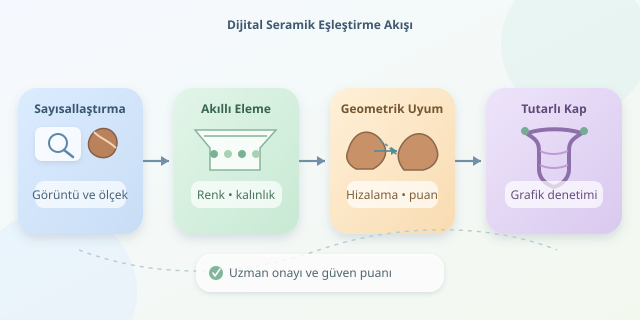

Bir kazı alanından çıkan binlerce seramik parçasını düşünün: Kutunun üzerinde örnek resim yok, parçaların bir bölümü kayıp ve bazı kenarlar yüzyıllardır aşınıyor. Bildiğimiz yapbozun oldukça huysuz kuzeni! Görüntü işleme, bu karmaşayı ölçülebilir bir eşleştirme problemine dönüştürür. Amaç, parçaları rastgele denemek değil; geometriden, renkten ve fiziksel kısıtlardan yararlanarak olası komşuları bulmaktır.

``

## Önce parçaları bilgisayarın diline çevirmek

İlk adım, her parçayı kimlik numarasıyla kaydetmek ve kontrollü ışık altında görüntülemektir. Fotoğraflardaki ölçek referansı, piksel mesafelerini milimetreye çevirmeyi sağlar. Farklı büyütmelerle çekilmiş iki parçayı doğrudan karşılaştırmak, biri santimetreyle diğeri inçle konuşan iki ustayı aynı tezgâha göndermeye benzer.

Arka plan ayrıştırılır, gölgeler azaltılır ve parça sınırları çıkarılır. OpenCV ile eşikleme, morfolojik işlemler ve kontur bulma kullanılabilir. Ancak dış konturun tamamı kırık kenar değildir: Özgün ağız veya taban çizgileri ayrıca sınıflandırılmalıdır. Eğri ve kalın parçalar için çok açılı fotoğraflar ya da üç boyutlu taramalar daha güvenilir bilgi sunar.

## Eşleşmenin matematiği: Yakınlık yetmez

İki kırık kenarın uyuşması için uygun konuma taşınmaları gerekir. Rijit dönüşüm, noktaları $T(p)=Rp+t$ biçiminde döndürür ve öteleyerek yerleştirir. Burada $R$ dönme matrisi, $t$ ise öteleme vektörüdür. Ölçek kalibre edilmişse parçaları keyfî biçimde büyütmek doğru değildir.

Hizalanmış kenar kümeleri arasındaki uzaklık, simetrik Chamfer ölçüsüyle hesaplanabilir:

$$d(A,B)=\frac{1}{2\vert A\vert }\sum_{a\in A}\min_{b\in B}\\vert a-b\\vert +\frac{1}{2\vert B\vert }\sum_{b\in B}\min_{a\in A}\\vert b-a\\vert $$

Küçük değer, geometrik yakınlığa işaret eder; kesin eşleşmeye değil. Benzer eğriler farklı kaplara ait olabilir. Bu yüzden birden fazla kanıt birlikte değerlendirilir.

| Kanıt | Sağladığı ipucu | Temel sınırı |
|---|---|---|
| Kenar geometrisi | Kırık çizgilerinin uyumu | Aşınma şekli değiştirir |
| Renk ve bezeme | Yüzey deseninin devamlılığı | Işık ve kir yanıltabilir |
| Kalınlık | Komşuluk için fiziksel tutarlılık | Aynı kapta değişebilir |
| Üç boyutlu yüzey | Kırık yüzeylerin tamamlayıcılığı | Tarama maliyeti yüksektir |

## Binlerce aday arasında akıllı eleme

$n$ parçanın bütün çiftlerini denemek yaklaşık $n(n-1)/2$ karşılaştırma gerektirir. On bin parçada bu sayı yaklaşık elli milyondur. Bilgisayar hızlıdır, fakat gereksiz karşılaştırmaları sevmez.

Önce kalınlık, malzeme, renk dağılımı ve kenar eğriliği gibi özniteliklerle aday havuzu daraltılır. Yaklaşık en yakın komşu indeksleri, benzer özniteliklere sahip parçaları hızla getirir. Ardından pahalı geometrik hizalama uygulanır. Bu sıralama önemlidir: Hızlı filtreler fazla katıysa gerçek komşular daha baştan kaybolabilir.

## Küçük bir kenar puanlayıcısı

Aşağıdaki Python kodu, önceden hizalanmış iki kenarın simetrik uzaklığını hesaplar. Diziler, aynı koordinat sisteminde ve milimetre cinsinden örneklenmiş kırık kenar noktalarını içermelidir; parçaların bütün dış konturlarını değil.

```python
import numpy as np
from scipy.spatial import cKDTree


def kenar_puani(a, b):
    a = np.asarray(a, dtype=float)
    b = np.asarray(b, dtype=float)
    if (a.ndim != 2 or b.ndim != 2
            or a.shape[1] != 2 or b.shape[1] != 2
            or len(a) < 2 or len(b) < 2):
        raise ValueError("En az iki noktalı Nx2 diziler gerekli.")

    agac_a = cKDTree(a)
    agac_b = cKDTree(b)
    uzaklik_ab = agac_b.query(a)[0]
    uzaklik_ba = agac_a.query(b)[0]
    return float((uzaklik_ab.mean() + uzaklik_ba.mean()) / 2)
```

KD-tree, her noktanın karşı kenardaki en yakın komşusunu bulmayı hızlandırır. İki yönlü ortalama, yalnızca tek tarafın iyi örtüşmesini ödüllendirme riskini azaltır. Kenarlar benzer aralıklarla örneklenmelidir; aksi hâlde yoğun örneklenen bölgeler puanı fazla etkiler. Bu fonksiyon hizalama yapmaz. Öncesinde dönüşüm aranmalı, sonrasında örtüşme uzunluğu ve parça çakışması kontrol edilmelidir.

## İyi çiftlerden tutarlı bir kaba

En düşük puanlı çiftleri sırayla birleştirmek caziptir, ama erken bir hata bütün rekonstrüksiyonu bozabilir. Bunun yerine parçalar düğüm, olası eşleşmeler bağlantı olacak şekilde bir grafik kurulabilir.

Sistem yalnızca yerel uyumu değil, küresel tutarlılığı da denetler: Aynı kenar iki farklı komşuya bağlanmamalı, parçaların iç bölgeleri çakışmamalı ve bağlantı döngüleri çelişkili konumlar üretmemelidir. Üç boyutlu çalışmada kırık yüzey normalleri uygun biçimde karşıt yönlere bakmalıdır. Işın araması gibi yöntemler, tek bir karara kilitlenmeden birkaç olası düzenlemeyi birlikte değerlendirebilir.

## Başarıyı nasıl ölçeriz?

Güzel görünen bir dijital kap tek başına başarı ölçütü değildir. Gerçek komşulukları bilinen örneklerde eşleşme kesinliği, bulunan doğru bağlantıların oranı ve geometrik yerleştirme hatası ölçülmelidir. Farklı aşınma düzeyleri, eksik parçalar ve birbirine benzeyen kaplar ayrıca denenmelidir.

Pratikte bu sistemler çoğunlukla arkeoloğa güven puanlı öneriler sunar; her parçayı kusursuzca birleştiren sihirli makineler değildir. İnsan uzman, bezeme üslubu ve üretim tekniği gibi bağlamsal bilgileri ekler. Sonuç, algoritmanın sabrıyla arkeoloğun sezgisinin ortak çalışmasıdır: Çömlek konuşmaz, ama kırık kenarları epey ipucu verir!
