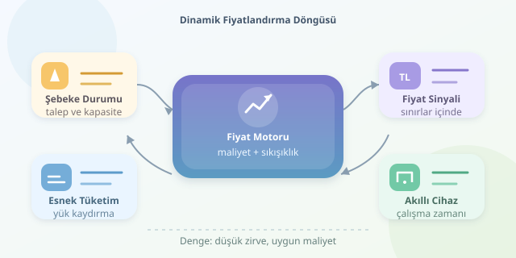

Elektrik fiyatının gün boyunca değişmesi, marketteki indirim etiketlerinin saat başı yenilenmesine benzer. Ancak burada amaç yalnızca satış yapmak değildir: üretim ile tüketimi dengede tutmak gerekir. Herkes klimasını aynı anda açtığında sistem zorlanabilir; tüketimin bir kısmını daha sakin saatlere taşımak ise maliyetleri azaltabilir. Peki, bu fiyat sinyali nasıl hesaplanır ve tüketicinin kararına nasıl dönüşür?

``

## Önce fizik, sonra fiyat etiketi

Elektrik şebekesinde üretim ve tüketim sürekli dengelenmelidir. Depolama ve bağlantılar esneklik sağlasa da sınırsız değildir. Talep yükseldiğinde daha pahalı üretim kaynakları devreye girebilir; iletim darboğazları ve rezerv ihtiyacı da maliyeti etkileyebilir.

Bu nedenle dinamik fiyatlandırmanın temelinde **marjinal maliyet** bulunur: sisteme ilave bir birim elektrik sağlamanın maliyeti. Ancak tüketicinin ödediği fiyat; sözleşme, vergiler, şebeke bedelleri ve düzenlemeler nedeniyle bu maliyetle birebir aynı olmayabilir.

Başlıca yaklaşımlar şöyle ayrılır:

| Model | Fiyat nasıl belirlenir? | Tüketici açısından |
|---|---|---|
| Sabit tarife | Dönem boyunca değişmez | Öngörülebilir, zamanlama teşviki zayıf |
| Zaman dilimli tarife | Önceden tanımlanan saatlere göre değişir | Planlama kolaydır |
| Gerçek zamanlı tarife | Güncel piyasa veya sistem koşullarını izler | Esneklik değerlidir, belirsizlik artar |

## Basitleştirilmiş bir hesaplama modeli

Öğretici bir modelde enerji maliyetine, kapasite kullanımından doğan bir sıkışıklık bileşeni ekleyebiliriz:

$$p_t = \operatorname{clip}\left(c_t + \alpha \left[\max\left(0,\frac{D_t}{K_t}-\theta\right)\right]^2,\ p_{min},\ p_{max}\right)$$

Burada $c_t$ temel enerji maliyeti, $D_t$ talep, $K_t$ kullanılabilir kapasitedir. Talep ve kapasite aynı güç biriminde ölçülür. $\theta$ sıkışıklık eşiğini, $\alpha$ ise fiyat tepkisinin şiddetini belirler. Fiyatın birimi TL/kWh olduğundan $\alpha$ da aynı birimi taşır.

Kare terimi, eşik aşıldıkça baskının hızlanmasını sağlar. `clip` işlemi ise fiyatı belirlenen alt ve üst sınırlar arasında tutar. Bu formül gerçek bir piyasanın eksiksiz modeli değil, anlaşılır bir tasarım örneğidir.

$K_t=1000$, $\theta=0{,}75$ ve $\alpha=8$ seçildiğinde, sınırlar devreye girmiyorsa:

| Talep | Temel maliyet | Hesaplanan fiyat |
|---|---:|---:|
| 600 MW | 1,60 TL/kWh | 1,60 TL/kWh |
| 900 MW | 2,00 TL/kWh | 2,18 TL/kWh |
| 1000 MW | 2,50 TL/kWh | 3,00 TL/kWh |

## Tüketici neden davranış değiştirir?

Bu ilişkinin anahtarı **talebin fiyat esnekliğidir**:

$$\frac{\Delta Q}{Q}\approx\varepsilon\frac{\Delta p}{p}$$

Örneğin $\varepsilon=-0{,}2$ ise yüzde 10 fiyat artışı, diğer koşullar sabitken yaklaşık yüzde 2 tüketim azalmasıyla ilişkilendirilebilir. Bu küçük değişimler için kullanılan bir yaklaşımdır; herkesin davranışını kesin biçimde tahmin etmez.

Üstelik azalan tüketim tamamen kaybolmayabilir. Elektrikli aracın şarjını geceye taşımak, günlük ihtiyacı azaltmadan yoğun saatteki yükü düşürür. Buzdolabı ise fiyat bildirimini okuyup tatile çıkamaz! Cihazın esnekliği, konfor ihtiyacı ve otomasyon burada belirleyicidir.

## Python ile ucuz çalışma aralığını bulalım

Aşağıdaki kod fiyatları hesaplar ve her saat 1 kWh tüketen, iki saat kesintisiz çalışan bir cihaz için en ucuz başlangıcı seçer. Örnekte saatler ardışıktır; bedellere vergi ve diğer ücretler dahil değildir.

```python
from dataclasses import dataclass

@dataclass
class Hour:
    hour: int
    demand: float
    capacity: float
    cost: float

def price(slot: Hour, alpha=8.0, threshold=0.75):
    if slot.capacity <= 0:
        raise ValueError("Kapasite pozitif olmalıdır")
    stress = max(0.0, slot.demand / slot.capacity - threshold)
    raw = slot.cost + alpha * stress ** 2
    return min(6.0, max(0.5, raw))

slots = [
    Hour(18, 900, 1000, 2.0),
    Hour(19, 1000, 1000, 2.5),
    Hour(20, 800, 1000, 1.9),
    Hour(21, 600, 1000, 1.6),
]
prices = [price(slot) for slot in slots]
start = min(
    range(len(prices) - 1),
    key=lambda i: sum(prices[i:i + 2])
)
print(slots[start].hour, round(sum(prices[start:start + 2]), 2))
```

Çıktı `20 3.52` olur: cihazın 20.00’de başlaması toplam 3,52 TL enerji maliyeti oluşturur. 18.00’de başlatılması ise 5,18 TL tutar. Buradaki tasarruf, tüketimin miktarını değil zamanını değiştirerek elde edilir.

## İyi model yalnızca ucuzluğu hedeflemez

Gerçek uygulamalarda talep tahmini, hava durumu, yenilenebilir üretim ve tüketici tepkisi birlikte değerlendirilir. Herkes aynı ucuz saate yönelirse yeni bir talep zirvesi oluşabilir; bu yüzden tahmin ve optimizasyon tekrarlanmalıdır.

Şeffaf bildirimler, fiyat sınırları ve hassas tüketicilere uygun seçenekler de önemlidir. Her hane tüketimini kaydıramaz. Başarılı dinamik fiyatlandırma, faturayı bir bulmacaya çevirmek yerine anlaşılır sinyallerle esnekliği ödüllendirir.
