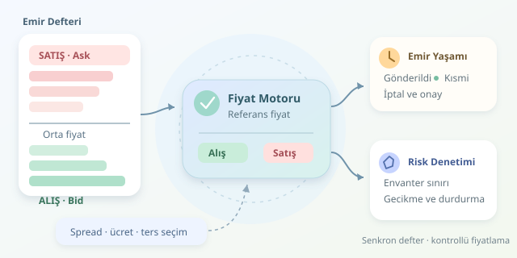

Bir pazarcının aynı ürünü farklı alış ve satış fiyatlarıyla değerlendirdiğini düşünün. Piyasa yapıcı botlar da benzer biçimde çalışır; ancak tezgâhları emir defteri, müşterileri diğer yatırımcılar, mesai arkadaşları ise milisaniyelerdir. İşin sırrı yalnızca fiyat farkını yakalamak değil, elde kalan pozisyonu ve gerçekleşmeyen emirleri yönetmektir.
``

## Spread neden bedava para değildir?

Emir defteri, farklı fiyat seviyelerindeki limit emirlerini tutar. En yüksek alış fiyatına **bid**, en düşük satış fiyatına **ask** denir. Aralarındaki fark spread, bu iki fiyatın ortalaması ise orta fiyattır:

$$m=(bid+ask)/2$$

Piyasa yapıcı, alış ve satış limit emirleri göndererek likidite sağlar. İki emir uygun sırayla gerçekleşirse fiyat farkından brüt gelir oluşabilir. Ancak yalnızca alış gerçekleşir ve piyasa düşerse, bot spread kazanmak yerine değer kaybeden envanter taşır. Kasa bazen dolar, bazen de istenmeyen ürünlerle dolar!

| Yaklaşım | İşleyiş | Başlıca risk |
|---|---|---|
| Piyasa yapıcı | Bekleyen emirlerle likidite sunar | Envanter ve ters seçim |
| Piyasa alıcı | Mevcut emirlerle hemen eşleşir | Kayma ve işlem maliyeti |




**Ters seçim**, botun fiyatı güncelliğini yitirmişken daha hızlı veya bilgili katılımcıların onunla işlem yapmasıdır. Özellikle ani haberlerde, cazip görünen spread aslında yaklaşan zararın ambalajı olabilir.

## Envanter fiyatları nasıl değiştirir?

Basit bir modelde bot, orta fiyatın çevresine simetrik emirler yerleştirir. Daha gerçekçi yaklaşım, envantere göre bir referans fiyat hesaplar:

$$r=m-\kappa\frac{q}{q_{\max}}$$

Burada $q$ net pozisyon, $q_{\max}$ pozisyon sınırı, $\kappa$ ise fiyat biriminde kaydırma katsayısıdır. Pozitif envanter referans fiyatı düşürür: bot daha düşük alış fiyatıyla yeni alımları yavaşlatır, daha cazip satış fiyatıyla envanteri azaltmaya çalışır. Bu, garanti değil, işlem olasılıklarını değiştiren bir teşviktir.

Yarı spread $h$ seçilirken maliyetler de düşünülmelidir:

$$h\gtrsim mf+a+b$$

Burada $f$ işlem başına oransal maker ücreti, $a$ beklenen ters seçim maliyeti, $b$ hedeflenen ek marjdır. Bu yaklaşık ilişki, kârlılık garantisi değildir; ücret indirimleri, oynaklık ve gerçekleşme ihtimali sonucu değiştirir.

## Python ile fiyat üretmek

Aşağıdaki eğitim örneği, tutarlı bir defter görüntüsünden aday fiyatlar üretir. Ondalık hesaplama fiyat adımına uyumu kolaylaştırır; alış aşağıya, satış yukarıya yuvarlanır.

```python
from decimal import Decimal as D, ROUND_FLOOR, ROUND_CEILING


def quote_prices(bid, ask, q, limit, size, tick, half, skew):
    # Sayısal girdiler Decimal olmalıdır.
    if bid >= ask or min(limit, size, tick, half) <= 0:
        raise ValueError("Geçersiz piyasa veya parametre")

    mid = (bid + ask) / D("2")
    reference = mid - skew * q / limit

    def align(price, rounding):
        steps = (price / tick).to_integral_value(rounding=rounding)
        return steps * tick

    buy = align(reference - half, ROUND_FLOOR)
    sell = align(reference + half, ROUND_CEILING)
    orders = {}

    if q + size <= limit and D("0") < buy < ask:
        orders["buy"] = buy
    if q - size >= -limit and sell > bid:
        orders["sell"] = sell
    return orders
```

Fonksiyon emir göndermez; yalnızca fiyat önerir. Karşı tarafla hemen eşleşecek adayları eler ve mevcut pozisyona göre sınır kontrolü yapar. Negatif pozisyona izin vermesi, açığa satışın mümkün olduğu bir ortam varsayar; spot işlemlerde satış miktarı kullanılabilir varlıkla sınırlandırılmalıdır.

## Asıl mühendislik: Emir yaşam döngüsü

- **Defteri senkronize et:** Önce snapshot al, ardından sıra numaralı güncellemeleri uygula. Mesaj kaybında yeni görüntü almadan fiyat üretmeye devam etme.
- **Emir durumunu izle:** Gönderildi, kabul edildi, kısmen gerçekleşti ve iptal edildi durumlarını ayır. İptal isteği, iptalin tamamlandığı anlamına gelmez.
- **Gereksiz yenilemeyi azalt:** Fiyat değişimi belirli bir eşiği geçmeden emirleri değiştirme. Fiyat-zaman öncelikli piyasalarda sürekli iptal, kuyruk avantajını kaybettirebilir.
- **Riski birlikte hesapla:** Pozisyona ek olarak açık ve iptal bekleyen emirleri hesaba kat. Bakiye, teminat, minimum emir tutarı ve hız sınırlarını ayrıca denetle.

Üretimde emirler, borsanın davranışı doğrulanarak **post-only** gönderilmelidir. Kodun yerel kontrolü yeterli değildir; ağ gecikmesi sırasında defter değişebilir. Bağlantı kopması, eski veri veya aşırı pozisyon için işlemleri durduran bir güvenlik mekanizması gerekir.

## Performansı doğru ölçmek

Başarıyı yalnızca kazanılan spread ile ölçmeyin. Ücret sonrası kâr, gerçekleşme oranı, envanter oynaklığı ve işlemlerden sonraki fiyat hareketini birlikte izleyin. Geriye dönük testte kuyruk sırası, kısmi gerçekleşme ve gecikme modellenmezse sonuçlar gereğinden parlak görünür. Piyasa yapıcılık, iki fiyat yazmaktan çok belirsizliği disiplinle yönetme işidir. Bu örnek eğitim amaçlıdır, yatırım tavsiyesi değildir.
