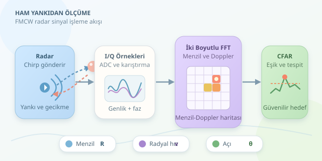

Radar, karanlıkta çevresine seslenen bir yarasaya benzer; yalnız ses yerine elektromanyetik dalga kullanır. Gönderdiği sinyalin yankısını dinleyerek hedefin uzaklığını ve hareketini çıkarır. Ancak ekrandaki parlak noktanın arkasında sihir değil; zaman gecikmesi, faz değişimi, Fourier dönüşümü ve biraz da gürültüyle mücadele vardır. Gelin ham örneklerden ölçüme uzanan yolu inceleyelim.

``

## 1. Uzaklık, gidiş-dönüş süresinde saklıdır

Bir sinyal hedefe gider, yansır ve geri döner. Ölçülen gecikme $t_d$ ise menzil:

$$R=\frac{ct_d}{2}$$

Burada $c$, ışık hızıdır. İkiye bölmemizin nedeni sinyalin yolu iki kez katetmesidir. Örneğin 200 nanosaniyelik gecikme yaklaşık 30 metreye karşılık gelir. Darbeli radarda gecikme, gönderilen dalga biçimiyle alınan sinyalin korelasyonu üzerinden bulunabilir; eşleşmiş filtre, yankıyı gürültü içinde belirginleştirir.

## 2. FMCW: Zaman farkını frekansa çevirmek

Otomotiv radarlarında yaygın olan FMCW, frekansı zamanla doğrusal değişen bir **chirp** gönderir. Chirp eğimi $S=B/T$ ile tanımlanır; $B$ bant genişliği, $T$ tarama süresidir.

Alınan yankı gönderilen sinyalle karıştırılır. Alçak geçiren filtre sonrasında ortaya çıkan fark, yani beat frekansı, durağan hedef için yaklaşık olarak şöyledir:

$$f_b=St_d,\qquad R=\frac{cf_b}{2S}$$

Analog-sayısal dönüştürücü bu sinyali örnekler. Karmaşık I/Q örnekleri, hem genliği hem fazı korur: genlik yankının gücünü, faz ise ince zaman ve hareket bilgisini taşır.

## 3. Hız, chirpler arasındaki faz değişimidir

Hedef hareket ediyorsa Doppler frekansı oluşur:

$$f_D=\frac{2v_r}{\lambda},\qquad v_r=\frac{\lambda f_D}{2}$$

Buradaki $v_r$, radar doğrultusundaki **radyal hızdır**; cismin toplam hız büyüklüğü değildir. Art arda gönderilen chirplerde aynı menzil hücresinin fazı düzenli değişir. Bu değişime uygulanan Fourier dönüşümü, Doppler frekansını verir. Hızın işareti kullanılan I/Q ve faz konvansiyonuna bağlıdır.

| İşlenen boyut | Karşılaştırılan veri | Elde edilen bilgi |
|---|---|---|
| Hızlı zaman | Bir chirp içindeki örnekler | Beat frekansı ve menzil |
| Yavaş zaman | Ardışık chirpler | Doppler ve radyal hız |
| Anten boyutu | Farklı alıcıların fazları | Geliş açısı |




## 4. Python ile küçük bir menzil–Doppler deneyi

Aşağıdaki örnek, tek hedefin karmaşık yankısını üretir. Menzil–Doppler bağlaşımı ihmal edilmiştir: gerçek hareketli hedefte, uygun işaret konvansiyonuyla $f_b\simeq 2SR/c+f_D$ olur. Bu sadeleştirme iki boyutlu FFT mantığını görünür kılar.

```python
import numpy as np

c, fc = 3e8, 77e9
lam = c / fc
N, M = 256, 64
fs, Tr, B = 4e6, 80e-6, 1e9
S = B / (N / fs)
R0, v0 = 12.0, 3.0

fast = np.arange(N) / fs
slow = np.arange(M) * Tr
fb = 2 * S * R0 / c
fd = 2 * v0 / lam
phase = 2 * np.pi * (
    fb * fast[None, :] + fd * slow[:, None]
)
x = np.exp(1j * phase)
rng = np.random.default_rng(42)
x += 0.2 * (rng.normal(size=x.shape)
            + 1j * rng.normal(size=x.shape))

window = np.hanning(M)[:, None] * np.hanning(N)[None, :]
range_fft = np.fft.fft(x * window, axis=1)
rd = np.fft.fftshift(
    np.fft.fft(range_fft, axis=0), axes=0
)
power = np.abs(rd[:, :N // 2]) ** 2
i, j = np.unravel_index(np.argmax(power), power.shape)
f_range = np.fft.fftfreq(N, 1 / fs)[j]
f_doppler = np.fft.fftshift(np.fft.fftfreq(M, Tr))[i]
print('Menzil:', c * f_range / (2 * S))
print('Radyal hız:', lam * f_doppler / 2)
```

İlk FFT menzil hücrelerini, ikinci FFT Doppler hücrelerini oluşturur. Hann pencereleri güçlü hedeflerin komşu hücrelere sızmasını azaltır; bunun bedeli ana lobun genişlemesidir. Sonuç yaklaşık 12 metre ve 3 m/s çıkar. Küçük farklar, frekansların ayrık FFT hücrelerine yuvarlanmasından kaynaklanır.

## 5. En parlak hücre her zaman hedef değildir

Örnekte en güçlü hücreyi seçtik; gerçek sistemlerde bu yaklaşım yetersizdir. Zemin yansımaları, çoklu yollar ve parazitler sahte zirveler üretir. CFAR, çevredeki hücrelerden yerel gürültü seviyesini tahmin ederek uyarlanabilir eşik kurar. Koruma hücreleri, hedef enerjisinin gürültü tahminini şişirmesini önler. Tespitler zaman içinde izlenerek yanlış alarmlar azaltılabilir.

## 6. Menzilden konuma, ölçümden sınırlara

Menzil tek başına konum değildir: hedef aynı uzaklıktaki birçok noktada bulunabilir. Anten dizisinin faz farklarından azimut açısı $\theta$ kestirilirse, iki boyutta $x=R\cos\theta$ ve $y=R\sin\theta$ hesaplanır. Üç boyutlu konum için yükseliş açısı da gerekir.

Menzil çözünürlüğü yaklaşık $\Delta R=c/(2B)$, hız çözünürlüğü ise $\Delta v=\lambda/(2MT_r)$ olur. Daha geniş bant yakın hedefleri ayırır; daha uzun gözlem küçük hız farklarını seçer. Ancak örnekleme hızı ve chirp aralığı belirsizlik sınırlarını belirler. Radarın marifeti yalnız yankıyı duymak değil, ölçümün nerede güvenilir olduğunu bilmektir.
