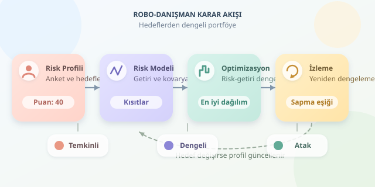

Bir robo-danışman, paranızı sihirli bir algoritmaya teslim eden dijital kahin değildir. Daha çok, hedeflerinizi ve sınırlarınızı matematiksel bir yatırım problemine çeviren otomatik bir yardımcıdır. Kullanıcı anketiyle başlayan süreç; risk ölçümü, varlık seçimi, optimizasyon ve düzenli kontrol adımlarından geçer. Gelin bu dijital portföy mutfağının tarifini inceleyelim.

``

## 1. Risk profili: Cesaret tek başına yetmez

İlk adım, kullanıcının **risk isteğini** ve **risk taşıma kapasitesini** ayrı ayrı değerlendirmektir. Piyasa düşüşünde sakin kalabileceğini söylemek başka, altı ay sonra ihtiyaç duyulacak parayı kayba maruz bırakabilmek başkadır.

Anketler genellikle yatırım süresini, gelir istikrarını, likidite ihtiyacını, finansal deneyimi ve kabul edilebilir kaybı sorgular. Sistem, cevapları bir puana dönüştürür; fakat tutarsız cevapları da kontrol etmelidir. “Kayıp istemiyorum” ile “en yüksek getiriyi istiyorum” aynı sepete sessizce atılamaz!

| Profil | Öncelik | Portföy tasarımına etkisi |
|---|---|---|
| Temkinli | Sermaye dalgalanmasını sınırlamak | Daha düşük risk hedefi |
| Dengeli | Büyüme ve istikrar | Çeşitli risk kaynakları |
| Atak | Uzun vadeli büyüme | Daha yüksek dalgalanma toleransı |

Bu sınıflar kesin yatırım reçeteleri değildir; kısa vade veya zorunlu nakit ihtiyacı öneriyi değiştirebilir.

## 2. Matematik: Getiri kadar birlikte hareket etmek de önemli

Portföy ağırlıklarını $w$, beklenen getirileri $\mu$, kovaryans matrisini $\Sigma$ ile gösterelim. Beklenen portföy getirisi $E[R_p]=w^T\mu$, oynaklığı ise $\sigma_p=\sqrt{w^T\Sigma w}$ olur.

Kovaryans, varlıkların birlikte nasıl hareket ettiğini anlatır. İki varlık aynı anda düşüyorsa, isimlerinin farklı olması güçlü çeşitlendirme sağladıkları anlamına gelmez. Orkestra benzetmesiyle: Her enstrüman aynı notayı çalıyorsa ses artar, çeşitlilik değil.

Ortalama-varyans yaklaşımında yaygın hedef şudur:

$$\max_w\left(w^T\mu-\frac{\lambda}{2}w^T\Sigma w\right)$$

Burada $\lambda$ riskten kaçınma katsayısıdır. Büyük değerler, aynı varsayımlar altında riski daha fazla cezalandırır. Ayrıca $\sum_i w_i=1$ ve $w_i\geq0$ gibi kısıtlar eklenebilir. Böylece bütçe tamamen dağıtılır ve açığa satış yapılmaz.

## 3. Python ile küçük bir optimizasyon motoru

Aşağıdaki örnek, `numpy` ve `cvxpy` paketlerini kullanır. Hisse, tahvil ve altın için **tamamen örnek amaçlı** yıllık getiri ve kovaryans varsayımları içerir; güncel piyasa tahmini değildir.

```python
import numpy as np
import cvxpy as cp

risk_score = 40
if not 0 <= risk_score <= 100:
    raise ValueError("Risk puanı 0–100 arasında olmalı.")

assets = ["hisse", "tahvil", "altın"]
mu = np.array([0.07, 0.035, 0.04])
cov = np.array([
    [0.0324, 0.0018, 0.0018],
    [0.0018, 0.0036, 0.0006],
    [0.0018, 0.0006, 0.0225]
])
risk_aversion = 2 + 18 * (1 - risk_score / 100)
w = cp.Variable(3)

objective = cp.Maximize(
    mu @ w - risk_aversion / 2 * cp.quad_form(w, cov)
)
constraints = [
    cp.sum(w) == 1,
    w >= 0,
    w <= np.array([0.65, 0.80, 0.20])
]
problem = cp.Problem(objective, constraints)
problem.solve()

if problem.status != cp.OPTIMAL:
    raise RuntimeError("Güvenilir optimum elde edilemedi.")
print(dict(zip(assets, np.round(w.value, 4))))
```

Kod, risk puanını örnek bir katsayıya çevirir; ardından ağırlıkları üst sınırlar içinde optimize eder. Bu eşleme evrensel değildir: Gerçek platformlarda uygunluk politikasıyla kalibre edilir. Getiri ve kovaryansın aynı zaman ölçeğinde olması da kritiktir. Yıllık getiriyi günlük kovaryansla eşleştirmek, tarifte gram yerine kilogram kullanmaya benzer.

## 4. Optimum sonuç neden son söz değildir?

Beklenen getiriler gözlemlenmiş gerçekler değil, tahminlerdir. Küçük tahmin değişiklikleri büyük ağırlık değişimleri üretebilir. Bu nedenle platformlar pozisyon sınırları, daha sağlam kovaryans tahminleri, senaryo testleri ve işlem maliyetleri kullanabilir.

| Yaklaşım | Güçlü tarafı | Sınırı |
|---|---|---|
| Sabit dağılım | Basit ve açıklanabilir | Koşullara uyumu sınırlı |
| Ortalama-varyans | Getiri-risk dengesini modeller | Tahmin hatalarına duyarlı |
| Senaryo tabanlı model | Olumsuz durumları sınar | Senaryo kalitesine bağımlı |

Oynaklık bütün riskleri kapsamaz. Likidite, kredi, enflasyon ve kur riski ayrıca değerlendirilmelidir. Tarihsel korelasyonların kriz sırasında değişebileceği de unutulmamalıdır.

## 5. Yeniden dengeleme: Otomatik pilotun bakımı

Piyasalar hareket ettikçe ağırlıklar hedeflerden uzaklaşır. Sistem takvimle veya sapma eşiğiyle yeniden dengeleme önerebilir. Ancak her küçük sapmada işlem yapmak; komisyon, alış-satış farkı ve vergi etkileri yüzünden gereksiz maliyet yaratabilir.

Kullanıcının hedefleri değiştiğinde yalnızca portföy değil, risk profili de yenilenmelidir. İyi bir robo-danışman, önerisinin gerekçesini ve belirsizliklerini anlaşılır biçimde gösterir. Algoritmik disiplin faydalıdır; fakat getiri garantisi değildir. Bu örnek eğitim amaçlıdır, kişisel yatırım tavsiyesi değildir.
