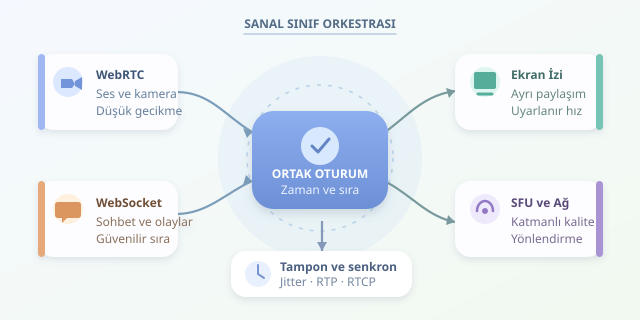

Öğretmen bir problemi anlatırken öğrenciler görüntüyü izler, sohbetten soru sorar ve paylaşılan ekrandaki çözümü takip eder. Her şey tek bir uygulamada gerçekleşse de arka planda farklı iletişim kanalları çalışır. İşin sırrı, bütün verileri aynı borudan geçirmek değil; farklı hızlarda akan bu kanalları ortak bir zaman ve oturum mantığı etrafında buluşturmaktır. Kısacası, sanal sınıf küçük bir dijital orkestradır.

``

## Aynı sınıf, farklı iletişim yolları

Video ve ses genellikle **WebRTC**, sohbet ve kontrol olayları ise **WebSocket** üzerinden taşınır. WebRTC bağlantısını kurmak için gereken SDP teklifleri, yanıtları ve ICE adayları da bir sinyalleşme kanalıyla paylaşılır. WebRTC bu kanalın protokolünü zorunlu olarak belirlemez.

Buradaki temel ayrım, verinin gecikmeye ve kayba karşı hassasiyetidir. Eski bir video karesini beklemek görüntüyü dondurabilir; sohbet mesajını kaybetmek ise konuşmanın anlamını bozabilir.

| Veri türü | Yaygın taşıma yöntemi | Öncelik |
|---|---|---|
| Ses ve kamera | WebRTC medya akışları | Düşük gecikme, akıcı oynatma |
| Ekran paylaşımı | Ayrı WebRTC video izi | Okunabilirlik, uygun kare hızı |
| Sohbet | WebSocket | Güvenilir teslimat, mesaj sırası |
| Katılım ve paylaşım olayları | WebSocket | Tutarlı oturum durumu |

WebRTC veri kanalları da sohbet taşıyabilir. Ancak sunucuda geçmiş saklama, moderasyon ve yeniden bağlanma yönetimi için WebSocket sık tercih edilir.

## Senkronizasyon neden yalnızca zaman damgası değildir?

Bir medya parçasının kullanıcıya ulaşma süresini yaklaşık şöyle düşünebiliriz:

$$T_{sunum}=T_{yakalama}+d_{ag}+d_{tampon}+d_{cozum}$$

Burada ağ gecikmesi, tamponda bekleme ve çözümleme süresi birlikte etkilidir. Üstelik ağ gecikmesi sabit değildir. Paketlerin geliş aralığındaki değişkenliğe **jitter** denir. Tarayıcıdaki jitter tamponu, biraz bekleyerek bu düzensizliği yumuşatır. Fazla beklemek akıcılığı artırabilir, fakat öğretmenin cevabını geciktirir: mühendisliğin klasik battaniye çekiştirmesi!

Ses ve görüntü, RTP zaman damgalarıyla izlenir. RTCP Sender Report mesajları, RTP saatlerini NTP tabanlı zamanla ilişkilendirerek akışların ortak zaman çizelgesinde eşleştirilmesine yardımcı olur. Dudak senkronizasyonunu uygulamanın JavaScript döngüsü değil, büyük ölçüde tarayıcının medya altyapısı yönetir.

Ekran paylaşımı ayrı bir video izidir. Kamerayla aynı kare hızında çalışması gerekmez. Bir slayt için düşük kare hızı yeterliyken, animasyonlu bir simülasyon daha fazla güncelleme isteyebilir.

## Sohbeti medya zamanına nasıl bağlarız?

Sohbet mesajına yalnızca istemcinin yerel saatini eklemek yeterli değildir; cihaz saatleri farklı olabilir. İstemci, sunucuyla zaman ölçümleri yaparak saat farkını tahmin edebilir. Dört zaman damgalı bir alışverişte yaklaşık fark:

$$o=((t_2-t_1)+(t_3-t_4))/2$$

Burada $t_1,t_4$ istemciye, $t_2,t_3$ sunucuya aittir. Tahmin, gidiş ve dönüş gecikmelerinin benzer olduğu varsayımına dayanır; kesinlik garantisi değildir.

Sunucu ayrıca mesajlara artan sıra numarası ve benzersiz kimlik verir. Böylece yeniden bağlanmada eksikler tamamlanır, tekrarlar ayıklanır. Medyaya bağlı bir açıklama için oturum zamanı kullanılabilir; ancak farklı izleyicilerin oynatma gecikmeleri değiştiğinden herkesin aynı anda aynı kareyi görmesi garanti edilmez.

## Ekran paylaşımını olaylarla eşleştirmek

Aşağıdaki örnekte `sender`, önceden müzakere edilmiş ayrı ekran paylaşımı göndericisidir. `ws` açık bir WebSocket bağlantısıdır; `clock.now()` ise tahmini sunucu zamanını döndürür.

```javascript
async function ekranPaylas(sender, ws, clock) {
  const stream = await navigator.mediaDevices.getDisplayMedia({
    video: true,
    audio: false
  });
  const track = stream.getVideoTracks()[0];
  const shareId = crypto.randomUUID();
  const bildir = (type) => ws.send(JSON.stringify({
    type, shareId, timestamp: clock.now()
  }));

  await sender.replaceTrack(track);
  bildir("screen-start");
  track.addEventListener("ended", async () => {
    await sender.replaceTrack(null);
    bildir("screen-stop");
  }, { once: true });
  return stream;
}
```

`replaceTrack`, kamerayı kaldırmadan ayrılmış göndericiye ekran görüntüsünü bağlar. Paylaşım kimliği, başlangıç ve bitiş olaylarını eşleştirir. Kontrol olayı ilk görüntüden önce ulaşabileceği için alıcı, video hazır olana kadar “Paylaşım yükleniyor” gösterebilir. Üretimde izin reddi, gönderim hataları ve uygulama içindeki durdurma düğmesi de ele alınmalıdır.

## Kalabalık sınıfta orkestrayı büyütmek

Çok katılımcılı derslerde **SFU**, medya akışlarını alıp uygun alıcılara yönlendirir. Böylece herkesin herkese ayrı yayın göndermesi gerekmez. Simulcast, farklı kalite katmanları sunar; zayıf bağlantıdaki öğrenci daha düşük çözünürlük alabilir. TURN ise doğrudan bağlantının kurulamadığı ağlarda aktarma sağlar.

Başarıyı paket kaybı, RTT, donma süresi ve sohbet teslim süresiyle ölçün. Taşıma şifrelemesini uçtan uca şifrelemeyle karıştırmayın; SFU mimarisinde ek uçtan uca koruma ayrıca tasarlanmalıdır. Son olarak ekran paylaşımı iznini açıkça isteyin. En iyi altyapı, öğrencinin protokolleri değil, dersi fark ettiği altyapıdır.



