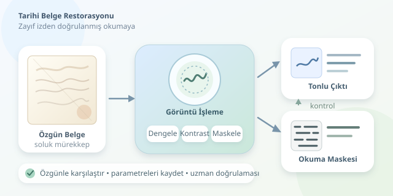

Bir Osmanlı mektubunda kaybolan kelimeler veya eski bir defterde silikleşen hesaplar… Zaman, mürekkebe pek nazik davranmıyor. Neyse ki görüntü işleme, kâğıda dokunmadan bazı izleri görünür kılabiliyor. Buradaki amaç geçmişi yeniden yazmak değil; görüntüde hâlâ bulunan zayıf bilgiyi dikkatle ortaya çıkarmak. Dijital büyüteç hazırsa, arşivin sessiz dedektifliğine başlayalım.

``

## Önce fizik: Yazı neden kaybolur?

Mürekkep zamanla kimyasal değişime uğrayabilir; kâğıt sararabilir, lekelenebilir veya arka yüzdeki yazıyı gösterebilir. Böylece harflerle zemin arasındaki fark küçülür. Ancak düşük kontrast, mutlaka bilginin tamamen yok olduğu anlamına gelmez.

Basitleştirilmiş bir görüntü modeli şöyledir:

$$I(x,y)=L(x,y)R(x,y)+n(x,y)$$

Burada $I$ kaydedilen görüntü, $L$ aydınlatma, $R$ yüzeyin yansıtma özelliği, $n$ ise gürültüdür. Restorasyon sırasında düzensiz aydınlatmayı azaltıp mürekkebin oluşturduğu farkı belirginleştirmeye çalışırız. Fakat sinyal bütünüyle kaybolmuşsa, kontrast artırmak gerçek harfleri geri getiremez.

| Sorun | Görüntüdeki belirti | Uygun başlangıç |
|---|---|---|
| Soluk mürekkep | Zayıf yerel kontrast | Yerel kontrast artırma |
| Düzensiz ışık | Gölgeli bölgeler | Aydınlatma düzeltme |
| Kâğıt lekeleri | Yazıyla karışan desenler | Renk ve doku analizi |
| Arkadan geçen yazı | Üst üste çizgiler | Ön-arka yüz karşılaştırması |

## İyi restorasyon, iyi çekimle başlar

Yüksek çözünürlük, dengeli ışık ve doğru odak çoğu filtreden değerlidir. Ölçek ve renk hedefi kullanmak, çekimleri karşılaştırmayı kolaylaştırır. Ana dosyayı mümkünse kayıpsız ve yüksek bit derinlikli saklayın; işlemleri kopyalarda yürütün. Belgeyi düzleştirmek veya daha güçlü ışıkla aydınlatmak gibi fiziksel müdahaleler ise konservasyon uzmanının değerlendirmesini gerektirir.

## OpenCV ile kontrollü bir başlangıç

Aşağıdaki Python örneği, koyu mürekkebin açık zeminde bulunduğu bir çalışma kopyasına yöneliktir. Büyük ölçekli arka planı tahmin eder, aydınlatmayı dengeler ve iki çıktı üretir: tonlu görüntü ile okuma maskesi.

```python
import cv2
import numpy as np

gray = cv2.imread("belge.png", cv2.IMREAD_GRAYSCALE)
if gray is None:
    raise FileNotFoundError("belge.png okunamadi")

background = cv2.GaussianBlur(gray, (0, 0), sigmaX=25)
ratio = gray.astype(np.float32) / (
    background.astype(np.float32) + 1.0
)
normalized = np.clip(255 * ratio, 0, 255).astype(np.uint8)

clahe = cv2.createCLAHE(
    clipLimit=2.0, tileGridSize=(8, 8)
)
enhanced = clahe.apply(normalized)
mask = cv2.adaptiveThreshold(
    enhanced, 255, cv2.ADAPTIVE_THRESH_GAUSSIAN_C,
    cv2.THRESH_BINARY, 35, 10
)

cv2.imwrite("ton_restorasyonu.png", enhanced)
cv2.imwrite("okuma_maskesi.png", mask)
```

Arka plana bölme işlemi yaklaşık olarak $I_{duz}=255I/(B+\varepsilon)$ yaklaşımını kullanır. $B$ yumuşatılmış arka plan, $\varepsilon$ sıfıra bölünmeyi önleyen küçük terimdir. Bulanıklaştırma ölçeği, harf çizgilerinden belirgin biçimde büyük olmalıdır; aksi hâlde yazıyı da arka plan sanabiliriz.

CLAHE, kontrastı küçük bölgelerde düzenler; sınırlama parametresi aşırı yükseltmeyi frenler. Yine de gürültü ve lekeler belirginleşebilir. Uyarlamalı eşikleme ise her bölge için ayrı karar vererek siyah-beyaz maske üretir. Bu maske ince çizgileri kaybedebilir; bu yüzden tonlu çıktının yerine değil, yanında değerlendirilmelidir.

Buradaki sayılar evrensel reçete değildir. Çözünürlük, harf kalınlığı ve leke boyutu değiştikçe bulanıklaştırma, eşik penceresi ve kontrast sınırı yeniden ayarlanmalıdır. Tek tıklamalı mucize filtresi, ne yazık ki henüz arşive uğramadı.

## Tek fotoğraf yetmezse: Çok bantlı görüntüleme

Görünür ışıkta benzer duran mürekkep ve kâğıt, farklı dalga boylarında farklı tepkiler verebilir. Çok bantlı çekim, bu ayrımı araştırır. Yakın kızılötesi bazı belgelerde yazıyı ayırırken, başka mürekkeplerde kontrastı azaltabilir. Ultraviyole kaynaklı floresans da uygun koşullarda farklılıkları gösterebilir; sonuç malzemeye bağlıdır.

| Yaklaşım | Kazandırdığı bilgi | Temel sınır |
|---|---|---|
| RGB fotoğraf | Renk ve parlaklık | Sınırlı spektral ayrım |
| Çok bantlı çekim | Dalga boyuna bağlı farklar | Ekipman ve kalibrasyon |
| OCR | Makinece okunabilir metin | Silik yazıda hata riski |

Bantlar önce geometrik olarak hizalanmalıdır. Ardından bant oranları veya temel bileşen analizi denenebilir. Yanlış hizalama, gerçekte olmayan kenarlar üretir; daha renkli görüntü her zaman daha doğru görüntü değildir.

## Son kontrol: Görünürlük mü, uydurma mı?

Başarıyı yalnızca görüntünün güzelliğiyle ölçmeyin. Aynı bölgeleri orijinalle karşılaştırın; ince çizgilerin korunup korunmadığını ve lekelerin harfe dönüşüp dönüşmediğini inceleyin. Okuma doğruluğunu uzman değerlendirmesiyle sınayın. OCR sonuçlarını doğrulanmış metin kabul etmeyin.

Üretken yapay zekâ eksik harfleri inandırıcı biçimde tamamlayabilir; fakat bu, tarihsel kanıt değildir. Tahminleri açıkça işaretleyin, kullanılan parametreleri kaydedin ve özgün dosyayı koruyun. İyi dijital restorasyon geçmiş adına konuşmaz; geçmişin kalan sesini daha anlaşılır hâle getirir.



