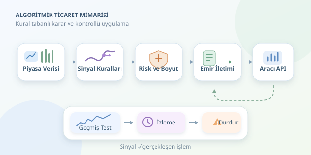

Piyasaları sürekli izleyen, yorulmayan ve “Bu sefer kesin yükselir!” heyecanına kapılmayan bir yardımcı düşünün. Algoritmik ticaret, alım-satım kararlarını önceden tanımlanmış kurallarla otomatikleştirerek tam olarak bunu hedefler. Ancak otomasyon, kârlılık garantisi değildir: Bilgisayar kötü bir fikri de büyük bir disiplinle uygulayabilir. Asıl mesele, emir göndermekten önce sağlam bir karar mekanizması kurmaktır.




``

## Bir stratejinin anatomisi

Algoritmik bir sistem genellikle beş parçadan oluşur: veri, sinyal, pozisyon büyüklüğü, emir iletimi ve izleme. Fiyatlar sisteme girer; kurallar işlem isteği üretir; risk katmanı ne kadar sermaye kullanılacağını belirler; emirler aracı kurumun API’sine gönderilir.

Burada **sinyal ile gerçekleşen işlem aynı şey değildir**. “Al” sinyali oluşabilir, fakat yetersiz bakiye, kapalı piyasa veya bağlantı sorunu yüzünden emir gerçekleşmeyebilir. Bu nedenle gerçek sistem, yalnızca strateji fonksiyonundan değil, emirlerin durumunu takip eden bir mekanizmadan da oluşur. Otomatik pilotun yanında gösterge paneli de gerekir.

## Kurallar hangi fikre dayanır?

Stratejinin ekonomik veya davranışsal bir gerekçesi bulunmalıdır. Örneğin trend takibi, fiyat hareketlerinin belirli dönemlerde devam edebileceğini varsayar. Ortalamaya dönüş ise aşırı sapmaların zamanla azalabileceğini düşünür. İkisi aynı piyasada farklı sonuçlar verebilir; çünkü varsayımları farklıdır.

| Yaklaşım | Temel varsayım | Örnek kural | Zayıf kaldığı ortam |
|---|---|---|---|
| Trend takibi | Hareket devam edebilir | Kısa ortalama uzunun üzerindeyse al | Yatay, dalgalı piyasa |
| Ortalamaya dönüş | Sapmalar azalabilir | Ortalamadan belirgin uzaklaşınca ters pozisyon al | Güçlü, kalıcı trend |
| Arbitraj | İlişkili fiyat farkı kapanabilir | Maliyet sonrası fark yeterliyse işlem yap | Likidite ve gerçekleşme sorunları |

Hareketli ortalama, son $n$ fiyatın aritmetik ortalamasıdır:

$$MA_t = (P_t + P_{t-1} + ... + P_{t-n+1})/n$$

Kısa pencere değişime daha hızlı tepki verir; uzun pencere daha fazla yumuşatma sağlar. Bunun bedeli gecikmedir. Daha hızlı sinyal ise genellikle daha fazla işlem ve maliyet anlamına gelir.

## Getiri kadar maliyet de konuşur

Bir dönemin brüt getirisi $r_t = P_t/P_{t-1}-1$ şeklinde hesaplanabilir. Önceden belirlenmiş pozisyon ağırlığı $w_t$ için basitleştirilmiş net strateji getirisi şöyledir:

$$r_t^{net} = w_t r_t - c\vert w_t-w_{t-1}\vert $$

Burada $c$, tek yönlü oransal işlem maliyeti varsayımıdır. Komisyon, alış-satış farkı ve fiyat kayması bu maliyeti etkiler. Formül öğretici bir yaklaşımdır; gerçek gerçekleşmeler emir büyüklüğüne, likiditeye ve piyasa koşullarına bağlıdır. Çok işlem yapan stratejilerde küçük görünen masraflar birikerek sonucu tersine çevirebilir.

## Python ile basit bir araştırma iskeleti

Aşağıdaki örnek, `open` ve `close` sütunları bulunan, tarih indeksli bir pandas DataFrame’i kullanır. Kaldıraçsız biçimde ya tamamen piyasada kalır ya da nakitte bekler. Kapanışta hesaplanan sinyal, en erken sonraki açılışta uygulanır.

```python
import pandas as pd

prices = df.sort_index().copy()
fast = prices["close"].rolling(20).mean()
slow = prices["close"].rolling(50).mean()

signal = ((fast > slow) & slow.notna()).astype(float)
position = signal.shift(1).fillna(0)

# Her açılıştan bir sonraki açılışa fiyat getirisi.
forward_return = prices["open"].shift(-1) / prices["open"] - 1
turnover = position.diff().abs().fillna(position)

cost = 0.001  # Tek yönlü yaklaşık maliyet: %0,1.
net_return = (position * forward_return - cost * turnover).dropna()
equity = (1 + net_return).cumprod()

print(equity.tail())
```

`shift(1)`, aynı günün kapanış bilgisinin o günün açılışında kullanılmasını engeller. Böylece önemli bir **geleceği görme yanlılığı** önlenir. `turnover`, pozisyon değişimini ölçerek maliyet uygular; `cumprod()` ise bileşik sermaye eğrisini oluşturur. Son satırın sonraki açılışı bilinmediğinden getirisi dışarıda bırakılır. Örnek; nakit faizini, vergileri ve ayrıntılı emir gerçekleşmesini modellemez.

## Backtest: Prova güzel, sahne farklı

Geçmiş veride deneme yapmak gereklidir; fakat tek başına yeterli değildir. Parametreleri aynı veri üzerinde sürekli değiştirerek en güzel sonucu seçmek, geçmişi ezberleyen bir sistem üretir. Veriyi kronolojik eğitim, doğrulama ve test bölümlerine ayırın; test dönemini parametre seçmek için kullanmayın.

Ayrıca veri boşluklarını, bölünme ve temettü düzeltmelerini, işlemden kaldırılmış varlıkları kontrol edin. Yalnızca toplam getiriye değil; maksimum düşüşe, oynaklığa ve işlem sayısına da bakın. Farklı dönemlerde çöken bir stratejiyi tek parlak yıl kurtarmaz.

Canlıya geçmeden önce kâğıt üzerinde işlem, küçük sermayeyle kontrollü deneme, pozisyon limitleri ve acil durdurma mekanizması kullanın. Bağlantı koptuğunda tekrar gönderilen bir emir çift pozisyon yaratmamalıdır. İyi algoritma yalnızca ne zaman alacağını değil, ne zaman duracağını da bilir. Bu çerçeve eğitim amaçlıdır; yatırım tavsiyesi değildir.
