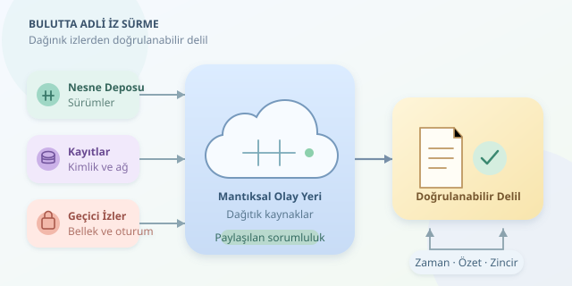

Geleneksel adli bilişimde şüpheli bilgisayarı kapatıp diskini incelemeye almak tanıdık bir başlangıçtır. Bulutta ise ortada el koyabileceğiniz tek bir bilgisayar bulunmayabilir: uygulama başka bölgede, günlükler ayrı hesapta, geçici veriler çoktan silinmiş olabilir. Dedektiflik aynı dedektifliktir; yalnızca olay yeri artık hareket eden bir hedeftir.




``

## Fiziksel Diskten Mantıksal Olay Yerine

Bulut, verinin fiziksel donanımda bulunmadığı anlamına gelmez. Donanım hâlâ vardır; ancak sanallaştırma, çoğaltma ve sağlayıcının yönettiği hizmetler araştırmacıyla fiziksel ortam arasına katmanlar ekler. Aynı uygulamanın izleri nesne depolamada, veritabanında, kimlik hizmetinde ve ağ günlüklerinde dağılabilir.

Buradaki temel kavram **paylaşılan sorumluluktur**. Müşterinin erişebildiği deliller hizmet modeline göre değişir. Bir sanal makinenin disk görüntüsünü almak mümkünken, yönetilen bir hizmetin ana makine belleğine erişmek çoğunlukla mümkün değildir.

| Model | Erişilebilen delil örnekleri | Temel sınırlama |
|---|---|---|
| IaaS | Disk anlık görüntüsü, işletim sistemi kayıtları | Hipervizör sağlayıcının kontrolündedir |
| PaaS | Uygulama kayıtları, dağıtım geçmişi | Çalışma ortamına erişim sınırlıdır |
| SaaS | Denetim kayıtları, hesap etkinlikleri | Dışa aktarma olanaklarına bağımlılık vardır |

## Delilin Kaybolması İçin Diskin Yanması Gerekmez

Otomatik ölçeklendirme bir örneği sonlandırabilir; kısa ömürlü bir konteyner saniyeler içinde kaybolabilir. Bellekteki oturum bilgileri ve geçici dosyalar, disk anlık görüntüsünde bulunmayabilir. Üstelik anlık görüntü her zaman uygulama açısından tutarlı bir durum sunmaz; devam eden işlemler ayrıca değerlendirilmelidir.

Günlükler de sihirli güvenlik kameraları değildir. Bazı veri erişim kayıtları varsayılan olarak etkin olmayabilir. Saklama süresi dolduysa veya saldırgan kayıt hedefini değiştirdiyse geçmişi sonradan üretmek mümkün değildir. Bu yüzden adli hazırlık, olaydan önce başlar.

| Zorluk | Soruşturmaya etkisi | Hazırlık yaklaşımı |
|---|---|---|
| Geçici kaynaklar | Delil hızla kaybolur | Merkezi, sürekli günlük toplama |
| Çok kiracılı altyapı | Başkalarının verileriyle karışma riski | Kapsamı daraltılmış mantıksal toplama |
| Bölgesel dağılım | Yetki ve aktarım sorunları | Bölge envanteri, hukuki değerlendirme |

## Zaman Çizelgesi Tek Bir Saat Değildir

Dağıtık sistemlerde farklı saatler, gecikmeli günlük teslimi ve yeniden denenen işlemler bulunur. Kaydın sisteme ulaşma zamanı, olayın gerçekleşme zamanı olmayabilir. UTC kullanmak karşılaştırmayı kolaylaştırır; fakat saat sapmasını tek başına çözmez.

Bir zaman damgasının belirsizliği $d$ ise gerçek olay zamanını yaklaşık olarak $t_{min}=t_{kayit}-d$ ile $t_{max}=t_{kayit}+d$ arasında değerlendirebiliriz. Aralıkları çakışan iki olayın sırası kesin olmayabilir. İstek kimlikleri, oturum bilgileri ve kaynak tanımlayıcıları bu noktada saatlerden daha iyi tanıklık edebilir.

## Küçük Bir Toplama Örneği

Aşağıdaki Python örneği, sürümleme etkin bir S3 kovasındaki belirli nesne sürümünü indirir. Veriyi parça parça işler, SHA-256 özetini hesaplar ve kaynak bilgilerini ayrı bir manifest dosyasına yazar. Gerçek değerler ve yetkili kimlik bilgileri gerektirir.

```python
import boto3
import hashlib
import json
from datetime import datetime, timezone

bucket = "kanit-deposu"
key = "kayitlar/olay.json"
version = "GERCEK_SURUM_KIMLIGI"
started = datetime.now(timezone.utc).isoformat()

s3 = boto3.client("s3")
response = s3.get_object(
    Bucket=bucket, Key=key, VersionId=version
)
digest = hashlib.sha256()
with response["Body"] as stream, open("kanit.bin", "xb") as output:
    for chunk in stream.iter_chunks(chunk_size=1024 * 1024):
        if chunk:
            output.write(chunk)
            digest.update(chunk)

manifest = {
    "source": f"s3://{bucket}/{key}",
    "version_id": response["VersionId"],
    "started_utc": started,
    "finished_utc": datetime.now(timezone.utc).isoformat(),
    "sha256": digest.hexdigest(),
}
with open("manifest.json", "x", encoding="utf-8") as file:
    json.dump(manifest, file, ensure_ascii=False, indent=2)
```

Burada $h=SHA256(D)$, indirilen baytların parmak izidir. Sonradan hesaplanan özetin eşleşmesi bütünlük kontrolünü destekler; verinin başlangıçta doğru olduğunu veya saldırganca değiştirilmediğini kanıtlamaz. S3 ETag değeri de her durumda içerik özeti kabul edilmemelidir. Kod, mevcut dosyaları ezmemek için özel oluşturma kiplerini kullanır; tek başına eksiksiz delil zinciri sağlamaz.

## İyi Soruşturma, İyi Hazırlıktan Çıkar

Toplama sırasında kullanılan hesabı, izinleri, API isteklerini, araç sürümünü ve hataları kaydedin. Büyük dışa aktarmalarda sayfalama ve hız sınırları nedeniyle eksik sonuç oluşmadığını doğrulayın. Özgün çıktıları erişimi sınırlı, değişmezlik politikası uygulanmış depolamada koruyun; analiz için çalışma kopyaları üretin.

Delilin kimden kime geçtiğini belgeleyin. Sağlayıcı desteği gerektiren işlemleri erken başlatın; sınır ötesi veri aktarımında ilgili hukuk ve sözleşmeleri değerlendirin. Bulutta başarılı adli bilişim, tek bir diski bulmak değil, dağınık izlerden doğrulanabilir ve sınırları açıkça belirtilmiş bir hikâye kurmaktır.
